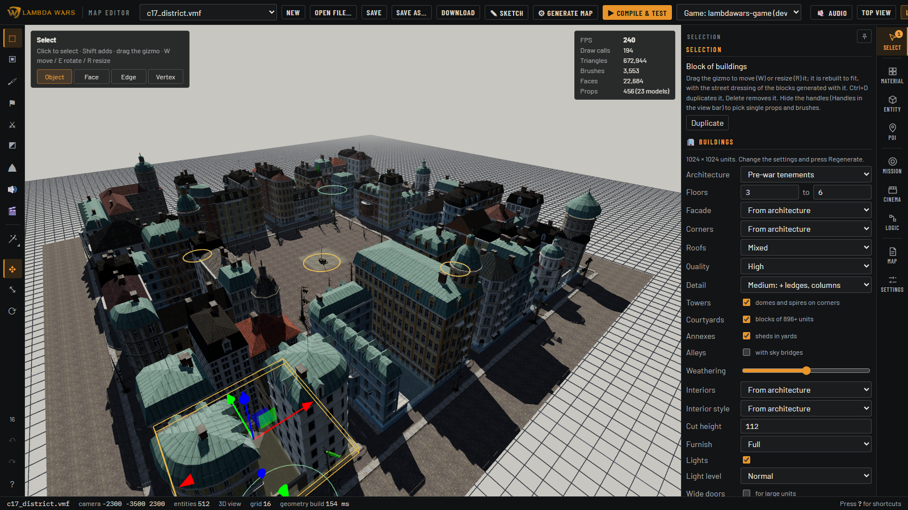
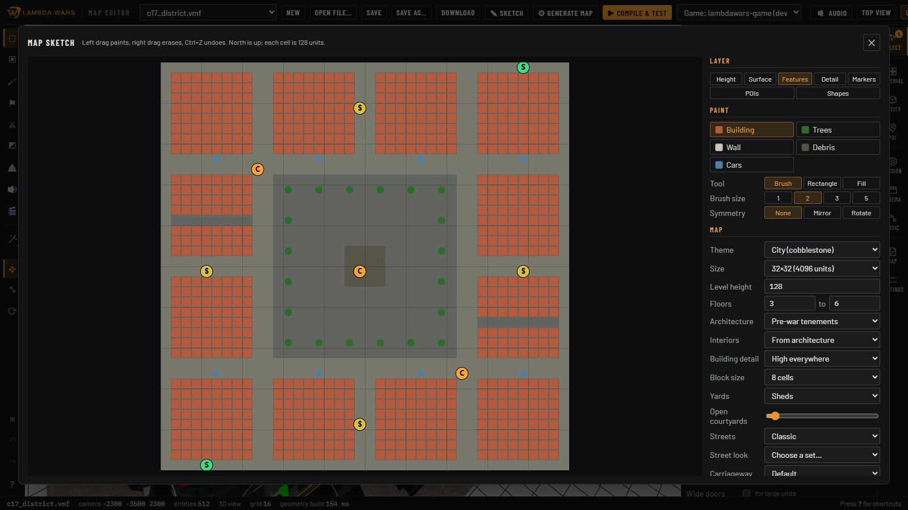

# simple-hammer-editor

A browser-based level editor for **Lambda Wars** (Source Engine, Alien Swarm branch), built on three.js. It opens,
edits and writes Hammer `.vmf` maps, generates whole maps or parts of them (terrain, City 17 buildings, enterable
interiors, roads, points of interest, mission logic), compiles them with the Source SDK tools and the Lambda Wars
navmesh builder, and launches the game on the result. Maps stay plain VMF, so Hammer can still open them.



## Requirements

- Windows, with **Lambda Wars** installed through Steam (or a clone of the game repo). The editor reads the game's
  materials, models, FGD, sounds and Python from it.
- **Alien Swarm** from Steam, for the SDK compile tools (`vbsp.exe`, `vvis.exe`, `vrad.exe`, `bspzip.exe` in
  `Alien Swarm/bin`). Only needed to compile.
- **Node.js** 20.19 or 22.12 and newer.
- Chrome or Edge (WebGL 2).

## Setup

```bash
npm install
npm run dev        # http://localhost:5190
```

The dev server serves the game's assets and runs the compilers. Installs are found automatically in every Steam
library; to override, copy `editor.config.example.json` to `editor.config.json` (every field is optional):

| Setting | Default | Used for |
|---|---|---|
| `install` | the Steam `Lambda Wars` install | the install maps are compiled against, copied to and launched from; its assets and entity definitions come first |
| `installs` | `lambdawars-game` and `Lambda Wars` in any Steam library | extra installs to choose from: paths, or `{ "name", "dir" }` |
| `gameDirs` | the active install, then the others | where textures and models are looked up |
| `sdkBinDir` | `Alien Swarm/bin` in any Steam library | the compile tools |

The **Game** picker in the top bar switches between installs (for example the Steam install and a dev clone). It
saves the choice to `editor.config.json` and reloads, keeping unsaved work as an autosave.

## Workflow

1. **Open or start a map.** The editor opens on a start screen: new map, examples (opened as a copy), recent maps
   from `maps/` and the game's `mapsrc/`, a setup check of the game and the compile tools, and an offer to recover
   autosaved work. **New** opens a four-step wizard: mode (*Annihilation*, *Overrun*, *Singleplayer mission* or
   *Empty*), size and ground, start from (template layout, sketch or empty ground) and the name.
2. **Lay it out.** Draw the map from above with **✎ Sketch** (height levels, surfaces, buildings, markers, points
   of interest, free streets and areas), or paint a coarse layout in **⚙ Generate map**. Both build a complete map
   you can keep editing, and the sketch is saved with the map so it can be redrawn and regenerated.
3. **Edit it.** Block out brushes, paint materials, place entities and props, sculpt and paint terrain. The
   **Generate** menu (G) adds buildings, building blocks, interior buildings, roads, powerlines, points of interest
   and stairs, and keeps their settings so they can be changed and regenerated later.
4. **Script it.** Place Lambda Wars kits (capture points, starts, unit groups, attack waves), wire entity outputs,
   and build a mission as a flowchart of stages, objectives and conditions in the **Mission** panel. Add camera
   shots, flybys and atmosphere in the **Cinema** panel, soundscapes and local sounds with the Sound tool.
5. **Compile and play.** **▶ Compile & test** checks the map (and offers fixes), runs vbsp, vvis and vrad, builds
   the navmesh in a hidden dedicated server, installs the BSP into the game and launches Lambda Wars on it.
6. **Save** (Ctrl+S) writes to `maps/`. The game's own `mapsrc/` is never overwritten.



## The screen

- **Top bar**: map picker, New, Open (the start screen), Save, Save as, Download, Sketch, Generate map, Compile & test, the Game
  picker, the audio preview and view toggles (top view, lighting preview, tool brushes, handles, sky brushes, props,
  entities, decals, wireframe, grid).
- **Tool rail** (left): the tools below, the Generate menu, gizmo modes, grid size, undo, redo and the shortcut list.
- **Viewport**: the 3D or top view, with the tool's options in the top-left corner and frame stats in the top
  right. The status bar names what is under the cursor.
- **Panels** (right): Selection (the inspector, entity outputs and generator settings), Materials, Entities, POI,
  Mission, Cinema, Logic (the I/O graph), Map (document, lighting, outliner) and Settings (sky, sun, fog, exposure,
  colour correction and other map-wide settings). Panels follow the tool in use; the pin keeps one open.

| Tool | Key | Use |
|---|---|---|
| Select | 1 or Q | click, Shift+click and box select; move, rotate and resize with the gizmo |
| Block | 2 | drag on a surface to make a brush (box, cylinder, cone, dome) |
| Paint | 3 | click a face to apply the material; Shift: whole brush, Ctrl: pick the material |
| Entity | 4 | place the class chosen in the Entities panel |
| Lambda Wars kit | 5 | place the kit chosen in the Mission panel |
| Decal | 6 | place decals and overlays |
| Ground | 8 | paint, raise, lower, smooth and flatten displacement terrain |
| Sound | 0 | soundscape zones and local sounds |
| Cinema | C | camera paths, particles and screens |

## Keyboard and mouse

Press **?** in the editor for this list.

| Input | Action |
|---|---|
| Right drag | look around; while held, W A S D fly, E or Space up, Q down (Shift: faster) |
| Arrow keys | fly |
| Middle drag | pan |
| Alt + left drag | orbit round the point under the cursor |
| Wheel | zoom towards the cursor |
| T | top view on or off (right drag pans, wheel zooms) |
| F | frame the selection (the whole map when nothing is selected) |
| Click, Shift+click, drag on empty space | select, add to the selection, box select |
| Esc | clear the selection |
| Shift+1 to 4 | select objects, faces, edges or vertices |
| W, E, R | gizmo: move, rotate in steps (Shift: free), resize |
| Hold V + drag | snap move: drop a corner, edge or face of the selection onto another (Shift: one axis, Ctrl: keep height, Esc cancels) |
| X | in face mode: extrude the selected faces |
| Ctrl+C, Ctrl+V | copy, paste at the cursor |
| Ctrl+D, Delete | duplicate, delete |
| Ctrl+T | turn the selected brushes into a `trigger_once` |
| Ctrl+Z, Ctrl+Y (or Ctrl+Shift+Z) | undo, redo |
| H, U | hide the selection, unhide all (editor only) |
| [ and ] | grid size |
| , and . | rotate entities 15° (Shift: 90°); turn a selected POI or block of buildings a quarter turn |
| G | Generate menu: 1 to 8 pick a generator, Enter repeats the last, Esc or G closes |
| 7, 9, P | start a road, a powerline, a point of interest |
| Enter, Esc | while generating: done, one step back; drawing a road or powerline: build, cancel |
| Backspace | drawing a road, powerline or stairs: take back the last point |
| Shift + drag | placing a building, block or house: a square footprint |
| L | lighting preview on or off |
| M, PageUp, PageDown | mission objectives in the viewport, previous and next objective |
| Alt+1 to 9, Alt+P | open a panel, pin the panel |
| Ctrl+S | save |
| ? | shortcut list |

## Documentation

Reference for every part of the editor is in [docs/](docs/README.md):

- [Editing maps](docs/editing.md): files, viewport, tools, panels, entity I/O, map settings, the Generate menu
- [Compiling and testing in game](docs/compiling.md): checks, the compile pipeline, navmesh, engine limits
- [Missions](docs/mission.md): kits, unit types, the mission flowchart
- [Ambient and local sound](docs/audio.md) and [cinematics](docs/cinematics.md)
- Generators: [whole maps (Sketch, Generate map)](docs/generators/maps.md),
  [buildings](docs/generators/buildings.md), [simple interior buildings](docs/generators/interior-buildings.md),
  [interior buildings with rooms](docs/generators/rooms.md),
  [roads and powerlines](docs/generators/roads-powerlines.md),
  [points of interest](docs/generators/points-of-interest.md)
- [Example maps](docs/example-maps.md): the Sofia, Civil Protection and Garden District missions
- [Development](docs/development.md): tests, scripts, worktree ports, source layout

```bash
npm test             # unit tests
npm run typecheck
```
