# simple-hammer-editor

A simple, browser-based map editor for **Lambda Wars** (Source Engine, Alien Swarm branch), built on
three.js. It reads and writes Hammer `.vmf` files, so maps stay compatible with Hammer for fine-tuning,
and hands compiling to the regular Source SDK tools.

## Running

```bash
npm install
npm run dev        # http://localhost:5190
```

The dev server also serves game assets (materials, models) and runs the map compilers, so it needs a
local Lambda Wars install. Paths are auto-detected; override them in `editor.config.json`
(see `editor.config.example.json`).

| Setting | Default | Used for |
|---|---|---|
| `install` | the Steam `Lambda Wars` install (the first one with VPKs) | The install maps are compiled against, copied to and launched from. Its assets and entity definitions come first. |
| `installs` | `lambdawars-game` and `Lambda Wars` in any Steam library | Extra installs to choose from: paths, or `{ "name", "dir" }` |
| `gameDirs` | the active install, then the other installs | Where textures and models are looked up (the other installs fill in what the active one lacks) |
| `sdkBinDir` | `Alien Swarm/bin` in any Steam library | `vbsp.exe`, `vvis.exe`, `vrad.exe` |

Pick the install with the **Game** dropdown at the right of the top bar, for example the Steam install
or a dev clone of the game repo. The editor saves the choice to `editor.config.json` and reloads,
keeping unsaved work as an autosave.

Maps are listed from this repo's `maps/` folder and from the game's `mapsrc/` folder.

### Controls

| Input | Action |
|---|---|
| Right mouse drag | Look around |
| W A S D, E / Space, Q | Fly (hold Shift for faster) |
| Middle mouse drag | Pan |
| Alt + left drag | Orbit around the point under the cursor |
| Mouse wheel | Zoom towards the cursor |
| 1 / 2 / 3 / 4 | Select, Block, Paint, Entity tool |
| M / R | Gizmo: move / resize |
| Shift + click | Add to selection |
| Ctrl + D, Delete | Duplicate, delete |
| Ctrl + Z, Ctrl + Y | Undo, redo |
| [ and ] | Grid size |
| , and . | Rotate entities (Shift: 90°) |
| F | Focus the selection |
| Ctrl + S | Save |

## Phases

Development is split into phases; each phase ends with screenshots in `docs/screenshots/`.

### Phase 0: VMF loading and brush geometry

- KeyValues parser shared by VMF and VMT files.
- Brush faces built by clipping each side's plane against the others; displacements built from `dispinfo`.
- World geometry merged into one mesh per material (about 140 draw calls for a full map), with a BVH for picking.
- Editor camera, map picker, tool/sky brush toggles, wireframe, and an FPS/draw-call overlay.


### Phase 1: textures, displacements, entities and props

- VMT parsing (including `patch` materials and `%compile*` tool flags) and a VTF decoder for every common
  format. DXT textures go to the GPU compressed; mip chains are kept.
- `WorldVertexTransition` displacements blend their two textures by the painted vertex alpha.
- `MultiBlend` displacements mix up to four textures by per-vertex weights (the `multiblend` rows), shaded
  like the engine does it: slot 1 first, slot 4 (the base) gets the rest, base alpha and `$spectexture`
  alpha set the edge. The Ground tool paints a layer, noise-fills all layers so big areas stop tiling, and
  makes new blends (`content/materials/she/blend/*.vmt`, packed into the BSP with bspzip on compile).
  Demo: `scripts/multiblend-demo.mjs` (maps `multiblend_before` / `multiblend_after`). Compile with final
  lighting: fast vrad leaves dark lightmap seams along the edges of displacement patches.
- MDL/VVD/VTX loader for props (LOD 0, skins, multiple `$cdmaterials`), drawn as instanced meshes:
  346 props from 94 models in under 100 extra draw calls.
- Point entities are colour-coded markers (green spawns, orange control points, yellow lights, ...).
- Sun direction and colour come from `light_environment`, the background from `env_fog_controller`.


### Phase 2: writing VMF files

- KeyValues nodes keep pairs and child blocks in one ordered list, so a parse → write round-trip is
  byte-identical. Verified by the test suite against the sample map and all 54 VMFs in the game's `mapsrc/`.
- Edits go through typed wrappers (`MapSide`, `MapSolid`, `MapEntity`) that write back into the tree, so
  anything the editor does not understand (visgroups, editor colours, connections, cameras) survives.
- Save (Ctrl+S), Save as and Download. Saves go to this repo's `maps/` folder and bump `mapversion` like
  Hammer does; the game's own `mapsrc/` is never overwritten.
- Document panel with a "Verify round-trip" check. Changed brushes rebuild incrementally (about 3 ms).


### Phase 3: editing tools

- **Select**: click picks a brush or entity (Shift adds); a move/resize gizmo snaps to the grid, with
  texture lock while moving. Brushes inside brush entities can be picked one by one.
- **Block**: drag a rectangle on any surface to create a brush with the current material and height.
- **Paint**: click a face to apply the current material (Shift: whole brush, Ctrl: pick a material).
- **Entity**: click to place the class chosen in the Entities tab. A control point automatically gets its
  `trigger_capture_area`. Entity classes, keys, choices and editor models come from the game's FGD.
- Inspector with FGD-typed entity fields and brush size inputs; material browser with thumbnails decoded
  from the VTFs; undo/redo; duplicate; delete.
- Fixed brush picking after BVH construction (triangle order changes inside the BVH).

The screenshots below were taken by `scripts/phase3-demo.mjs`, which builds a small arena from an empty
map with real mouse and keyboard input (it is saved as `maps/phase3_arena.vmf`).


### Phase 4: compile and test in game

- **Compile & test** dialog with pre-flight checks and one-click fixes: a sealing sky shell of world
  brushes, a `light_environment`, a spawn point, player starts, and a `func_map_boundary` (camera limits
  and fog-of-war height data).
- The dev server runs the Alien Swarm SDK tools against the full game install: `vbsp`, `vvis` (skipped,
  with a warning, when the map leaks) and `vrad -hdr` (Lambda Wars maps use HDR lighting only), then
  installs the BSP into `lambdawars/maps/`. The tool output streams into the dialog.
- The Recast navmesh is built headless: a hidden `srcds.exe` loads the map and runs `recast_build` from
  a temporary server config; the editor stops it once all five meshes are saved. The fog-of-war heightmap
  is written by the server on the same load.
- **Launch game** starts Lambda Wars windowed on the compiled map.

The Phase 3 arena compiles in about 8 seconds including the navmesh, and loads in game (last screenshot).


Known issue on the development machine: the game's in-game web UI (CEF) failed to start its helper
process (`lambdawars_browser.exe`) on every launch, also when launched by hand, so the HUD stays on
"Loading CefViewPort". The map itself loads and renders.

### Phase 5: generators

**Map generator** (top bar → *Generate map*): paint a coarse layout on a grid of 256-unit cells (ground,
road, high ground, buildings, trees, player base, control point, scrap) with rotational or mirror symmetry,
or roll a random two-player layout, then generate a complete map:

- Displacement terrain over the whole map: high-ground cells become smoothed plateaus, roads and bases are
  blended into the ground texture through vertex alpha (grass/dirt for rural, concrete for city).
- Buildings on building cells (see below), trees in forest cells, bushes and rocks or cars, lamps and
  barriers along the roads.
- Player starts with their RTS camera spawns, control points with capture areas, scrap markers, sun, fog.
- A scenery apron outside the playable area (forest or city blocks), the sealing sky shell and the
  `func_map_boundary`, so a generated map passes every compile check without fixes.

**Building generator** (select one or more block brushes → *Generate buildings* in the Selection tab):
splits the footprint into lots on the 128-unit facade grid and builds each one with a facade style from the
game's `building_template` materials (one texture tile is exactly one floor), a ground floor with doors,
a cornice, a parapet and optional rooftop props. With alleys enabled, neighbouring buildings get 64-unit
alleys and sky bridges. One undo step reverts the whole operation.

The generated city map (`maps/phase5_city.vmf`) compiles in about 20 seconds including the navmesh and
loads in Lambda Wars (last screenshot; the HUD is stuck on the CEF issue described in phase 4).


### Phase 6: UI/UX improvements

- **Top view** (T): orthographic, north up, right drag pans and the wheel zooms to the cursor. All tools work in it.
- **Box selection**: drag on empty space with the Select tool (Shift adds), in the 3D and top view.
- **Hover feedback**: the object under the cursor gets an outline, and the status bar names it (class,
  targetname, material, owning brush entity).
- **Copy and paste at the cursor** (Ctrl+C / Ctrl+V), also between maps.
- **Hide / unhide** (H / U) for editing only; hidden objects are still saved and compiled.
- **Outliner** in the Map tab: entities grouped by class, searchable, click to select and frame.
- **Autosave** every minute while there are unsaved changes, to `.autosave/` ("Autosaves" in the map picker).
- Shortcut overlay (?), view and status details in the status bar.


### Phase 7: scripting (entity I/O)

Map scripting in Source is done with entity inputs and outputs. The editor now edits them directly:

- **Outputs editor** in the Selection tab: output, target, input, parameter, delay and "once" per row.
  Outputs and inputs are drop-downs filled from the game's FGD (including inherited ones such as `Kill`),
  and target names autocomplete from the map. A **Fired by** list shows what triggers the selected entity.
- **Validation**: missing targets, unknown outputs and inputs are flagged on the row and listed in the new
  **Logic** tab.
- **Logic graph**: every connection in the map as a left-to-right graph; click a node to select and frame it.
- **Connection lines** in the viewport for the selected entity (orange: outputs, blue: incoming).
- **Tie to entity** (Ctrl+T for `trigger_once`): turns selected brushes into a trigger, `func_detail`,
  `func_brush`, fog-of-war or navmesh blocker; **Move brushes to world** reverses it.
- Connections are read and written in Hammer's ESC-separated format (commas in old maps are read too);
  rewriting every connection in `sp_radio_tower` reproduces the file byte for byte.


### Phase 8: Lambda Wars entities and mission scripting

A **Mission** tab with Lambda Wars kits, placed with the kit tool (5). Each kit creates the entities a
feature needs and wires their outputs, as one undo step:

| Kit | Creates |
|---|---|
| Capture point | `control_point` (flag) + `trigger_capture_area` with the chosen radius, owner and capture time |
| Multiplayer start | `info_start_wars` (HQ spawn, team hint) + its `info_player_wars` camera |
| Mission player start | camera spawn, `wars_player_setup` (faction, colour, applied at start) and a starting squad of mixed units |
| Unit group | N units of any unit type of the game, for an owner, with a shared name and an optional custom unittype |
| Attack wave | `unit_maker` → `wars_give_order`, which sends the units to itself (move it to change the goal); starts disabled so a trigger can enable it |
| Walking queue | A line of people at a counter that moves: every few seconds the one in front walks off to the side and back to the entrance, and the rest step up one place, front first. One `wars_give_order` per spot (`PerformOrderUnit` takes the person by name) and a loop of `logic_relay` steps |
| Mission message | `wars_messagebox`, shown at map start through a shared `logic_auto` or wired to a trigger |
| Objective | `wars_mission_objective`; "completing wins" wires it to the map's `wars_win_condition` |

- **Apply standard relations** makes the player hate every other unit owner (`wars_player_relation` +
  `ApplyRelation` at map start), as the shipped missions do.
- Mission title and description are stored on worldspawn; compiling a map named `sp_*` writes the
  `maps/<name>.res` entry the game's mission list reads.
- **Gameplay overlay**: capture-area rings coloured by owner, base rings around player starts, and the route
  from each wave to its goal.
- Camera spawns account for the game forcing the spawn camera to pitch 65°, yaw 135°
  (`GetPlayerSpawnSpot`), so the camera looks at the start position.
- Launching an `sp_` map uses the mission gamerules (a listen-server config runs `wars_setgamerules mission`).


### Unit types in the kits

The kits' unit list is built from the game, not kept by hand. `scripts/gen-unit-catalog.py` reads the
install (`editor.config.json`, or a path argument) and writes `src/lw/unitCatalog.ts` (checked in, 143 types):

- `lambdawars.fgd`: every `unit_*` class, its `studio()` model and the `unittype` choices it accepts.
- `python/wars_game/**.py`, parsed with `ast` (nothing is imported): each `UnitInfo` class's `name`
  (the unittype), `cls_name` (the entity class to place), `modelname`, `displayname`, `image_name`,
  `hulltype`, `zoffset` and `scale`, inherited through its bases. Display names come from
  `resource/lambdawars_english.txt`.
- The unit entity classes (`@entity('unit_x')`) that use `UnitBaseAirLocomotion`, with the height their
  locomotion keeps above the ground (`locomotion.desiredheight`, or the helicopters' `flyheight`).
- Faction: from the unit's icon folder (`vgui/combine/...`), else the module it lives in; refugees
  (`citizen.py`) are their own **Citizens** group. Helper classes (`unit_dummy`, damage controllers,
  `unit_scan`) are left out. Game-mode copies (`overrun_`, `char_`, `mission_`, `destroyhq_`, ...) are listed
  after each faction's own units.

Re-run it after the game's unit list changes: `python scripts/gen-unit-catalog.py`.

In the Mission tab, **Unit group**, **Attack wave** and **Mission player start** use a searchable drop-down
grouped by faction (search matches name, unittype and class; ✈ marks air units). Old kit ids (`zombie`,
`metropolice`, ...) still resolve, so the POI catalogue keeps working.

- **Custom unittype**: a free field on Unit group and Attack wave (and per squad row). It replaces the
  `unittype` key (or the wave's `NPCType`) while the entity class stays that of the chosen unit, for
  mission-only variants such as a future `sp_tutorial_unit_metropolice_baton` on `unit_metropolice`.
- **Air units**: placed units spawn where they stand and the air locomotion keeps them at its height above
  the ground, so the kits place them at that height (dropship 600, gunship 350, scanners 370, manhack 52)
  instead of on the floor; nothing snaps them down. `unit_maker` (Attack wave) goes through the game's
  `PlaceUnit`: it drops the unit to the floor, adds `zoffset` (128 for dropship and gunship) and the unit
  climbs, so the maker itself stays on the ground.
- **Spacing**: big hulls get more room than the kit's spacing (Strider, dropship, gunship 320).
- **Mixed start squad**: Mission player start takes rows of unit, count and optional custom unittype
  (stored as `unit_metropolice_riot:1, unit_stalker:1`), placed as one grid named `player_squad` and owned
  by you. A unit placed elsewhere (say the Stalker for Unit 09) is a Unit group with owner *Player 0 (you)*.
- **Viewport**: units are drawn with the model of their unittype (riot police use `police_extended.mdl`,
  not the class's `police.mdl`) and the unit info's scale (dropship and gunship 0.75); an unknown custom
  unittype draws as its class.
- Test map: `node --experimental-transform-types scripts/unit-kits-map.mjs` writes
  `maps/sp_unit_kits_test.vmf` (a group of Stalkers, citizens, a Strider, a dropship, a gunship, riot police,
  scanners and manhacks for you and for the enemy, plus the mixed start squad); `scripts/unit-kits-demo.mjs`
  takes the editor screenshots.
- In game (`sp_unit_kits_test`, compiled with the navmesh, mission gamerules): all 40 units spawn for
  both owners and stay alive; `scripts/she_unitprobe.py` (copy it to the game's `cfg/`, the map runs it
  at 4, 15 and 30 s) printed heights above the ground of dropship 618–628, gunship 368–374, scanners
  376–394 and manhacks 46–55, bobbing with the fly noise, so the air units hover from the first second.
  Ground units stand at 0–1; the Strider's origin sits at 341 (its body height). The mixed start squad
  (riot officer + Stalker) spawned as yours. Not checked: ordering air units to move, and combat.

### Phase 9: lighting preview

**Lighting** (top bar, or L) switches the viewport from flat editor lighting to an approximation of the
compiled result:

- The sun from `light_environment` (pitch, yaw, colour, brightness) with real-time shadows from brushes and
  props, and its `_ambient` as the sky fill.
- `light`, `light_spot` and Lambda Wars' `light_deferred` entities as point and spot lights. A fixed pool
  (24 point, 8 spot) is assigned to the lights nearest the camera, so moving never triggers shader rebuilds.
- Sun height, direction, colour and ambient sliders edit `light_environment` live (one undo step per
  drag; now in the Settings tab, see below). Point, spot and dynamic lights are in the Entities palette.
- City16 with sun shadows runs at about 180 FPS.


### Phase 10: 2D map drawing with height layers

**Sketch** (top bar) opens a 2D painter for drawing a map from above on a grid of 128-unit cells, with
separate layers:

| Layer | Paints |
|---|---|
| Height | Levels 0–4 (level height configurable, default 128). Level changes become cliffs; **Ramp** cells turn a step into a walkable slope. |
| Surface | Grass, dirt, road, cobble, rubble: blended into the terrain through displacement alpha. |
| Features | Buildings (on their cell's level, floors and facade configurable), trees, walls, debris, cars. |
| Markers | Mission start, multiplayer start, capture point, scrap, zombie and Combine groups, Combine wave, rebels: placed with the phase 8 kits. |

Brush, rectangle and fill tools, brush sizes, mirror/rotational symmetry, undo, and city/rural themes.
**Generate 3D map** builds power-4 displacement terrain (32-unit vertices: cliffs stay sharp, ramps are
solved as smooth surfaces between the levels around them), the features, markers, lighting, sky shell and
map boundary. The sketch is saved next to the map as `maps/<name>.sketch.json` and reopened with it, so
a map can be redrawn and regenerated. The example below compiles sealed with a navmesh in 11 seconds.


### Phase 11: decals

- **Rendering**: `infodecal` entities are projected onto the nearest surface (short rays from the origin,
  like the engine), sized by texture size × `$decalscale` and oriented like Source does (upright on walls,
  world-X on floors). `info_overlay` entities are drawn from their basis and corner UVs and **clipped to
  the brush faces in their `sides` list**, as vbsp does. Decals are batched per material; City16's 119
  decals and 21 overlays add 11 draw calls.
- **Decal tool** (6) with a **Decals** mode in the Materials tab (decals and overlays folders, alpha-aware
  thumbnails). Two placement types:
  - *Decal*: an `infodecal` at the clicked point; the size comes from the material.
  - *Overlay*: an `info_overlay` with a chosen size and rotation; the clicked face and the coplanar faces it
    covers are written to `sides`.
- Moving an overlay moves its basis with it; a **Decals** toggle hides them all.
- The decal map compiles with both overlays in the BSP's overlay lump.


### Additions found while building the Sofia map

- **Block shapes**: the Block tool draws boxes, cylinders, cones/spires and domes (stacked convex
  frustums) with a configurable number of sides.
- **Static prop check**: the MDL loader reads `$staticprop` and physics `prop_data`; the compile dialog
  flags `prop_static` entities that vbsp would delete and converts them to `prop_dynamic` in one click.
- **RTS camera ground**: the map boundary floor now sits at ground level and sketch maps add playerclip
  blocks over raised levels. The game's spawn camera traces down to playerclip, so this keeps the camera
  at the right height (shipped maps do the same).
- Decals can be placed along a world-space ray (`placeDecalRay`) for scripted map building.
- **Decal scatter** (`src/edit/decalScatter.ts`): `alongWall` and `onFloor` make lists of rays (posters every
  so often along a wall, stains at a height, litter in a rectangle) and `placeDecals` casts them, placing an
  overlay where the hit face is world or `func_detail` and an `infodecal` anywhere else.

### Map settings

The **Settings** tab gathers the map-wide setting entities into cards with sliders, colour pickers and
file pickers:

| Card | Entity | Added when compiling |
|---|---|---|
| Sky | worldspawn `skyname` | always set |
| Sun & ambient light | `light_environment` | yes |
| Dynamic shadows | `shadow_control` | yes |
| Fog | `env_fog_controller` (master) | yes |
| Exposure & bloom | `env_tonemap_controller` + `logic_auto` | yes |
| Colour correction | `color_correction` (global, lookup table picker) | |
| Post-processing | `postprocess_controller` (master) | |
| Dynamic sun (deferred) | `light_deferred_global` | |
| Wind, Detail props, Water quality, Music | `env_wind`, `env_detail_controller`, `water_lod_control`, `wars_music_controller` | |

- Settings are stored as the standard entities, so Hammer and existing maps work as before; City16's
  own fog, tonemap and colour correction show up in the cards. Their markers are not drawn in the viewport.
- A card marked **Default** isn't in the map yet: compiling adds it with defaults taken from the shipped
  maps (to the compiled copy only). Changing a value stores it in the map; the switch turns a setting
  off, and a default one then stays out of the compile (`she_settings_off` on worldspawn).
- Exposure and bloom have no entity keys: like the shipped maps, a `logic_auto` sends
  `SetAutoExposureMin/Max`, `SetBloomScale` and `SetTonemapRate` to the controller on map spawn. The card
  reads and edits that wiring, including maps that use `OnNewGame`.
- The lighting preview (L) also shows the fog.


## Building generator: City 17 architecture

The phase 5 generator made one box per lot. These phases rebuild it after the architecture of Half-Life 2's
City 17 (shaped corners, real roofs, layered facades); each one is usable from the Building panel,
Generate map, Sketch and the Sofia script.

### Building phase 1: footprints and corners

- **Block planner** (`src/gen/buildingPlan.ts`): blocks of 896+ units become a ring of buildings around a
  courtyard (corner buildings, lots along each side); smaller blocks become a row of lots, deep lots
  sometimes L-shaped around a back yard. Buildings vary in height, corner buildings tend to be a floor taller.
- **Corners**: buildings on a block corner get a square, 45° cut or rounded corner (radius 128–256, built
  from 64-unit segments). Cut and rounded faces get entrance doors on the ground floor.
- **Whole windows on every face** (`src/gen/facade.ts`): each wall's texture starts at its corner and is
  stretched slightly so it shows a whole number of window bays, so angled and curved faces never cut a
  window in half.
- **Annexes and walls**: one- and two-storey sheds in courtyards and yards, and a wall with a gateway on
  one side of most courtyards.
- Building panel options: corners (mixed, cut, rounded, square), courtyards, annexes.
- A 32-building test set (alleys, sky bridges, gates) compiles through vbsp, vvis and vrad without errors.

Before: [the phase 5 boxes](docs/screenshots/phase5-buildings-generated.png).


### Building phase 2: facade relief

Decoration is built as `func_detail` (it doesn't cut visibility), on a **Detail** setting in the Building
panel; the building shells stay world brushes. Decoration draws from its own random sequence, so changing
the level never changes the layout or textures.

| Level | Adds | Detail brushes per building |
|---|---|---|
| None | cornice band and parapet | ~7 |
| Low | stone base course along the street, stepped cornice (fascia + overhanging band) | ~10 |
| Medium (default) | a heavy ledge over the ground floor, thin ledges between floors (every floor or every other), quoins on the corners, flat columns every 2–3 window bays | ~22 |
| High | brackets under the cornice at every bay | ~50 |

- Columns stand on the bay boundaries of the fitted facade texture, so they fall between windows.
- Generate map uses Low for the backdrop buildings outside the playable area.
- Six blocks at High (32 buildings, about 1,500 brushes) compile through vbsp, vvis and vrad in 8 seconds.


### Building phase 3: roofs

`src/gen/roofs.ts` builds roofs from planes: over a convex footprint a hipped roof is the intersection of
one rising plane per wall, so each roof tier is a **single convex brush**, also over cut and rounded
corners (a rounded corner gets a conical roof). Planes that end up without a face are dropped, so the
compiler never sees a redundant side.

| Roof | Shape | Covering |
|---|---|---|
| Hipped | one tier, 37° | terracotta tiles, slate or metal |
| Mansard | a steep attic storey (76°) with **dormers** at every second bay, then a low cap | slate, copper or metal |
| Gabled | two slopes, gable walls in the facade's plain material (rectangular buildings) | tiles, slate or metal |
| Curved | three tiers (72°, 52°, 19°): the bell-shaped copper roofs | copper or slate |
| Flat | the parapet roof with rooftop props | concrete |

- Dormers have a window from the building's own facade texture and a small gabled cap; chimneys (brick
  with a cap) stand on the roof at random spots, from 1 to 3 per building.
- Sheds get a low metal roof half of the time. Roofs, dormers and chimneys are func_detail.
- Roof choice draws from its own random sequence, so roofs don't change the layout or facades.
- Building panel: **Roofs** (mixed, or one kind for all). Six blocks with every kind at High detail
  (34 buildings, about 1,700 brushes) compile through vbsp, vvis and vrad in 10 seconds.


### Building phase 4: corner towers and domes

Corner buildings of 3+ floors get a tower on their street corner: most rounded corners, a third of the
cut ones and a fifth of the square ones (`src/gen/towers.ts`).

- **Placement**: on a rounded corner the tower continues the curved facade upwards (radius up to 160,
  touching the curve at its apex); on cut and square corners an eight- to twelve-sided tower stands
  tangent to both walls. It rises one or two floors above the eaves, and always clears the roof.
- **Body**: windows from the building's own facade (fitted per side, about one bay per side), a cornice
  ring and a drum.
- **Caps**: a profile revolved into stacked frustums, each one a convex brush, so even the onion's
  bulge is valid. Baroque **bell** (most common, as on City 17's corner towers), **dome**, **onion** and
  **spire**; bells and domes get a small windowed lantern with its own dome; all end in a finial.
  Copper, slate or grey metal.
- Building panel: **Towers** on or off. Six blocks with rounded corners at High detail (53 buildings,
  about 2,500 brushes) compile through vbsp, vvis and vrad in 19 seconds.
- Rooftop signs were left out: the game has only five single-letter sign models, too few to spell
  anything.


### Building phase 5: bays, balconies and the street level

Walls on the block's outline face the street; only they get these features (`src/gen/facadeFeatures.ts`).
Courtyard walls and party walls stay plain. Features sit on whole window bays and never overlap.

- **Oriels** (Medium detail and up, 4+ floors, walls of 384+): one or two per wall, two bays wide,
  rectangular, angled or half-round, from the first floor to under the cornice (or a floor lower), with
  windows fitted per face, a stepped corbel underneath and a cap band.
- **Balconies** (Medium and up, 3+ floors): a long one on the first floor, or single-window balconies
  stacked up the facade: a slab on two brackets with a **wrought-iron railing** (the game's
  see-through `metal/metalrail001a`) on three sides.
- **Shopfront awnings** (Low and up): the game's striped awning props over some ground-floor bays, facing
  the street. **Basement vents**: vent decals at the foot of the wall every third bay.
- **Entrance steps** in front of a cut-corner entrance.
- Six blocks at High detail (51 buildings, about 3,200 brushes, 112 decals, 47 props) compile through
  vbsp, vvis and vrad in 19 seconds.

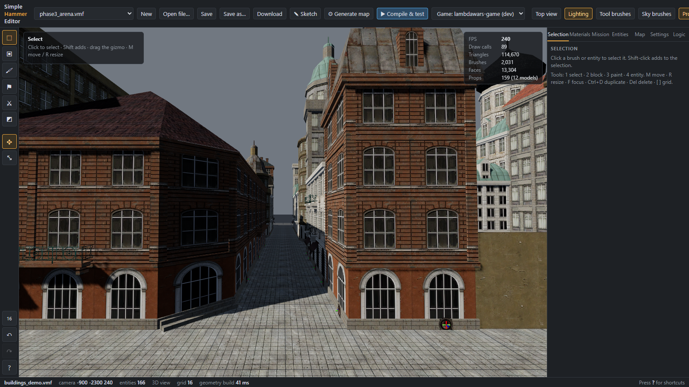
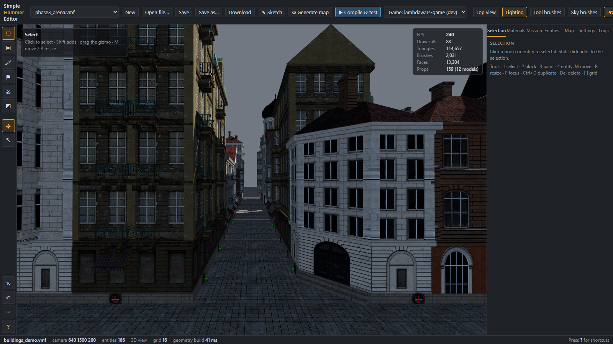
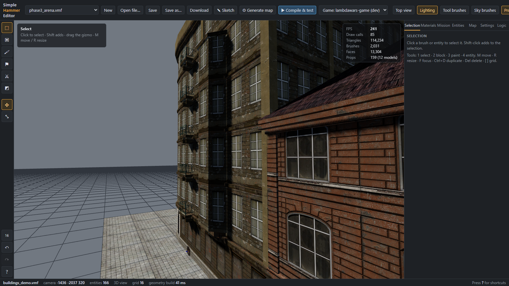
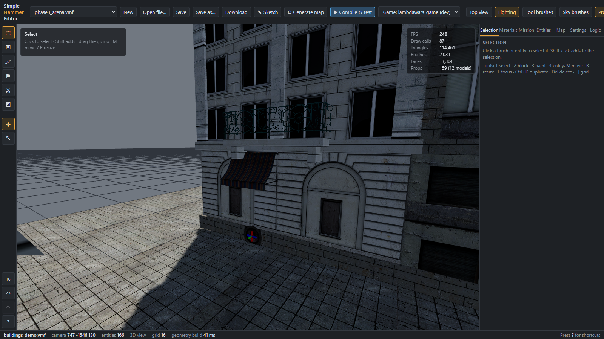
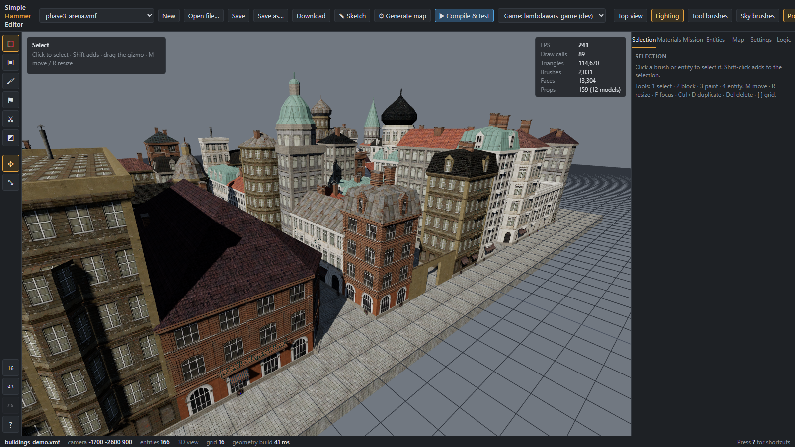

### Building phase 6: architectures, colours and the generator panel

**Architectures** (`src/gen/styles.ts`) bundle the choices into kinds of city building:

| Architecture | Facades | Roofs | Corners, towers | Street features | Floors |
|---|---|---|---|---|---|
| Pre-war tenements | ochre, yellow, cream, framed stone, blue, rose, sand … | mansard, curved, hip, some gables | mixed, more towers | oriels, balconies | 3–6 |
| Soviet blocks | grey concrete, stone, pale | flat with **rooftop stair houses** | square, no towers | balconies | 5–9 |
| Brick houses | brick, brown, rose | gables, hips, a few mansards | cut, few towers | oriels | 2–4 |
| Sheds and workshops | brick, brown, stone | gables, flat, hips | square | none | 1–2 |
| Mixed | everything | everything | mixed | all | 3–6 |

- **Eight new colour sets** from the game's facade textures, City 17's plaster colours: ochre with blue
  windows, yellow with framed windows, framed stone, cream, blue, rose and sand courtyard plaster, and
  grey concrete for the blocks, each with its own ground floor, door, plain and trim textures.
- **Weathering**: stain and dirt decals on street walls, under the cornice and below window sills
  (0 to 1, default 0.5).
- **Building panel**: Architecture (sets the usual floor range), Facade and Corners can follow the
  architecture, Weathering, and a **Seed** with a 🎲 button: the same seed and settings give the same
  buildings, so a result can be recreated. **Sketch** and **Generate map** get an Architecture picker too.
- Five blocks, one per architecture, at High detail (35 buildings, about 1,900 brushes, 93 decals) compile
  through vbsp, vvis and vrad in 11 seconds.

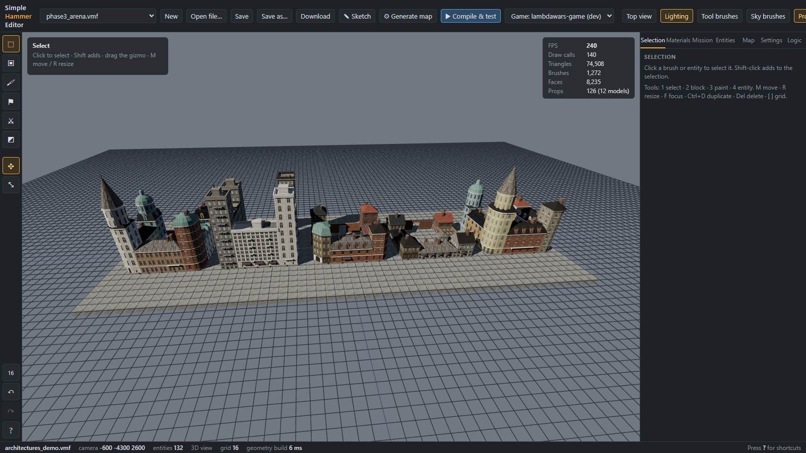
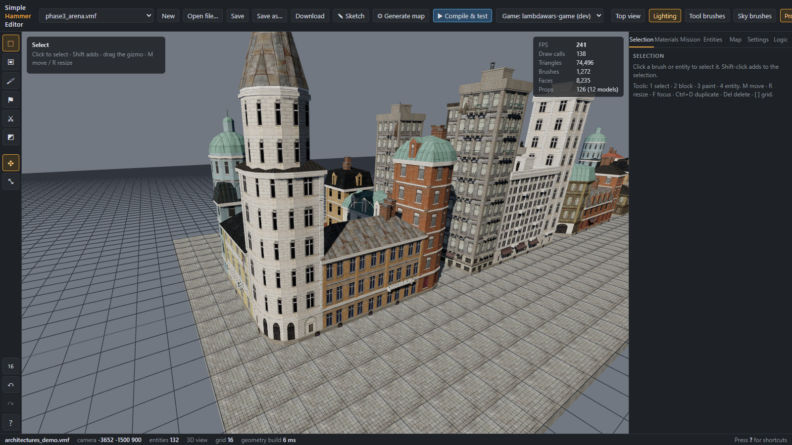
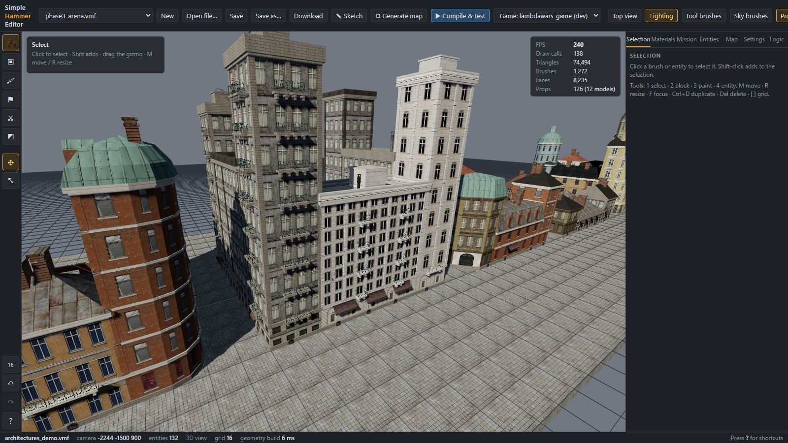
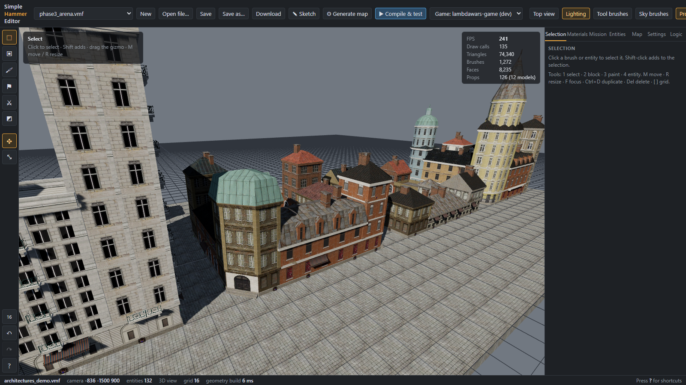
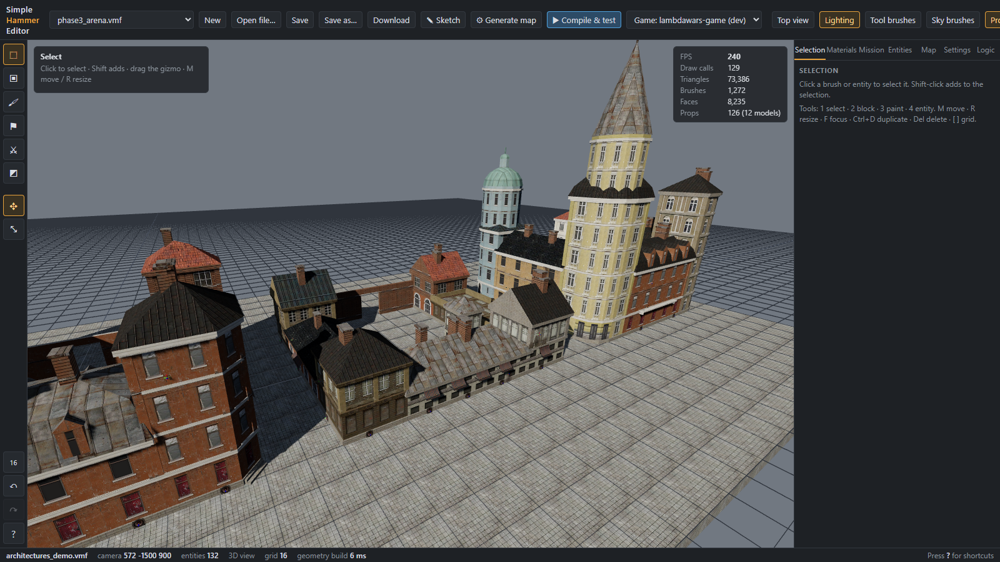
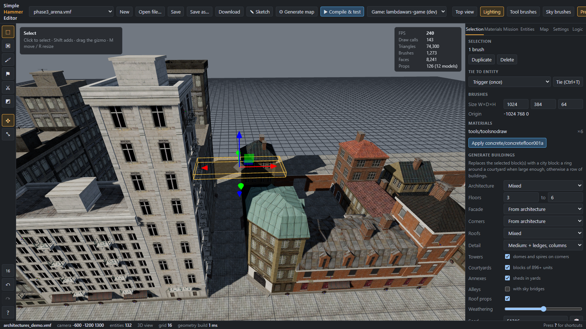

### Building phase 7: street dressing, and a test district

**Wall clutter** on street walls (`src/gen/streets.ts`): drainpipes down from the cornice at the wall
ends, satellite dishes, gas meters by the ground floor, cable insulators, and TV antennas on some ridges.

**The street pass** runs over all blocks generated together (Building panel with several blocks
selected, Generate map, Sketch):

- **Overhead cables**: each building's street walls offer anchors; anchors facing each other across a
  street (128–900 apart) are joined by a `move_rope` → `keyframe_rope` pair with sag. The editor now
  draws ropes (`src/render/ropeRenderer.ts`), with the sag from their Slack. Each anchor is a wall
  bracket (`utilitypolemount01a`) turned so its arm sticks out from the wall, and the cable ends on the
  bracket's outer insulator (`wallMount` in `src/gen/powerlines.ts`, measured from the model: the plate
  is at model y −42, the outer insulator top at y 7, z 22).
- **Lamp posts** along the pavements, arms out over the street; none in alleys (gaps under 192).
- **Bare trees** in courtyards and yards (clear of the sheds) and alternating with lamps on wide streets.
  City-theme sketches now use bare trees for their Trees feature too.

**Test district** (`maps/c17_district.vmf`, built by `scripts/build-district.mjs` from
`src/examples/district.ts`): a 40×40-cell sketch of pre-war tenement blocks (8×8 cells, 256-unit streets)
around a paved square, set up as a two-player skirmish (starts in opposite corners, three capture points,
four scrap points).

| | Sofia (before these phases) | City 17 district |
|---|---|---|
| Brushes | 1,107 | 3,946 (317 world, the rest func_detail; 794 of them roads) |
| Props / decals / cables | 566 / 52 / 0 | 606 / 219 / 24 |
| Compile with navmesh (fast) | about 30 s | 44.2 s, sealed |
| Editor (lighting preview, 900k triangles) | 240 FPS | 240 FPS (frame-rate cap) |

`scripts/compile-map.mjs` compiles a map from `maps/` like the compile dialog (map settings, vbsp, vvis,
vrad, navmesh) without the browser, optionally into another install:
`node --experimental-transform-types scripts/compile-map.mjs c17_district --install "<game root>"`.

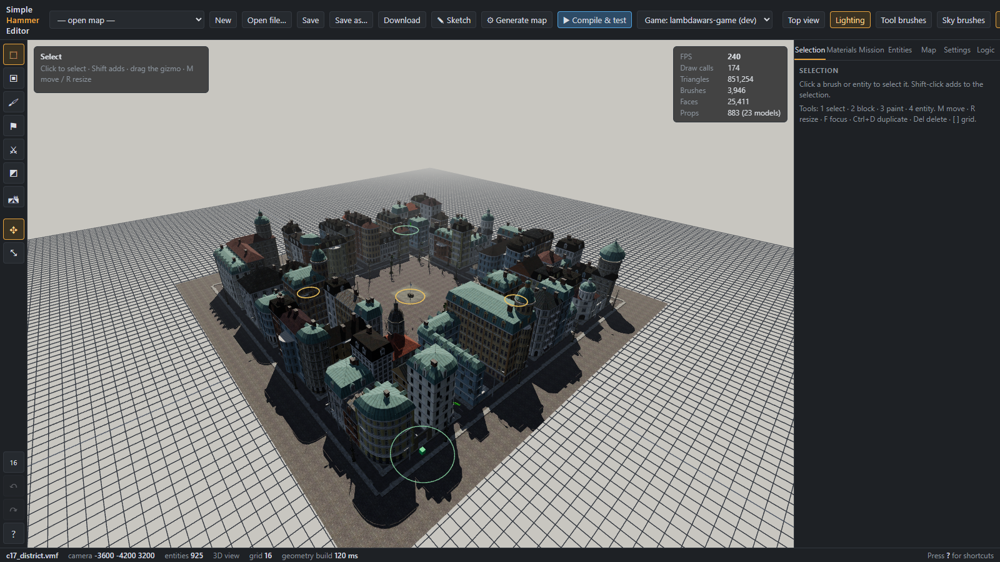
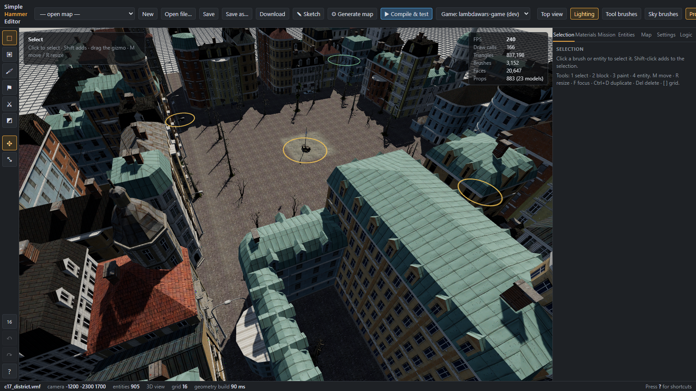
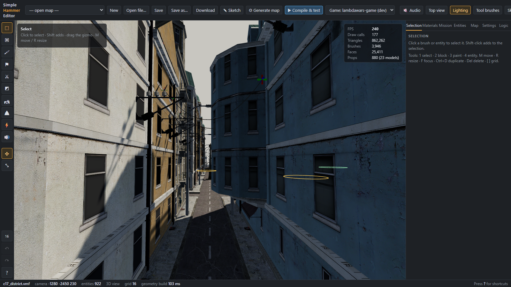
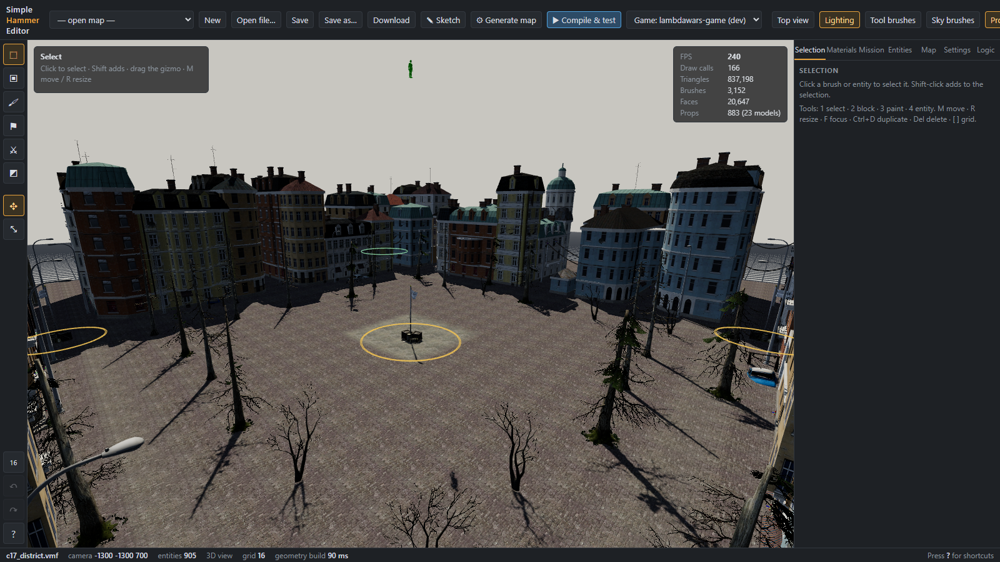
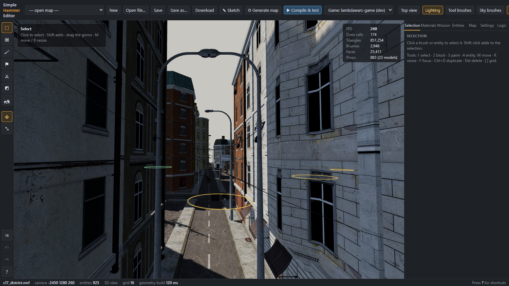
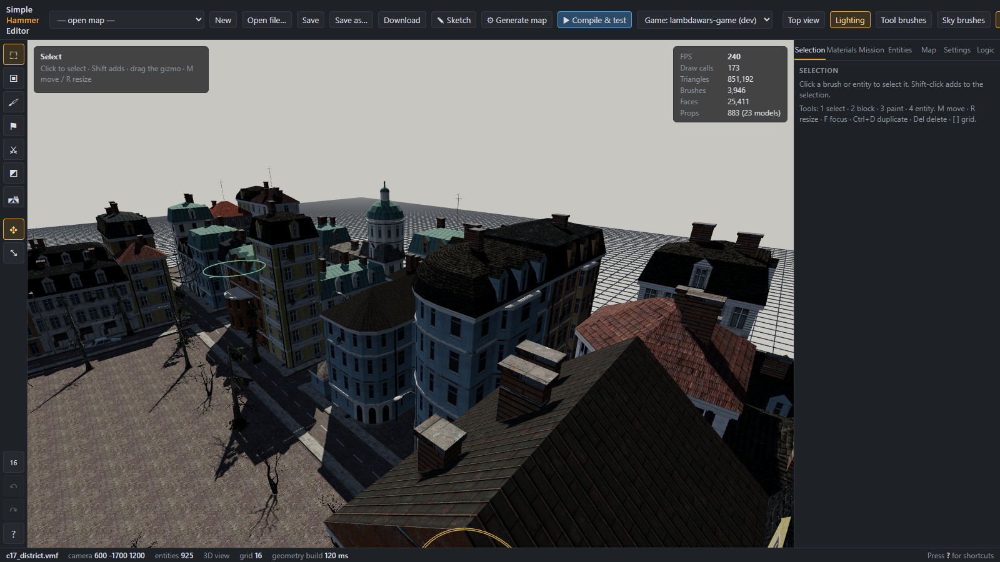

### Building phase 8: the t-junction budget, building quality and the street grid

A generated city filled vbsp's t-junction buffer (65,536 entries; the error is "Too many t-junctions"): the
Civil Protection map stood at 98.8% before anything else was added.

**Measuring** (`scripts/tjunc-budget.mjs`, `server/budget.ts`): builds variants of a map (without buildings,
roads, POIs or interiors, every block at one quality, the decoration level 0–3), runs vbsp and vbspinfo on each
in parallel and prints the t-junction count, its share of the limit and brushes, vertexes and faces:
`node --experimental-transform-types scripts/tjunc-budget.mjs sp_tutorial_combine --variants base,filler,no-pois`.
What it showed:

- Facade decoration (pilasters, ledges, window frames, cornices on every building) is nearly all of it.
- Window holes cut into walls, roofs resting on wall tops and walls flush with a neighbour's add many each.
- Brush entities (`func_brush`) don't count, but moving all decoration into them overflows the 65,536 unique
  vertexes instead. Overlays need world or `func_detail` faces under them.

**Building quality** per block (`QUALITY` in `src/gen/buildings.ts`, a Quality drop-down in the Building
panel): *High* (everything), *Medium* (base course and cornice, no enterable houses), *Filler* (plain walls
with windows and a cornice, no towers, oriels or balconies).

- **Detail layer** in the map sketch: paint High, Medium or Filler on cells; a block takes the most detailed
  quality painted on any of its cells. The block outlines are drawn on the layer.
- **Building detail: auto** (Map row): unpainted blocks within 3 cells of a marker or POI are High, within 8
  Medium, the rest Filler. "High" keeps every unpainted block at High.
- The Civil Protection map paints the station surroundings and the route, the rest is Filler: 50.7% of the
  buffer.

**Sofia layout** (Map rows in the sketch, all optional):

- *Block size*: the size of building blocks the sketch cuts its building areas into.
- *Yards: green*: the open lots behind buildings become lawns (`src/gen/yards.ts`) with leafy trees, benches,
  a bin and a playground or a parking spot with cars, instead of sheds and dirt.
- *Open courtyards*: the share of ring sides left open, so courtyards open onto the street.
- *Streets: Sofia*: wider pavements on streets of 512 and up, cars parked along the kerbs and bollards at
  the corners.
- **Lay out street grid** (Street grid section): replaces the building areas with blocks of 11 cells between
  4-cell streets, an 8-cell boulevard every third street and parks in about 15% of the blocks, and sets the
  options above with auto detail.

## Interior buildings

Enterable, roofless "cutaway" houses next to the solid City 17 buildings: hollow walls cut off flat at one
height, rooms with doorways, furniture and lights, sometimes stairs to a partial upper floor. Units walk into
them and stay visible from the RTS camera. The plan is in
[docs/interior-buildings-plan.md](docs/interior-buildings-plan.md).

### Interior phase 1: floor-plan planner

`src/gen/interiorPlan.ts` turns a footprint into an `InteriorPlan` (data only, no brushes):

- **Rooms**: the footprint is rasterised on a 64 grid (grid lines through every corner, the last cell of a
  run takes the remainder), cut into rectangles through its inner corners (an L becomes two), and each
  rectangle is split along its longer side into rooms of at least 128 × 128 (192 with wide doors).
- **Walls** come from the cell edges where the room changes: exterior walls 16 thick inside the
  footprint, partitions 8 thick on the room line. Overlaps are resolved so the boxes never intersect: a
  wall ending inside another is cut back to its face, the stronger wall keeps a corner, a crossing splits
  the weaker one. Pieces are then split wherever the room on either side changes, so each face looks
  into exactly one room.
- **Openings**: entrances first (requested footprint edges, otherwise a long wall; a second one on
  another side for houses over 384 long), then a spanning tree of inner doors so every room is reachable,
  plus a few extra doors for loops, and sometimes a wide gap between living rooms. Doors are 64 or 96
  wide (128 with wide doors); everything keeps 16 from wall ends and from walls that join the wall.
  Windows (64 or 96, sill 40, lintel 96) go on outside walls about every 128–192 units, 32 clear of
  doors and corners.
- **Room types**: a hall or living room at the front door, a kitchen next to it, the bath next to the
  kitchen, then bedrooms and storage; workshops get a workshop and storage rooms.
- **Two storeys**: an upper floor over one end (a third to half of the house), and a straight flight of
  8 steps (16 rise, 24 tread, 96 wide) along an outside wall of the open part, rising to the slab edge.
  Room splits never cut through the stairs and the space in front of them.
- **Lanes** (48 wide, from each door and the stairs to the middle of the room), **door zones** (64 deep
  on both sides of every doorway) and a **porch** strip in front of the main door, for later phases.
- Tests (`tests/interiorPlan.test.ts`, 6 footprints × 40 seeds × 3 option sets): every room reachable from
  an entrance, door widths, openings clear of wall ends, joins and each other, rooms tiling the footprint,
  disjoint wall boxes, the same seed giving the same plan, L-shapes, stairs landing on the upper floor.

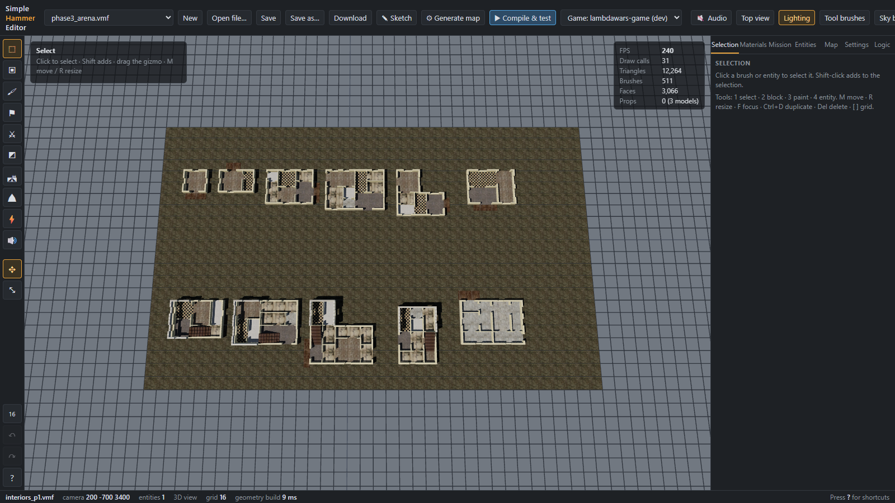
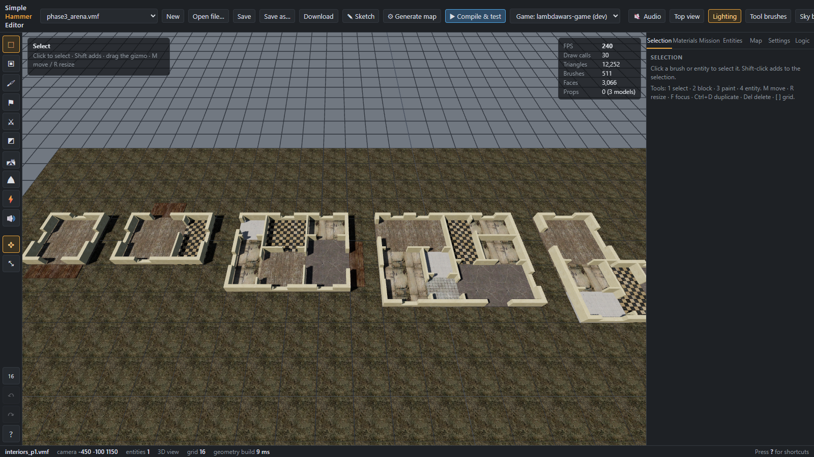
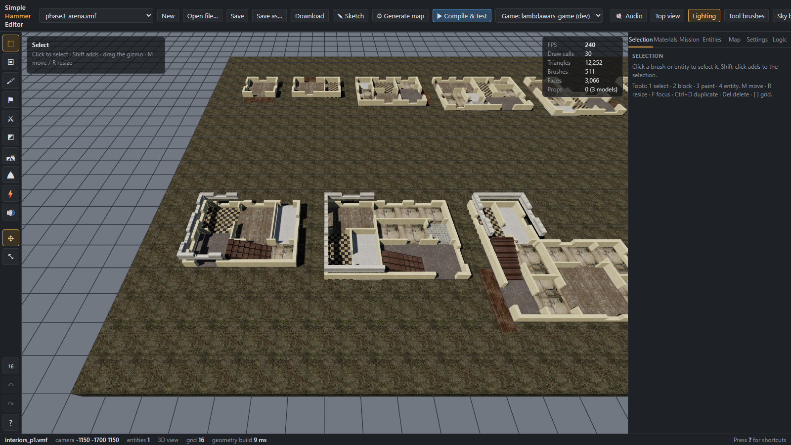
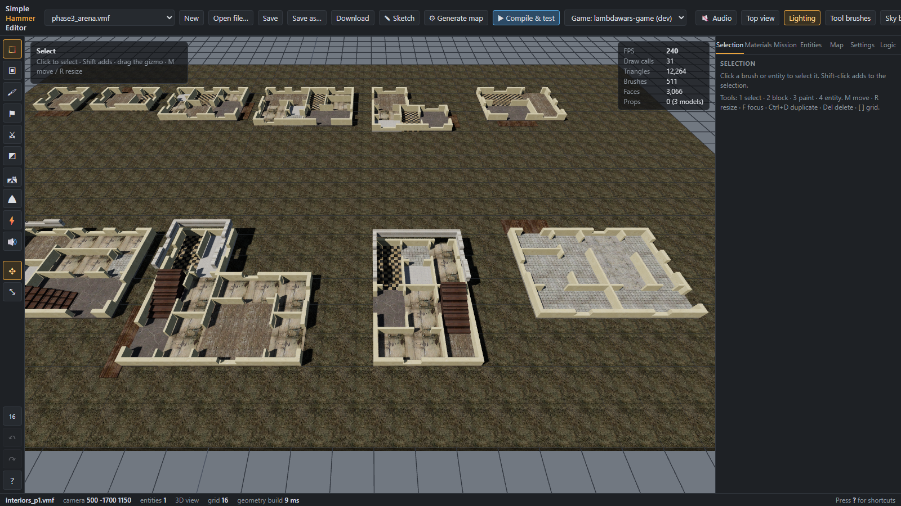

### Interior phase 2: hollow shell, caps and floors

`src/gen/interiorShell.ts` turns a plan into brushes, and `interiorHouse()` (`src/gen/interiorHouse.ts`, the
function the point-of-interest generator calls) now builds real houses instead of a solid box.

- **Walls**: each wall piece is split around its openings into convex boxes: full-height piers, a sill
  block under each window and a lintel over doors and windows. Walls stop flat at the **cut height**
  (default 112, 96–128 work), and the top of every wall brush (and every window sill) carries the
  **cap** material, world aligned so caps line up across brushes: from above the house reads as a bright
  outline of its floor plan.
- **Faces**: each face looks up the room in front of it: the outer face gets the house's outside finish,
  inner faces their room's finish (tiles in kitchens and baths, wallpaper or plaster elsewhere), the
  reveals of openings the room's finish too, bottoms nodraw. Textures are 0.25 scale with one 128-unit
  tile per storey, starting at the floor.
- **Floors**: one slab per room, top at z0 + 8 (an 8-unit step for units), sunk 32 into the ground so
  houses sit on uneven terrain; its outer sides show the outside finish like a plinth. A **porch** is a
  plank deck at the same height, sometimes with railings on its ends.
- **Windows**: open, backed with a black panel in the middle of the hole, or boarded with two or three
  planks across the outside, per house from its style.
- **Entities**: floor slabs are world brushes, walls, fills and the porch func_detail (open-top walls
  don't seal or block vis usefully at RTS heights); func_detail still blocks units and the navmesh.
- **Interior styles** (`INTERIOR_STYLES` in `src/gen/styles.ts`):

| Style | Outside | Inside | Floors | Cap | Windows |
|---|---|---|---|---|---|
| Plaster farmhouse | cream, yellow and grey plaster | wallpapers, white tiles | wood planks, tiled kitchens | white trim | black or open |
| Wooden shack | weathered white, red and grey siding | plank walls | worn planks | white planks | boarded or open |
| Brick cottage | red and brown brick | plaster and wallpaper, tiles | wood, tiles | white trim | black or boarded |
| Concrete outbuilding | concrete | concrete block | concrete | grey | open |
| Corrugated slum shack | rusty, red, yellow and grey corrugated metal | planks | planks, concrete | grey planks | open or boarded |

- Materials and window fills draw from their own random sequence, so they never change the floor plan.
- Tests (`tests/interiorShell.test.ts`): every brush is a valid box, wall and floor brushes never overlap,
  every opening is a clear hole, every wall stops at z0 + cut with the cap on top, inner faces use their
  room's finish.
- Five rows of seven houses (one row per style, the last house in each row cut at 96) are about 1,600
  brushes, 45 per house.

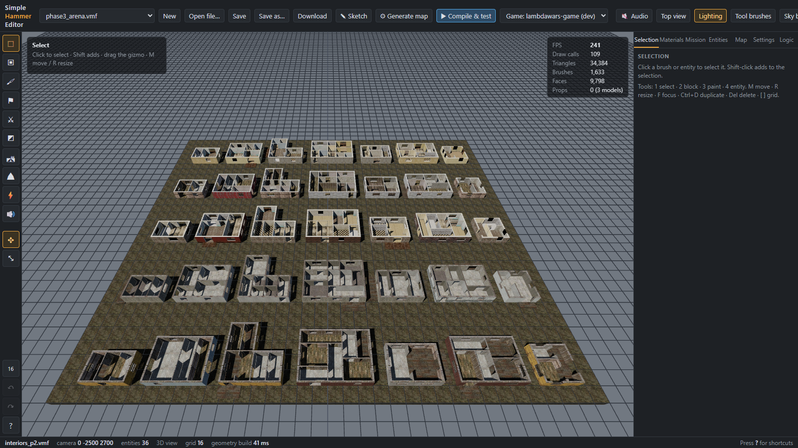
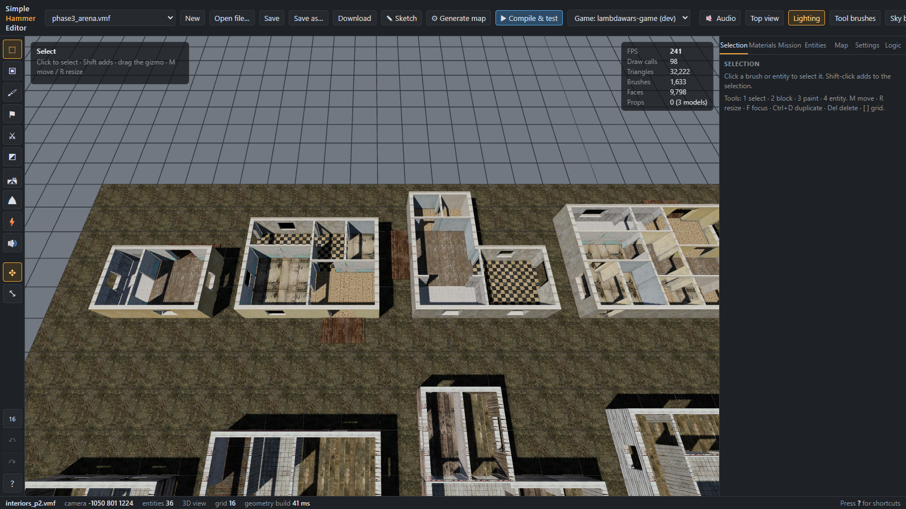
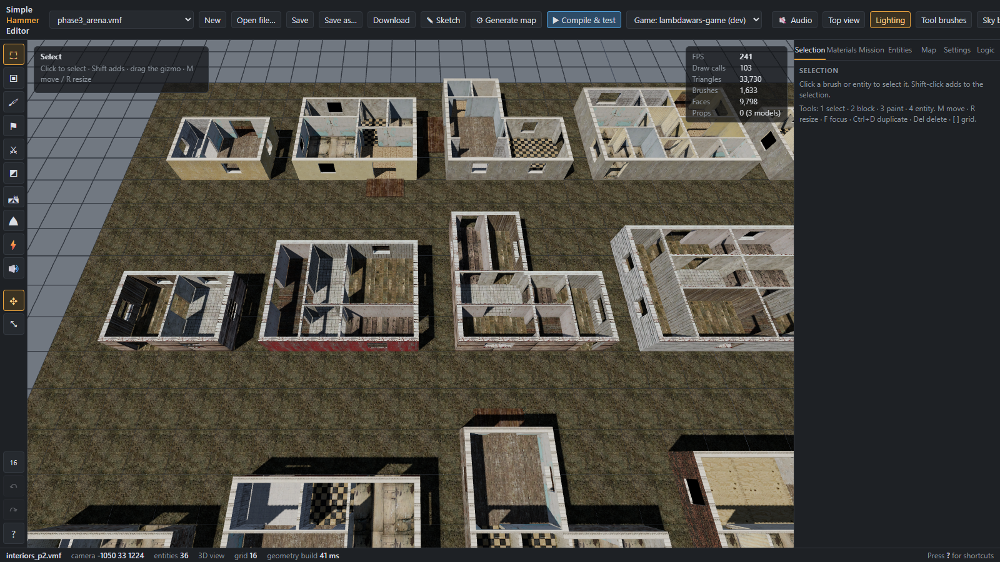
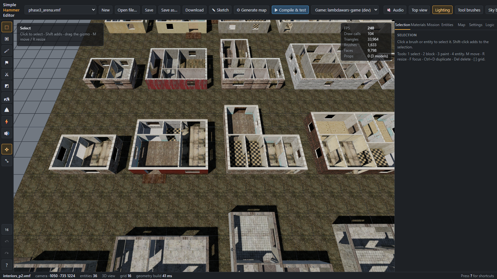
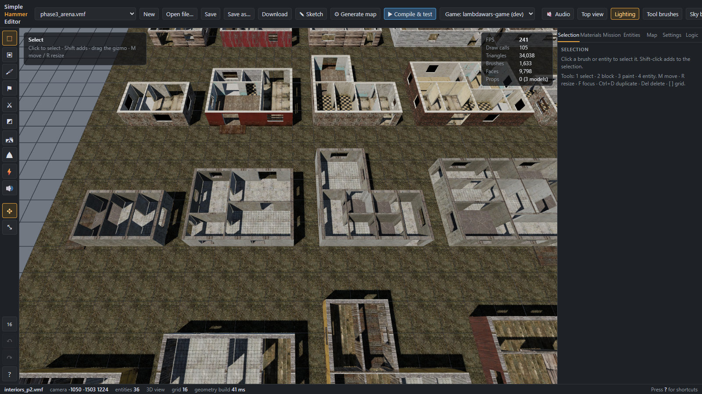
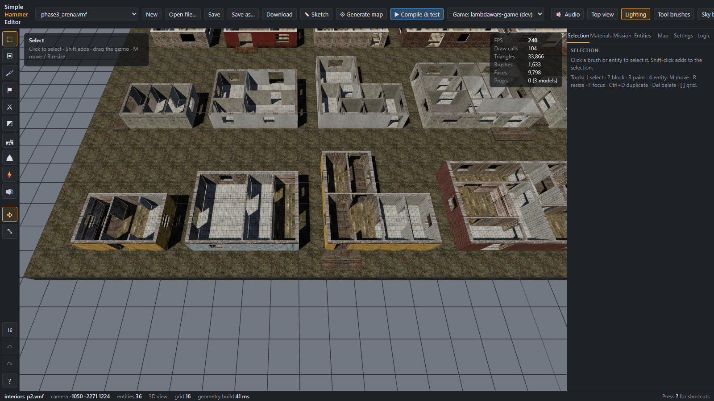
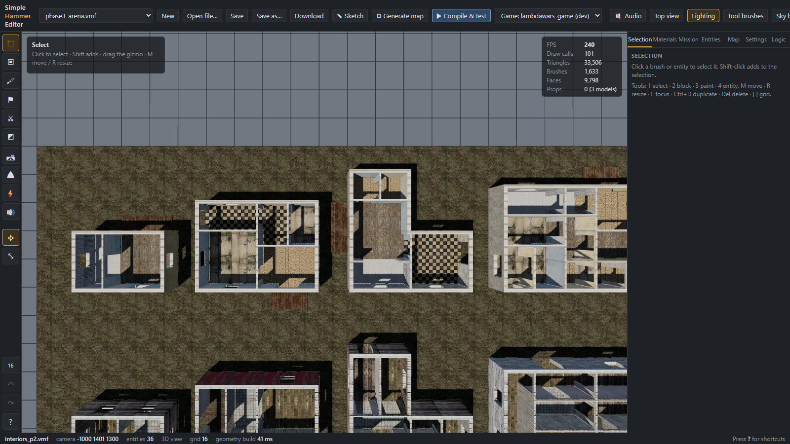
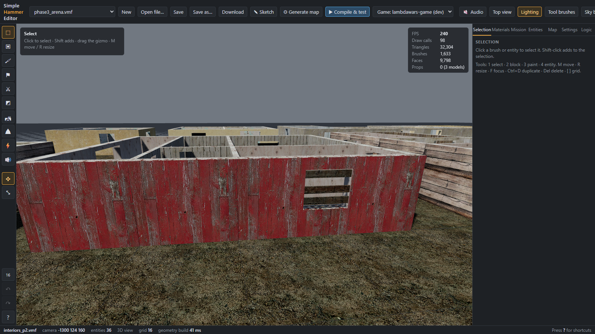

### Interior phase 3: furniture, lights and grime

`src/gen/interiorDressing.ts` furnishes the planned rooms; `interiorHouse()` gets **Furnish** (none,
sparse, full), **Lights** and **Weathering** options.

- **Models**: a table of the game's furniture with its bounds measured from the MDL hulls and the
  static-prop check of each model (`FURNITURE`): couches, beds, mattresses, bed frames, bathtubs, stoves,
  sinks, toilets, a fridge, a boiler, a pot-belly heater, a control-room desk, a cafeteria bench, crates,
  boxes and oil drums as `prop_static`; the tables and chairs have no static version and become
  `prop_dynamic` (solid 6). All models face +x, which was checked in the editor.
- **Room sets**: kitchens get a stove, fridge, sink and a table; living rooms a couch, heater, table and
  chair; bedrooms a bed, frame or mattress and boxes; baths a tub, toilet and sink; storage rooms and
  workshops crates, drums, a desk or bench; halls a boiler or a box. Sparse puts one or two items in a
  room, full up to four by floor area.
- **Placement**: wall items stand with their back (or long side, for tubs) against a wall, facing into
  the room, turned in 90° steps; free items (tables, chairs) stand in the room, chairs next to the
  table. Nothing goes on a **lane** (48 wide, door to door through the middle), in a **door zone**
  (64 deep on both sides of every doorway), over the stairs, on another prop, or (when taller than 36)
  in front of a window; nothing taller than the cut walls. The navmesh sees static props, so the lanes
  keep every room walkable.
- **Lights**: three rooms in four get a caged wall lamp (`light_cagelight01_on`) away from doors and
  windows, with a warm `light` (255 214 170, brightness 80–150, `_lightHDR` copying the LDR value, a
  pool of 96 to half brightness and 320 to dark) in front of it. The rest stay dark on purpose.
- **Grime**: blood, burns, rubble and stain decals on floors, stains, posters and graffiti on inner
  walls, by floor area and the Weathering setting; plaster debris piles in some rooms when weathering
  is high.
- Dressing draws from its own random sequence (`seed × 23 + 13`), so furnishing never changes the plan
  or the shell.
- Tests (`tests/interiorDressing.test.ts`): props inside their room and clear of lanes, door zones,
  stairs and each other; only checked static models as `prop_static`; one lamp and one light per lit
  room; no furniture with Furnish none; the same plan with and without furniture.

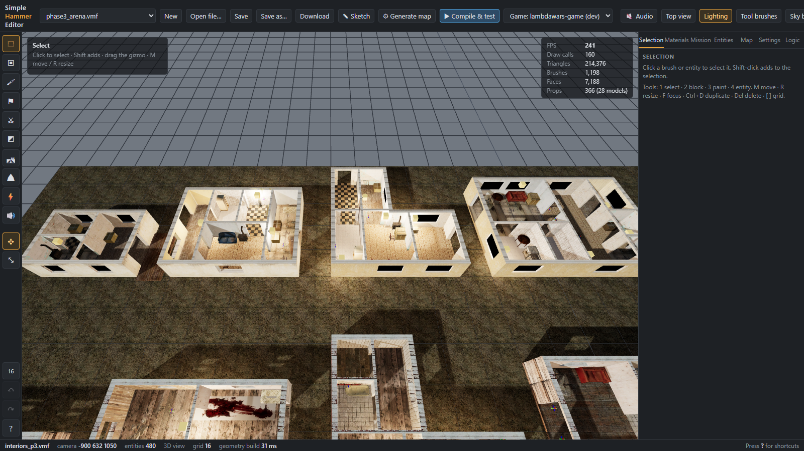
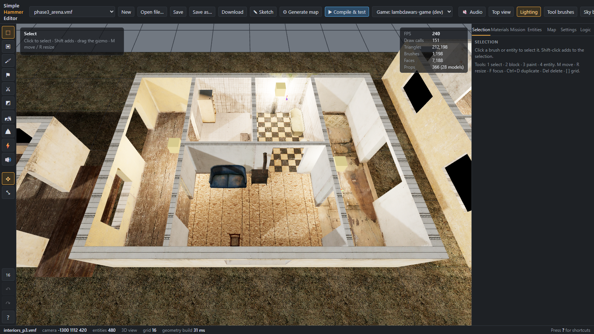
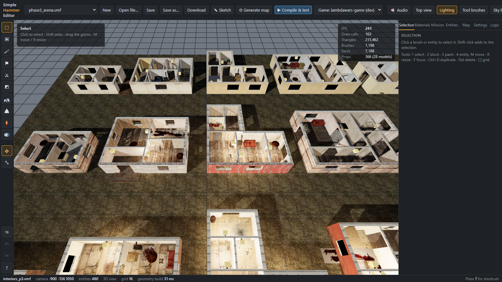
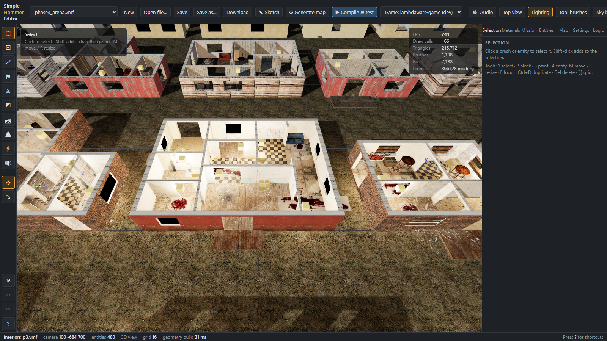
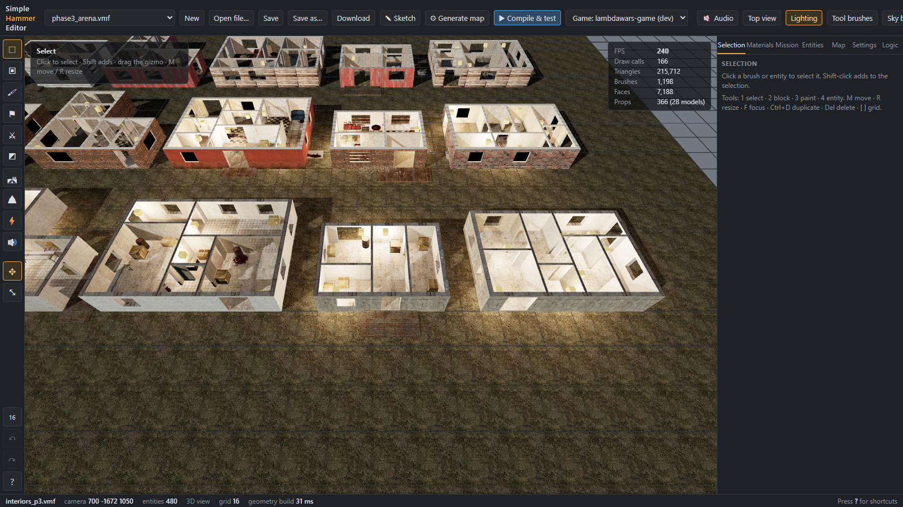

### Interior phase 4: second storey and stairs

`interiorHouse()` now builds the plan's second storey (`storeys: 2`):

- **Upper floor**: over one end of the house (a third to half of it), so the rooms below the open part
  stay visible from above. The ground-floor walls under it run up to the slab (z0 + 128), the slab is 8
  thick (120 clear below, enough for every hull), its top at z0 + 136 in the room's floor material with
  a plaster ceiling underneath, and it reaches 4 past its edge over the partition below. The upper
  storey's outside walls stand on the ground walls, from z0 + 128 to z0 + 128 + cut, with their own
  windows.
- **Railing**: a see-through `metal/metalrail001a` rail 32 high along the slab's open edge, with a
  gap where the stairs arrive.
- **Stairs**: a straight flight along an outside wall of the open part, rising towards the upper floor:
  8 solid block steps of 16 rise and 24 tread (the last one level with the slab), 96 wide (128 with wide
  doors), in the style's stair material.
- **NPC clip ramp**: a `TOOLS/TOOLSNPCCLIP` wedge (world brush) laid on the step nosings, from the floor
  one tread before the flight up to the slab: 128 rise over 192 run (34°, under Recast's 45°). Units and
  the navmesh see one smooth slope (`MASK_NPCWORLDSTATIC` includes NPC clip); players and the camera
  don't.
- The upper room is furnished as a bedroom; its lane runs from the head of the stairs.
- Tests: steps rise by 16 up to the slab top, the ramp is at most 45°, no railing at the stair head,
  walls, floors, slab and steps never overlap, every brush is valid; the planner tests keep the upper
  floor at most half the footprint and the stair foot and head on a lane.
- Whether the navmesh actually connects both floors is checked in game in phase 6.

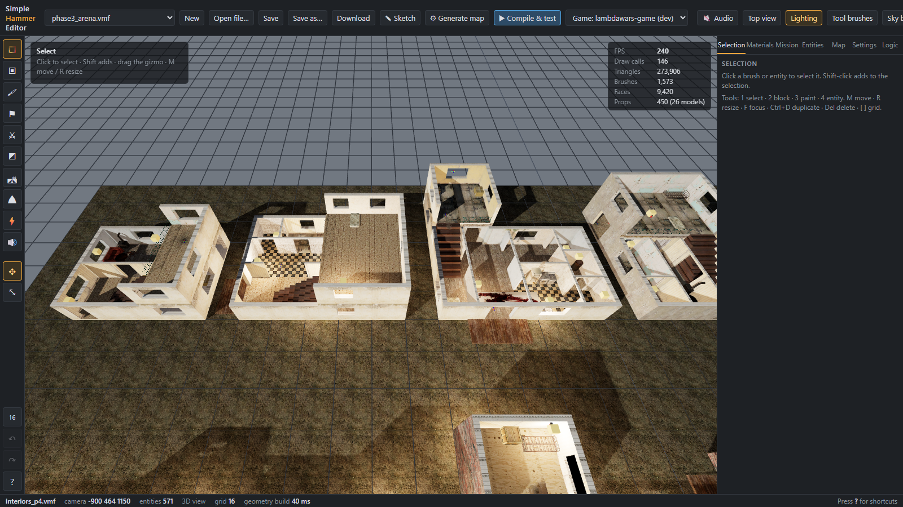
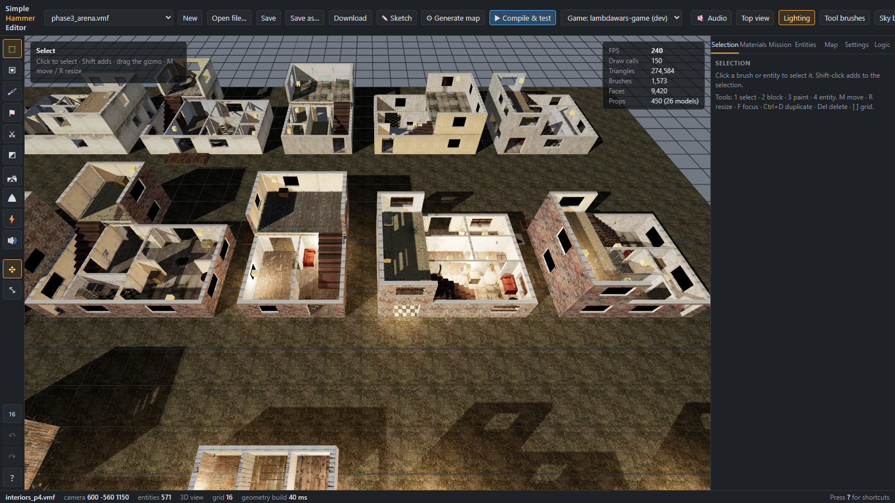
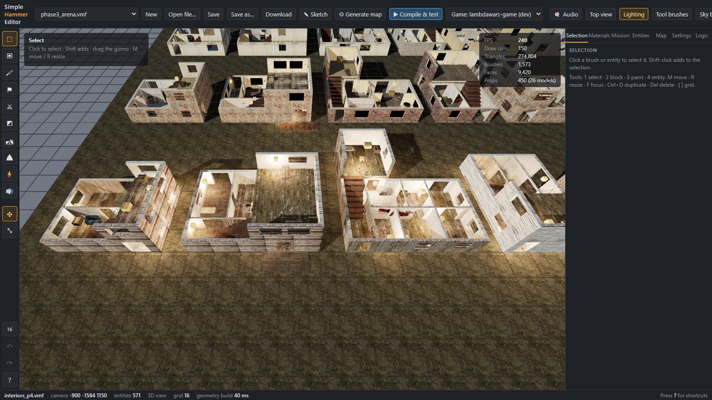
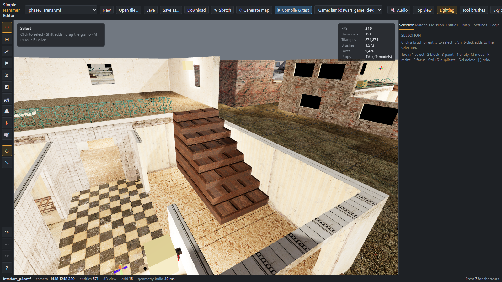
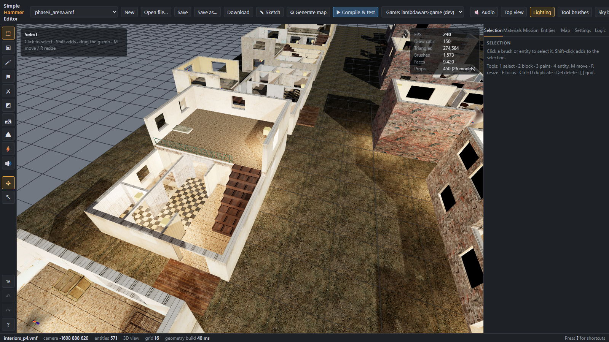

### Interior phase 5: integration and the panel

Enterable houses now come out of the building generator, next to solid ones.

- **`BuildingOptions.interiors`** (none, some, all; default from the architecture, which is none for the
  city architectures, so existing maps and seeds are unchanged), plus **interiorStyle**, **cutHeight**,
  **furnish**, **interiorLights** and **wideDoors**. The choice draws from its own random sequence.
- **Which buildings**: lots of 1–2 floors whose wings are axis-aligned rectangles, and the sheds in yards
  and courtyards. Ring buildings around courtyards and anything taller stay solid. The two wings of an
  L-shaped lot become one L-shaped house (`outlineOf` traces the outline) when it fits in 640 × 640,
  otherwise a house per wing. A single lot longer than 640 gets a 384–576 house at the street and the
  rest becomes its yard (with trees). With "some", the architecture's share of the eligible lots.
- An enterable house skips the roof, tower, cornice, oriels, balconies, awnings, wall clutter and roof
  props. It keeps the weathering (stains down its outer walls) and gets **eave stubs**, a band in the cap
  material just under the cap, at Medium detail and up (not with wide doors, and only where 88 stays
  clear in the doorways). The stone base course is left out: it rises 20 above the ground, over the
  18-unit climb, and would close the doorways.
- **Doors face away from neighbours**: walls against another building or a courtyard wall get no
  entrance (`noEntrance`, also an `interiorHouse()` option). The street pass keeps lamp posts and trees
  off the ground in front of every door (`BlockDressing.doors`).
- **New architectures**: **Village houses** (cream, sand, rose and brick plaster, gables and hips, 1–2
  floors, 70% enterable as farmhouses, brick cottages and shacks) and **Slum shacks** (1 floor, all
  enterable, corrugated metal and wood).
- **Building panel**: Interiors (from architecture, none, some, all), Interior style, Cut height, Furnish,
  Lights, Wide doors. **Generate map**: an Interiors setting and a new **Houses (enterable)** cell kind in
  the layout painter: village houses in the countryside, slum shacks in the city, always enterable.
  Random rural layouts get a few hamlets of houses (from their own random sequence), and buildings on
  rural blocks default to some interiors. **Sketch**: an Interiors setting.
- One undo step still reverts a whole generation.
- Tests (`tests/interiorBuildings.test.ts`): without interiors the output is byte-identical to before
  (hashes recorded before this phase, for three architectures); all interiors on a small block gives
  only enterable houses with nothing above the cut; slum and village defaults; no lamp or tree in front
  of a door; the L outline.

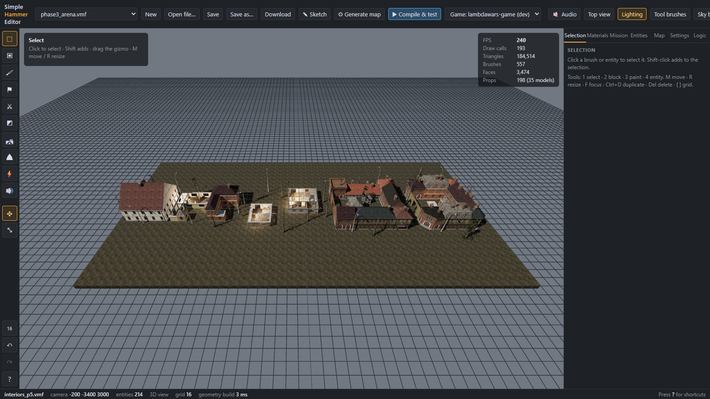
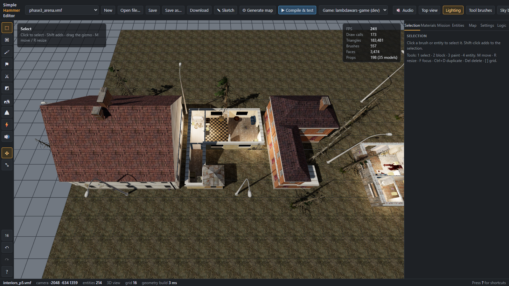
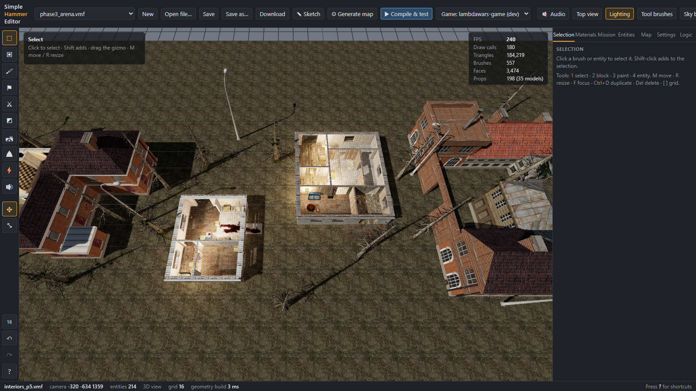
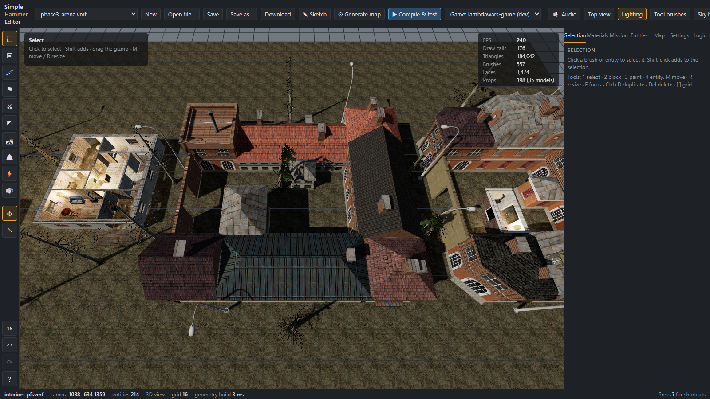
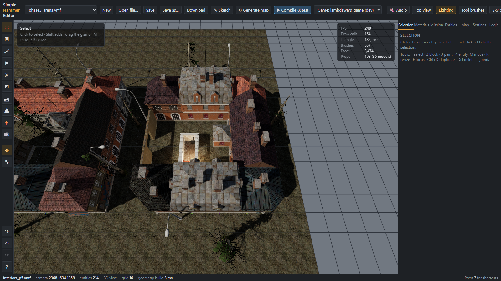
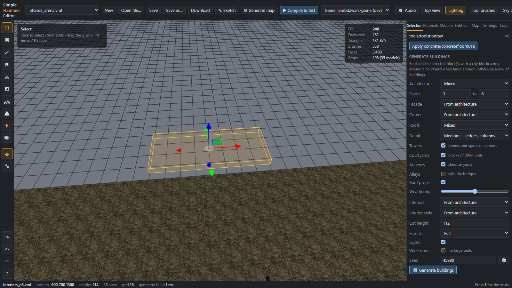
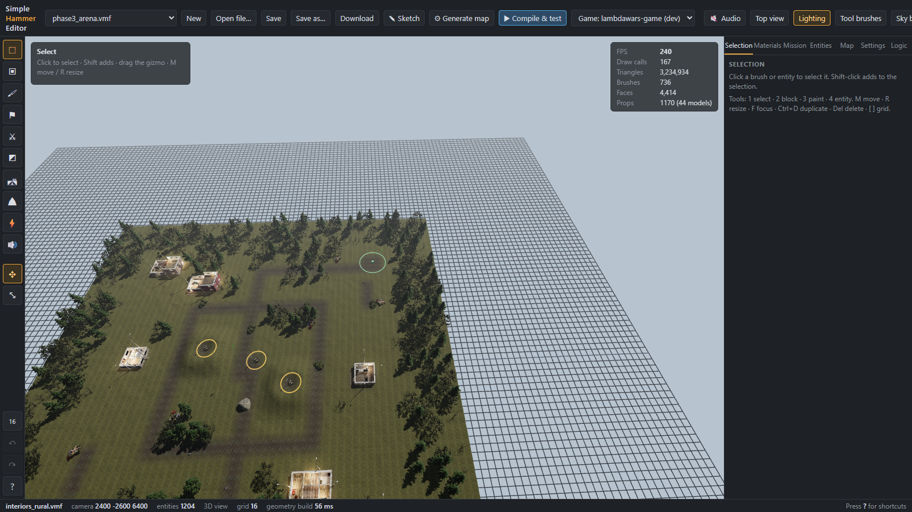
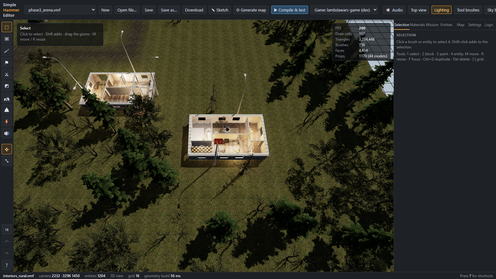

### Interior phase 6: test map, compile and in-game check

`scripts/interiors-demo.mjs` builds **`maps/interiors_test.vmf`**: a row per interior style, each with a
furnished one-storey house, a bare unlit one, a two-storey house, an L at full weathering and a fifth
house (wide doors in the first row, two storeys with cut heights from 104 to 128 in the others), plus a
village block with some interiors next to solid houses. There are two player starts, rebel squads in
front of the first row's two-storey house and its L, antlions (the medium hull) by its farmhouse, and a
Combine squad by the second start.

| | |
|---|---|
| Brushes | 1,970 (175 world: floors, the ground, NPC clip ramps; the rest func_detail) |
| Props | 324 `prop_static` (none converted by the static-prop check), 30 `prop_dynamic` (tables, chairs) |
| Lights / decals | 107 / 253 |
| Houses | 29 enterable |
| Compile (fast, with navmesh) | 24 s; no leak, no vbsp errors or warnings, no deleted props; navmesh 220 KB, all five meshes |

**Navmesh fix**: the first compile gave a navmesh of 887 bytes. The engine's build prunes the polygons
it can't reach from the `info_start_wars` entities, and in this build that pruning removes them all
(the editor's earlier maps were singleplayer, without starts, so they never hit it). The editor's
navmesh step now sets `recast_build_remove_unreachable_polys 0` (`server/compile.ts`).

**In-game check** (`lambdawars.exe -game lambdawars -dev -windowed -condebug +map interiors_test`,
`sv_cheats 1`, `recast_draw_navmesh 1`). The map tests itself: 10 seconds after spawn `wars_give_order`
sends each squad to a goal (the head of the stairs, the room of the L farthest from its front door,
the farthest room of the farmhouse), and a `trigger_multiple` in each target, filtered to that squad's
name, echoes a marker into the console log when a unit arrives.

- **Through doors, human hull**: 2 of the 3 rebels reached the L's farthest room. The third logged
  "blocked and gives up" next to the L's west wall.
- **Through doors, medium hull**: all 3 antlions reached the farmhouse's farthest room.
- **Upstairs**: 1 of the 4 rebels walked up the flight onto the upper floor; the navmesh overlay shows
  the path running up the NPC clip ramp onto the slab. The other two that reported gave up "blocked" in
  front of the house; all four were sent to the same goal point, so they queued in a 64-wide doorway and
  on a 96-wide flight. Recast does connect both floors, so the off-mesh link fallback isn't needed.
- **Not checked in game**: the large hull with wide doors, and ordering units by hand. The game stopped
  after about 40 seconds each run with "Could not launch browser helper process" (CEF's
  `lambdawars_browser.exe` never started; the HUD stayed on "Loading CefViewPort..." from the start,
  independent of this map), so there was no time for longer tests or more views.

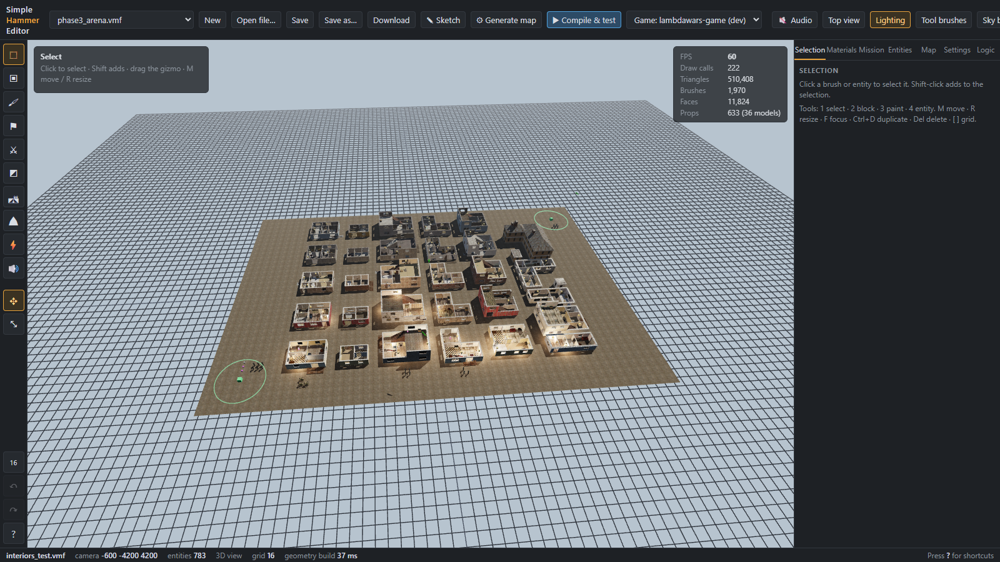
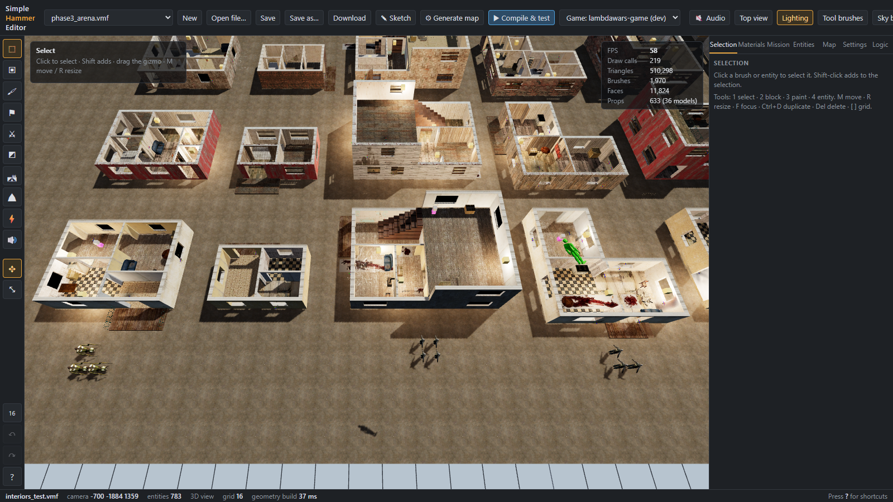
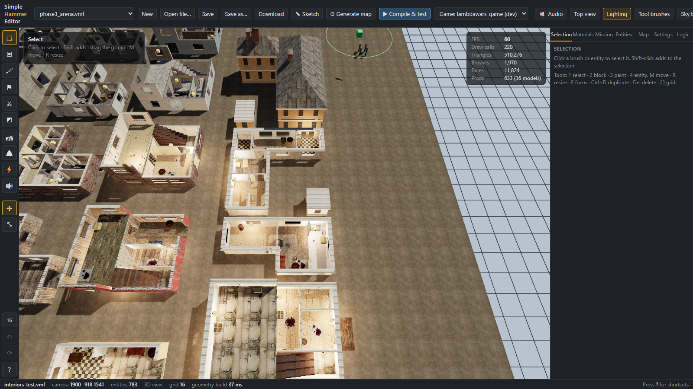


## Interior buildings with rooms

A building you walk into, made of rooms with a purpose: draw the rooms on a floor plan, give each a type, and
the generator builds the shell and furnishes every room for its type (`src/gen/rooms/`, plan in
`docs/plans/interior-buildings.md`). The Civil Protection station was the hand-made first version of this.

- **Rooms and shape** (`model.ts`): the building is a grid of 128-unit cells and each room is a rectangle of
  cells; the rooms together are the building's shape, so an L or a T is just rooms placed that way. Walls stand
  wherever a room meets the outside or another room. Walls along x keep the corners and walls along y stop
  against them, so no two wall brushes overlap.
- **How rooms meet**: each type prefers a doorway, a row of archways or no wall at all, and two rooms meet with
  the less open of their two preferences (a train hall and a concourse: archways; a concourse and a waiting
  room: a doorway). A link per pair of rooms overrides it, including a closed wall. Street doors go on outer
  walls and keep clear of the corners.
- **Shell** (`shell.ts`, with `hall.ts`): plain world walls, a window band high up in the north and east outer
  walls (the sun comes from the north-east), glass in a never-solid func_brush, and the invisible roof that
  blocks the sun (a func_brush that casts vrad shadows) with skylight strips over the halls. Nothing hangs
  under the roof.
- **Room types** (`types.ts`, `dressers.ts`): each room is furnished through a POI kit laid over its floor, so
  props stand on the floor, keep off each other and off the ways through. Every doorway is kept clear and
  joined to the others by walkways first.

| Type | Furniture |
|---|---|
| Train hall | A raised platform along the side it is entered from, tracks on ballast with buffers, passenger coaches at the platform, a second platform in a wide hall; benches, bins, luggage, push carts; hazard stripes on the edges |
| Concourse | Stone pillars on a grid (bases, capitals, lanterns) in a large one, a Breencast on a pole where most benches fit in front of it, ornaments by the street doors, luggage |
| Customs | Rows of chain-link cages against the long walls with gates onto a corridor, benches and luggage inside, a scanner line of barricades across the way in, a guard booth and monitor |
| Rations | Lanes between railings up to a Combine counter with monitors, the booth and crates of rations behind it, a Breencast in a corner, ration papers in the lanes |
| Waiting room | Rows of benches facing a Breencast monitor on the north wall, canteen tables with bottles and cartons, payphones, a vending machine |
| Hallway | Benches along the walls, bins, a payphone and a vending machine, lamps down the middle |

- **Relief, lamps and wear** (`relief.ts`): the camera looks north-west, so the north and west inner faces of
  every room get a plinth, a ledge, pilasters (stopping under window bands) and a cornice in one func_brush,
  lanterns on every other pilaster, posters, propaganda and stains as overlays on the walls. Lamps hang over the
  furniture; floors get stains, cracks and litter per type.
- **Stored and editable** (`store.ts`, `action.ts`): the spec is kept on the building's func_detail
  (`she_rooms`), with its walls' ids and everything else tagged, so it rebuilds in place. A green handle moves
  it; clicking anything it made selects it.
- **The dialog** (`src/ui/roomsDialog.ts`, *Interior building…* in the Selection panel, or *Design interior
  building…* with a block brush selected): drag rooms onto the floor plan, pick their types, click outer walls
  for street doors, set how neighbours meet, choose a preset (Train station, Customs house, Ration centre). The
  plan shows walls, doorways, archways and window bands as they will be built and lists what is wrong
  (overlapping rooms, doors not on an outer wall, rooms you can't reach from the street).


**Test map** (`scripts/build-rooms-station.mjs` → `maps/rooms_station.vmf`): the Train station preset on a paved
square (6 rooms, 24 × 24 cells), two player starts and two rebel squads outside its street door. At map start
one squad is ordered onto the train platform (through the concourse and its archways), the other into the
ration hall (through the concourse and the hallway); triggers there log when a unit arrives.

| | |
|---|---|
| Brushes | 317 (84 world: the walls and the ground; floors, platforms, pillars and counters in one func_detail; roof, glass and relief in func_brushes) |
| Props / lights / overlays | 181 (none converted by the static-prop check) / 53 / 149 |
| Compile (final, with navmesh) | 34 s, no leak; navmesh 219 KB |
| In game | all 4 rebels reached the platform and all 4 reached the ration hall |

`scripts/rooms-demo.mjs` builds the three presets side by side in the editor (`maps/rooms_demo.vmf`);
`scripts/rooms-dialog-demo.mjs` drives the dialog.


## Roads, powerlines, audio and mission flow

### Roads

The **Road tool** (7) draws roads as a line of points: click points (they snap to the grid, and onto
existing roads to join them), Enter or double-click builds, Backspace removes the last point, Escape
cancels. The preview shows the rounded centre line and the edges of the carriageway and pavements.

| Style | Surface | Kerbs and pavements | Default width |
|---|---|---|---|
| Asphalt road | the game's asphalt with a dashed centre line, one tile across so the line sits on the centre | 8-unit kerbs, paving slabs | 256 + 2 × 96 |
| Cobbled street | cobble | yes | 192 + 2 × 64 |
| Tram street | cobble with two tracks of steel rails | yes | 320 + 2 × 96 |
| Dirt track | dirt, almost flush with the ground | none | 160 |

- **Corners** are rounded with a set radius, so every piece stays a small convex brush; slopes follow the
  points' heights. Roads are func_detail and store their points and settings on the entity (`she_road`).
- **Crossings**: all roads are rebuilt together. The earlier road's surface wins where carriageways
  overlap; kerbs and pavements give way to other roads (convex polygon subtraction), which opens T-junctions
  and crossings. Rails stay on top.
- **Editing**: selecting a road (or any of its brushes) shows a Road panel for style, width, pavement and
  corner radius; changes rebuild all roads.
- **Sketch**: road cells become roads through the same code: asphalt with kerbs and pavements in the city
  (dirt tracks in the countryside), longest roads first so they run through junctions, pieces that end
  against another road extended to its centre. The test district's streets are now built this way.
- Long straights are cut into 512-unit pieces, and sketch pavements stop 6 units short of the building
  line. Pavements overlapping the buildings' base course pushed the district past vbsp's limit of 65,536
  t-junction indices ("Too many t-junctions to fix up"). Drawing a pavement into a building's base course
  with the Road tool can still do that on very large maps.


### Ground painting

The **Ground tool** (8) paints and sculpts displacement terrain (`src/edit/terrain.ts`):

- **Paint / Erase**: displacements blend two textures by a per-vertex alpha; Paint brings in the second
  texture of the chosen **ground set**, Erase the first. Eight sets from the game's blend materials:
  grass → dirt, grass → mud, gravel → dirt, rubble → dirt, cobble → dirt, dirt → concrete debris,
  rock → sand, snow → trodden snow. Painting with another set switches the touched patches to it.
- **Raise, Lower, Smooth, Flatten** (to the height where the stroke started).
- Radius and strength sliders; a ring follows the cursor; one undo step per stroke. Dabs are spaced a
  quarter radius apart, so strokes stay even at any mouse speed.
- Vertices are found by world position, so the shared edges of neighbouring patches always change alike:
  no cracks, and smoothing works across patch edges.
- **Turn into terrain**: select a flat floor brush and the tool options replace it with displacement
  patches (512 units, 9×9 vertices) in the chosen set.
- **Blend into ground** (Road panel): paints a worn dirt verge along both outer edges of a road, or the
  whole width under a dirt track.
- A 64-patch test terrain with a hill, painted paths and two blended roads compiles through vbsp, vvis
  and vrad without errors.


### Powerlines

The **Powerline tool** (9): click points along the route, Enter or double-click builds. Poles stand at
even spacing per leg and at every bend (turned to bisect it), on the ground under each point; a sagging
rope runs per wire from pole to pole (`move_rope` → `keyframe_rope` chains), drawn in the viewport.

| Poles | Model | Wires |
|---|---|---|
| Wooden, two wires | `props_forest/utilitypole01b` | 2 |
| Wooden, three wires | `props_forest/utilitypole01d` (prop_dynamic) | 3 |
| Wide crossarm | `props_forest/utilitypole03a` (prop_dynamic) | 4 |
| City pole, side arm | `props_c17/utilitypole02b` | 2 |

- The pole models have no attachment points; the wire positions were measured from their geometry.
- **House feeds** (on by default): from each pole, a wire across to the nearest wall within 480 units
  (found by raycasting the map), ending on the outer insulator of a wall bracket turned out from the
  wall it hit.
- **Spacing** and **sag** in the tool options; selecting any pole or rope shows a Powerline panel (pole
  type, spacing, sag, feeds, delete), and changes rebuild the whole line. The first pole stores the route.
- **Moved models**: `utilitypole01a/01d/03a` were moved from `props_c17` without being recompiled; their
  compiled-in name points to a `.vvd` that doesn't exist, and vbsp stops ("Unable to load vertex data").
  The model loader now reads that name, and the compile dialog's static prop check also catches such
  models (and converts them to prop_dynamic, which the game loads by path).
- Two powerlines with house feeds over painted terrain compile through vbsp, vvis and vrad, with all 34
  rope keyframes in the BSP.


### Ambient sound

- **Soundscapes** (`src/audio/soundscapes.ts`): the editor reads `scripts/soundscapes_manifest.txt` and
  every script it lists (30 soundscapes in Lambda Wars, plus the base game's): looping beds, random
  one-shots with time, volume and pitch ranges, and nested soundscapes.
- **Map default**: an **Ambient sound** card in the Settings tab (an `env_soundscape` with radius -1),
  with the soundscapes grouped by script and a ▶ button to listen for 15 seconds.
- **Zones**: the **Sound tool** (0) places `env_soundscape` zones with a soundscape and radius; the
  viewport draws them as cylinders, the one heard now brighter. Selecting a zone shows its soundscape,
  preview and radius in the inspector.
- **Audio preview** (🔊 **Audio** in the top bar; browsers only allow sound after a click): the editor
  plays the soundscape of the zone at the ground point in the middle of the screen (the RTS camera hangs
  high above it), or of the camera itself when it's low, cross-fading between soundscapes. Loops play
  continuously, random sounds at random times panned to a random side, as the game does. The viewport
  readout shows the soundscape and how many sounds are playing.
- Zones act as columns (distance on the ground plan), so a zone dropped on a roof still covers the street
  below. In game the last zone heard keeps playing until another takes over; the preview falls back to
  the map default instead, which shows each zone's extent more clearly.
- Fixed: with the lighting preview on, the top view was all fog.
- Checked with the test district: default `wars.city16`, `wars.canals.street` in a west street zone,
  `wars.ruins` on the square; the readout switched correctly as the camera moved, the game's PCM WAVs
  decoded, and all four `env_soundscape`s are in the compiled BSP.


### Local sounds

- **Sound browser**: the game's 3,900 sounds, searchable by words ("fire loop", "drip"), each with ▶;
  the picked sound shows whether it **loops** (has loop points: the game repeats it) or plays **once**.
- The **Sound tool**'s *Local sound* mode places an `ambient_generic` with the picked file, radius and
  volume, or a **preset**: a sound with the effects that belong to it.

| Preset | Adds | Sound |
|---|---|---|
| 💡 Broken lamp | a light with the fluorescent-flicker style (baked by vrad), sparks (`env_spark`) | electric buzz |
| 🔥 Fire | `env_fire` (infinite, full size), a flickering orange light | small fire loop |
| 💨 Steam leak | an `env_steam` jet | steam loop |
| 📻 Radio | a radio prop | music (plays once) |
| 💧 Dripping water | – | water leak loop |
| ⚙ Generator | a generator prop | generator hum |

- Presets that bring a prop place it when clicked on the ground; clicked on a fitting prop they add only
  their effects to it. **Suggestions**: selecting a lamp post, oil drum, fireplace, radio or generator
  offers the fitting presets in the inspector; the effects go to the right spot on the model (the lamp
  post's head hangs from its arm).
- **3D preview** (with 🔊 Audio on): local sounds play positioned around the listener (the same ground
  point as the soundscape, facing the camera's direction), fading out over their radius; looping sounds
  run while in range, one-shots play on coming into range, sparks crackle at random intervals. Their
  ranges are drawn as circles (a sphere for the selected one); the readout counts local sounds.
- Selecting an `ambient_generic` shows its radius, volume and the sound browser in the inspector.
- Checked with the test district: two fire barrels and a generator on the square (3 local sounds playing
  above them), a broken lamp on a street lamp post (1), dripping water in a street. The map compiles
  through vbsp, vvis and vrad (styled lights included), with the sparks, fires and sounds in the BSP.


### Mission flow: the flowchart editor

**Mission tab → Mission flow** opens a flowchart of the mission (`src/lw/mission.ts`,
`src/ui/missionFlow.ts`), saved next to the map as `maps/<name>.mission.json` (loaded and saved with it).

- **Stages** are cards: a title, the **messages** shown when the stage starts, the **objectives** shown
  while it runs, **actions** fired as it starts (an entity input with a delay: enable a wave, open a gate;
  the input field offers the target's inputs from the FGD), and **transitions**. The first transition
  whose condition is met wins; it leads to another stage, to 🏆 Victory or to 💀 Defeat, and marks the
  stage's objectives completed or failed.
- **Conditions**: 📍 reach a location (an area drawn in the viewport), 💥 destroy units or an object (by
  name), ☠ destroy a faction, 👥 have an amount of troops (population at least / at most N), ⏱ survive for
  a time, 🛡 lose a unit or object (lead it to Defeat for "keep it alive"), ⚑ capture a point, and 💰 gain
  resources (listed, but the game has no entity that reports resources: see below).
- **Editing**: drag cards to arrange them, drag the background to pan, the wheel zooms, ⤢ Fit shows it
  all. Drag a transition's dot onto a card to send it there. The side panel edits the selected stage;
  name fields offer the map's targetnames (unit groups, capture points).
- Sofia's mission is a flowchart: the old town → the tram line → the assault on the Largo → Victory when
  the flag is captured, Defeat when you are wiped out.


### Mission flow: building it into the map

**Build into map** (in the flowchart) turns the flowchart into entities as one undo step
(`src/lw/missionBuild.ts`, `src/lw/missionAction.ts`). **Compile & test** (and
`scripts/compile-map.mjs`) does the same on the compiled copy, so the map always gets the flowchart as it
stands. Built entities carry `she_mission 1` and are named `mf_<stage>_...`; building again replaces them
and the outputs they added to map entities, so they are never edited by hand.

- `mf_start` (logic_auto) triggers the start stage's `mf_<stage>_enter` relay. Entering a stage shows its
  messages one after another (each `wars_messagebox` displays the next on Continue), makes its objectives
  visible and in progress, and enables its transitions.
- Each transition is a disabled relay `mf_<stage>_tN` fed by its condition. When it fires it disables the
  stage's other transitions, switches their condition sources off, completes or fails the objectives and
  triggers the next stage, or `PlayerVictory` / `PlayerLost` on a `wars_win_condition` after 3 s.
- How each condition is built:

  | Condition | Entities |
  |---|---|
  | 📍 reach | a disabled `trigger_multiple` brush over the drawn area (ground −32 to +320), filtered to the owner with `filter_owner` |
  | 💥 destroy | its death output (`OnUnitKilled`, `OnBreak` for props, `OnAllSpawnedDead` for a unit_maker); several entities with one name count up a `math_counter` |
  | 🛡 lose | the death output of the unit or object goes straight to the transition |
  | ☠ / 👥 faction, troops | `wars_population_listener` + `logic_compare` (population is food used, not unit count) |
  | ⏱ survive | `wars_mission_timer`, started with the stage, paused when it ends |
  | ⚑ capture | the control point's `OnCaptured_Player<n>` |
  | 💰 resources | not built: a warning. The game has no entity that reports a player's resources; it needs a small Python entity in the game repo |

- **Draw in viewport** (or **Redraw**) on a reach transition hides the flowchart and lets you drag a box in the
  top view. Esc cancels.


### Mission flow: checking and playing it through

**✓ Check** (also run when the flowchart opens and after a build) lists problems in the side panel and
outlines the stage cards they belong to; click one to select its stage (`src/lw/missionCheck.ts`).
Compiling logs the errors too.

- Errors: no start stage, nothing leading to Victory, a stage with no transitions (the mission would get
  stuck), a transition to a deleted stage, a reach with no area, destroy / lose / capture targets that
  aren't in the map, a capture by a non-player, an action on an entity that isn't in the map.
- Warnings: stages nothing leads to, stages that can't reach Victory, nothing leading to Defeat, a start
  stage without an objective, a destroy target that can't die (a logic entity), an action input the
  target's class doesn't have, the resources condition, and messages or objectives placed by hand (and the
  logic driving them), which would show next to the flowchart's.

**▶ Play through** steps through the mission the way the built map plays it (`src/lw/missionSim.ts`):
the current stage lights up, its messages show one by one with Continue, the HUD objectives tick off,
and the side panel lists the conditions the stage waits for. Click the one that happens to move on; the
path taken is drawn in orange and a log records the messages, objectives, actions and timers on the way.
It follows the flowchart only; it does not run the game.


### Mission flow: game events, counts, "all of", ability gates and speakers

For missions that teach the player to build and research (the Combine tutorial "Civil Protection"), the
flowchart can react to the game's own events instead of hand-wired I/O.

- **🏗 Build a building**: a player finishes (or starts placing) N buildings of a type. The type is a
  drop-down of the game's buildings by faction. Its values are the unit info names the build menu uses
  (`build_comb_garrison`, `build_comb_powergenerator_scrap`, ...), not FGD classes: several buildings spawn
  another class than their name (the armory is `build_comb_armory_powered`, the scrap generator
  `build_comb_powergen_scrap`), so filtering on the class would miss them.
- **🔬 Research or train**: a player completes an ability N times. The game reports every completed ability by
  name: a research (`weaponsg_comb_unlock`), a trained unit (`unit_combine`), a placed building (at placement,
  not when it's finished) or a cast ability (`grenade_combine`).
- **How many**: both conditions count. "3 barricades" or "2 soldiers trained" counts only while the stage runs.
- **∧ All of several**: the transition fires once every part has been met, in any order (objective 17: one
  upgrade researched and two soldiers trained). Each part can be any condition except another "all of".
- **Abilities** (stage section): lock, unlock, hide or show while unavailable, or research instantly, any
  ability or build-menu entry for a player as the stage starts. Locks last until a later stage unlocks them.
- **Messages** get an optional speaker (Dispatch, Supervisor, Ringleader, ... or any name) and a hint line.

How they are built (`src/lw/missionBuild.ts`), from what the game's Python does:

| Piece | Entities | Game source |
|---|---|---|
| 🏗 building | `event_building_listener` → `filter_owner`.TestActivator → `filter_unittype`.TestActivator → transition | the listener passes an empty string with the **building as activator** and fires for every player (`core/ents/event_building_listener.py`); `filter_unittype` compares `unitinfo.name` (`core/ents/filters.py`) |
| 🔬 ability | `wars_ability_manager`.AbilityCompleted → `logic_case` (Case01 = name, case-insensitive) → `filter_owner`.TestActivator → transition | AbilityCompleted passes `ability.name` with the unit or building that did it as activator, else the manager itself (`core/ents/abilities.py`), so the manager gets the condition's owner |
| N of X | a `math_counter` (max N, starts disabled), reset and enabled when the stage starts, disabled when it ends | `math_counter` ignores Add while disabled |
| ∧ all of | each part feeds a disabled relay `…_sK` that adds 1 to `…_all` and disables itself; `…_all` reaching the number of parts fires the transition | |
| ability gate | one `wars_ability_manager` per player (`mf_abil<owner>`): `LockAbility`, `UnlockAbility`, `HideAbilityOnUnavailabe` (the game's spelling), `ShowAbilityOnUnavailabe`, `ResearchAbility` with the ability name | the inputs act on the manager's own owner |
| speaker, hint | the `wars_messagebox` Text becomes `<b>Speaker:</b> text<br><i>hint</i>` | the box sets its text with `innerHTML` (`ui/viewport/src/viewport/hud/wars/MessageBox.js`) and inserts its own `<br>` at character 200; a tag that would straddle it is moved past it |

What the game's HUD can't do: the message box has no speaker field, portrait or separate hint area, so the
speaker and hint are markup inside the one text. A text starting with `#` is a localisation token the client
looks up as a whole (`core/ents/messagebox.py`), so a speaker or hint can't be added to it (the check warns).

Ability and building names come from `src/lw/gameAbilities.ts`, generated from the game's Python by
`node scripts/extract-abilities.mjs [<game>/lambdawars]` (540 names with their English display names). The
check flags an unknown name, a building condition on something that isn't a building, a count below 1,
an "all of" with fewer than two parts, a gate without an ability, and a token with a speaker or hint.
**▶ Play through** counts events (one click each, "2 of 3") and shows an "all of" as its parts, ticked off
as they are met.

Test map: `scripts/mission-events-test.mjs` writes `maps/sp_mission_events.vmf` and its flowchart (a garrison,
three barricades, a research plus two AR2 unlocks, then the armory locked and hidden); a `logic_auto` plays it
through `point_broadcastclientcommand` (`unit_create`, `wars_abi`) and each stage echoes into `console.log`.
`scripts/mission-conditions-demo.mjs` takes the screenshots below.

Verified in game (Steam install, `-condebug`, 2026-10-30): every transition fired in order (`SHE_STAGE_A` →
`B` → `C` → `D` → `EndGame: Winners`). Stage B's counter ignored a barricade built before the stage
("ignoring ADD because it is disabled"), an enemy barricade didn't count, the "all of" waited for the second AR2
unlock, `GetTechNode('build_comb_armory', 2)` was locked with `showonunavailable` off, and the message box's
Text arrived intact with its markup. Not seen: the message box and objective HUD themselves (CEF doesn't start
on the test machine), and an ability completed by a real building: `wars_abi` cheats have no unit, so the
manager was the activator (a real research or training has the building as activator, per the Python).
`unit_create` can't place a second garrison next to the first at the cursor, so the test uses one.


## Points of interest

The **POI tool** (P) fills a rectangle with a finished area: a square, a parking lot, a Combine checkpoint,
a dock. Plan: [docs/poi-generator-plan.md](docs/poi-generator-plan.md). Every POI is built for an RTS: it
offers cover, chokepoints, high ground or a place to capture, and always leaves routes open for the big units.

### POI phase 0: framework and tool

- **Drawing**: pick a type in the **POI** tab, then drag a rectangle on the ground (a click places one at the
  type's default size). The rectangle snaps to 64 and is clamped to the type's sizes; the preview arrow shows
  which way the layout faces. *Fill selected block* turns selected block brushes into POIs instead.
- **Editing afterwards**, like roads: a POI's brushes are one `func_detail` carrying its spec in `she_poi`
  (type, seed, rectangle, rotation, ground height, landscape, parameters); its entities carry `she_poi_id`,
  and world brushes (water, later) are listed by id. Selecting any part shows the POI's settings in the
  Selection and POI tabs; every change rebuilds it in place as one undo step. *Regenerate* rebuilds from the
  stored spec (it follows the POI when it was moved with the gizmo), *Re-roll* picks a new seed, *Delete*
  removes everything it made.
- **The toolkit** (`src/gen/poi/kit.ts`) every type builds on, in the POI's own frame (rotations of 90° turn
  the whole layout):
  - pads (paving, asphalt, grass, sand) cut into pieces of at most 1024, reaching below the lowest terrain;
  - edges with gaps: fences and hedges from models, walls, kerbs and railings from brushes, a
    `fow_blocker` along hedges and high walls on request; `perimeter()` opens a gap wherever a route leaves;
  - placement: single props, rows, scatter with spacing; every prop stands on the pad or terrain under it
    (from its measured bounds) and is refused on a reserved route or on top of something placed;
  - **routes**: through-routes 160 wide (large units have a radius of 58; phase 7's route check found 128 too
    tight) are reserved first, and the gaps they open in fences and walls are 64 wider still;
  - overlays and painted lines on the pads, lights, lamp posts;
  - gameplay hooks each type opts into: a capture point at its focus (control point + capture area), scrap
    piles, enemy unit groups. They show up as parameters automatically.
- **Model table** (`src/gen/poi/models.ts`): bounds of about 240 models measured with the editor's MDL loader,
  and whether each is a valid `prop_static`; the rest become `prop_dynamic`.
- **Terrain**: on displacement terrain the POI levels the ground under it (blending back over 192 units) and
  paints the terrain's second texture there; props sample the ground with a ray that skips the POI's own brushes.
- The first type is a plain **paved lot** (paving, asphalt or gravel, kerbs, lamp posts).
- Tests (`tests/poi.test.ts`): the spec round-trip; a rebuild leaves the same parts and nothing stray, undo
  restores the old ones; for every registered type at four rotations, brushes are valid, every prop model is
  in the table and off the routes, and the same seed gives the same output.


### POI phase 1: square, parking lot, playground

- **Square** (1024 to 3072, default 1408): a cobbled border band round a tiled field, a centre feature in an
  open ring (a statue on a stepped plinth, a fountain basin with a column and bowl, or a Combine Breencast
  screen on a pole), benches at the ring's corners facing it, trees in concrete planters on a grid that keeps
  off the routes, and lamp posts round the edge with their arms over the square. Four routes lead from the
  middle of each side to the ring. *Combine occupation* adds barricades in the corners and Combine flags. The
  capture point (on by default) takes the centre in place of the feature.
- **Parking lot** (768×704 to 3072×2048): asphalt, rows of 128 × 256 bays facing 192-wide aisles (back-to-back
  rows share one), bay lines painted as overlays, an end lane joining the aisles to both long sides; aisles and
  lane are the routes. Cars park in a share of the bays nose to the aisle with a few degrees of turn; wrecks
  (the rusted variants, some on their roof) take any bay at an angle. A ticket booth by the entrance, lamp posts
  at the row ends, kerbs with gaps where the routes leave. Fewer rows are built when the lot is not deep enough.
- **Playground** (768×640 to 2048×2048): sand, rubber or gravel, a low timber fence with gates on all four
  sides, three to six pieces of equipment shuffled onto a loose grid with room around each (swings, slide,
  carousel, climbing frames, see-saw with its board, noughts-and-crosses post), a sandpit with a timber frame,
  benches facing in, two trees. *Abandoned* drops some equipment and adds rubbish, tyres, an old couch and
  mattress, stains and leaves. It can hold a zombie or headcrab group.
- Toolkit additions: fences fill each run with whole pieces (long ones first, the rest spread as small gaps),
  so no piece reaches into a gate; trees only claim their trunk for the route check; ring rims for basins;
  lines as one bar of the street-marking texture; props tipped on their side or roof stand on the right point.


### POI phase 2: park and market

- **Park** (1280 to 4096, default 1792): grass, a gravel loop round a centre feature and four winding spokes
  (one bend each, pushed sideways at random) out to the middle of each side; the paths are the routes, kept
  clear by squares along them. Centre: a raised ornamental pond with a stone rim (dry until phase 6), a
  fountain, a bandstand (a 16-high octagonal stage units can step onto, posts, a pointed metal roof) or plain
  lawn. Hedges round the edge with gaps at the paths and a `fow_blocker` along them (*Hedges block sight*),
  clusters of trees and bushes on the lawns (*Tree density*), benches and bins along the spokes and round the
  loop, lamp posts. It can hold a zombie group.
- **Market** (896×768 to 3072×3072): cobbles, pitches on a grid of back-to-back rows between 160-wide lanes
  (the routes, both ways). Each stall is brushes: a timber counter, four posts and a roof sloping to the
  front in corrugated metal, painted metal or shingles, or a board roof with striped awnings (the HL2 awning
  models) along the front; melons, crates and plastic crates on the counter, pallets, barrels and crates
  behind. Empty pitches get a cart. *Covered hall* adds columns round the stall block and an open frame of
  beams on top; *Abandoned* leaves roofs missing, fewer goods and rubbish in the lanes. The capture point
  takes one pitch in the middle.
- Toolkit: `path()` lays a strip of convex brushes along a polyline with discs at the bends and reserves it.


### POI phase 3: sport fields

- **Football pitch** (1280×896 to 3072×2560, default 1920×1600): a 1536 × 1024 pitch at the default size (it
  shrinks to fit), grass, painted touch and goal lines, halfway line, centre circle, penalty and goal areas
  with their arcs. Two goals from thin white boxes with a see-through chain-link net (back, sides and a roof
  sloping from the bar). Stepped **bleachers** on one or both long sides: steps 16 high (under the 18 units
  can climb), wood seats and concrete treads, a railing at the back, and a `TOOLS/TOOLSNPCCLIP` ramp over the
  steps (a world brush) that starts one step in front and reaches the top at the top step's edge, so the
  navmesh gets a smooth 1:3 slope that stays above every step's nose. Floodlight masts in the corners (lights
  on request), a low railing round the field with gaps at the routes, team benches. *Running track*: a
  red-brown oval of straights and half-round ends round the pitch. Routes run along the middle and across
  beside the goals.
- **Basketball court** (768×512 to 1536×1024): asphalt, a 640 × 384 court with lines, keys, circles and
  three-point arcs, two hoops (pole, arm, backboard, ring), a tall chain-link fence with gates, benches.
  *Abandoned* adds rubbish and stains.
- Painted lines use one bar of the street-marking texture between its cracked ends; the blue dots in the
  editor are the overlays' origin markers.


### POI phase 4: Half-Life 2 city set

Mostly prop placement on the toolkit, with a few brush pieces. The checkpoint and the barricade span a
street: drag them so their long side runs across the road (rotate by 90° for a road along x); the gap in
the middle is the route. Their ground is left as it is by default, so they sit on the road.

- **Combine checkpoint** (896×512 to 2560×1024): a line of tall and medium Combine barricades with a 192-wide
  vehicle gap, the citizen scanner gate beside it and a short booth on the other side, floodlights behind the
  line, a funnel of short barricades on the approach, Combine crates, an APC and a Breencast screen on the
  Combine side. The capture point sits just behind the gap; Combine soldiers or Metro Police on request.
- **Rebel barricade** (768×384 to 2560×1024): wrecked cars (some on their roof), furniture piles (couch,
  bed, bath, laundry cart with a mattress or crate on top), the Lambda Wars barricade props, three-layer
  sandbag walls (a new toolkit helper: rows of bags laid staggered and turned a little) and crates and drums,
  laid end to end along the width with one gap; junk piled against both faces; ammo and supply crates behind,
  explosive barrels as `prop_physics` (option).
- **Ration distribution** (768 to 2048): queue lanes between Combine railings (lanes 144 apart: a 128-wide
  route each and room for the rail), a counter with dispenser monitors across their heads, the booth behind
  it, crates of rations, a Breencast screen, barricades on the flanks and ration papers on the ground.


- **Junkyard** (1024×896 to 3072): gravel inside a chain-link or barbed-wire fence, rows of wrecks along two
  sides (half with another wreck on top, some upside down), containers and a roll-off dumpster along the
  others, tyre stacks, gravel heaps, dumpsters, a van and a truck cab, beams, drums and pipes. **Scrap**: three
  `scrap_marker` piles by default, one per quadrant first so workers have room round them.
- **Construction site** (1152×1024 to 3072): a fenced dirt yard round a half-built concrete frame: a
  foundation 16 high that units step onto, a grid of columns, a whole slab over the first floor and a
  smaller one higher up (1 to 3 floors), a ragged brick wall going up along the back, scaffolding (poles,
  plank decks, rails) along the front, a crane frame, sand and gravel heaps, a container, a bulldozer, concrete
  pipes, pallets, beams and cinder blocks.
- **Tank farm** (1152 to 3072): concrete, up to six big brush tanks with low roofs, each in a 16-high bund,
  pipe runs on supports along the outer side of each row, a pump house, smaller tank models, drums and
  explosive barrels (`prop_physics`), a barbed fence.


- **Rail yard** (1536×896 to 4096×2560): ballast, two to six tracks of rail models along the width with buffer
  stops at both ends, 16-high platforms between pairs of tracks (with a canopy of posts and a pitched metal
  roof on request), lines of parked train cars that block sight, wrecks lying on their side next to the
  track, and level crossings kept free of cars (one in the middle, two on yards from 3072 long). Rails are
  "walkable" props and may cross routes.
- **Gas station** (1024×896 to 2048×1536): asphalt, a canopy on two columns over two pump islands, the kiosk
  at the back built by `interiorHouse()` with its door facing the pumps (on this branch the interior
  generator is still its stub, a closed box; the house becomes enterable when the interiors branch is
  merged), propane tanks against it (`prop_physics`, explosive), a price sign on a pole, cars at the pumps,
  tyres and a dumpster. Routes along the forecourt and up the side.
- Toolkit: `house()` hands a local rectangle to `interiorHouse()` (doors on chosen sides) and files its world
  brushes, detail brushes and entities with the POI.


### POI phase 5: forest and rural set

These mostly stand on the terrain itself (levelled under the POI) rather than on a pad.

- **Rebel camp** (1024×896 to 2560): tents in a ring with their doors to a campfire (stones, charred logs,
  a flickering light, logs to sit on), a resistance shack, the rebel radio tower, a wooden watch post (legs,
  a deck at 128, rails, a tin roof, a ladder), a rebel flag, supply, ammo and item crates, a table, sandbags
  either side of the way in, a few pines. Rebel squads on request.
- **Thumper site** (896 to 2560): a Combine thumper on a disc of sand, short barricades and a light round it,
  boulders and rocks, and antlion burrows (sand mounds with a dark hole) further out, each with an
  `info_target` named `poi_<id>_burrow_N` to spawn waves from. Capture point by default; antlions, an antlion
  guard, Combine or zombies on request (the toolkit now knows `unit_antlion` and `unit_antlionguard`).
- **Crash site** (1024×896 to 2560): a scorched crater with a raised rim, a dropship container half buried in
  it at an angle, gunship wreckage thrown along the crash path, headcrab canisters stuck in the ground, dead
  and fallen trees, crates and drums, fires. Two scrap piles by default.
- Toolkit: `extrude()` for convex sections lying down and `log()` for logs and pipes; more fence kinds
  (farm planks, wooden rails).


- **Farmstead** (1408×1152 to 3072): a farmhouse built by `interiorHouse()` (one or two storeys, doors to the
  yard and the road; a closed box on this branch until the interiors branch is merged), an open-fronted barn
  of plank walls with a pitched roof and gables that units can walk into, hay bales inside, a stone well with
  a little roof, a dirt yard, two furrowed fields along the front, a plank fence round it all with gaps at the
  routes, a trough, a generator, tractor tyres and trees.
- **Graveyard and chapel** (1152×1024 to 3072): grass, dirt paths through the middle and across, rows of
  headstones and crosses (each with its grave in front; *Ravenholm look* opens some of them), a statue, a low
  brick wall with gates, a chapel at the back (its nave from `interiorHouse()`, a stone bell tower with a
  spire), dead trees, coffin pieces and the Ravenholm sign on posts by the gate. A zombie spawn site.
- **Lookout tower** (768 to 1536): a wooden (legs, cross bracing) or concrete tower with a deck, parapet and
  roof at 128 to 384 (default 256), reached by plank steps 16 high on the deck's open side with an NPC-clip
  ramp over them (1.25 units of run per unit of height, under the navmesh's 45°; a POI too small for the
  height asked for gets a lower deck), rocks and pines round it.


- **Logging camp** (1152×1024 to 3072): a dirt clearing with pines round the edge, piles of brush logs
  stacked in pyramids along rows (lines of cover; slots in rows filled until there are enough), an open
  sawmill shed over a saw bench with a log on it and sawdust round it, a truck or trailer, stumps, fallen
  trees, crates and drums.
- **Combine power node** (896 to 2048): a concrete compound inside Combine fence panels with one gate, the
  Lambda Wars power generator on a metal plinth with two Combine generators beside it, smaller generators in
  the back corners joined by cables, Combine lights (lit on request), a Breencast screen by the gate, crates
  and short barricades. Combine soldiers or elites on request.


### POI phase 6: water, the coast and the rocky set

**Water.** `water()` makes a world brush (water can't be func_detail) whose top face is a `%compilewater`
material; the first POI with water adds a `water_lod_control`. How units treat it was checked in the engine
source: the Recast map mesh (`engine-src/src/game/server/recast/recast_mapmesh.cpp`) takes the world's
collision (func_detail included) and props, and only filters out triangles with water below and air above,
the water *surface*. The ground under water stays walkable. So:

- **Ponds and fountains** keep their water inside a rim too high to climb (28 over the floor, the limit is
  18): the floor is an island the navmesh can't reach. The park's pond and the square's and park's fountains
  now hold water (*Water* option, on by default).
- **Sea** (`sea()`): displacement terrain under the sea part is lowered 128 (a short, steep shore), water sits
  16 below the ground, and a `func_nav_blocker` fills the water volume. In Lambda Wars that entity adds a
  Recast box obstacle (`python/core/ents/navblocker.py`), so units don't path into the sea, while piers and
  decks above the water stay walkable. On brush ground the ground under the sea has to be cut away by hand
  (the POI can only lower displacements).
- The coast POIs keep the sea at their back (local +y, the *Sea* percentage of their depth): rotate them so
  their back faces the water.
- A test map with the dock, the beach front and the park pond compiled without errors or leaks (two water
  bodies, two nav blockers).

**Coast:**

- **Dock** (1024 to 3072): a concrete quay with a wall down to the seabed, one to four piers on poles out over
  the water (each a 160-wide walkway route: chokepoints) with bollards, boats moored beside them (the HL2 row
  boats), buoys, containers, crates and drums on the quay, an optional dock crane.
- **Beach front** (1280×1024 to 4096×3072): sand down to the sea, a row of beach huts (from
  `interiorHouse()`, doors to the sea), umbrellas with chairs and blankets, a lifeguard tower (deck at 128,
  rails, a roof, a ladder), driftwood, and a breakwater of big coast rocks out into the water.
- **Shipwreck** (1408×1280 to 3072): the big fishing boat beached on its side along the shore, half in the
  water (a large wall of cover), spilled containers, crates, drums and pallets, rocks and driftwood; two
  scrap piles.
- **Lighthouse point** (1280 to 2560): a stone platform at the shore, a 512-high tapering lighthouse built
  like the buildings' corner towers (body, cornice, drum, dome and lantern) with a gallery round the top and a
  strong light, rocks round the point and into the water, the keeper's house (`interiorHouse()`) and a path.
- **Coastal bunker** (1280×1024 to 3072×2560): sand dunes, the Combine bunker overlooking the beach, trenches
  dug either side (the terrain lowered 40) lined with sandbags, barricades, a mortar, crates.


**Rocky set and the canal:**

- **Quarry** (1536 to 3072): a gravel floor open to the front with one to three 288-deep terraces of rock round the
  other three sides, each step 64 high (too high to climb), one 192-wide 1:3 ramp per terrace alternating sides (the
  chokepoints), a conveyor from the top down to the floor, a crane frame, mining carts on rails, a bulldozer.
- **Mine entrance** (1024×896 to 2560×2048): a cliff face of rock brushes across the back with a tunnel mouth
  cut into it (dark at the back), timber frames along the tunnel, rails running out with carts, industrial
  lamps either side, boulders along the cliff foot, crates, drums and a generator. An `info_target`
  `poi_<id>_tunnel` inside to spawn waves from.
- **Overlook** (1024 to 2048): a rock ledge 64 to 192 high with a single dirt ramp up, sandbags along its
  front edge, ammo, boulders round its foot.
- **Rocky pass** (1024 to 3072): a dirt road through a gap between two stepped rock masses (with boulders on
  top and along the faces, `fow_blocker`s over them on request), a rockslide half across the road leaving at
  least 128 (the route).
- **Radio relay** (1024 to 2048): a rocky knoll with one ramp, the rebel radio tower, a shack, a generator and
  sandbags on top.
- **Canal crossing** (1024 to 4096×2560, *Route Kanal*): a canal across the POI, the terrain lowered 192
  under it, concrete walls down to a muddy floor, water and a nav blocker in it, one to three concrete bridges
  with railings (the routes), ladders on the wall.


### POI phase 7: map integration, showcase and the route check

- **Sketch**: a **POIs** layer. Pick a type (grouped by landscape) and a rotation, drag a rectangle (grown to
  the type's minimum and cut to its maximum size), right-click one to remove it. Generating levels the
  terrain under each POI (and cuts its sea, pits or canal into it), builds it at that height with its spec
  stored, so it can be changed in the editor like any other POI. The sketch keeps them in `pois`.
- **Generate map**: a *POIs* count (default 2). The largest free rectangles away from the bases (ground,
  woods, or building blocks in a dense city, which they clear) get a POI of the theme each, mirrored through
  the map centre like the layout itself, so both players get the same; the pair nearest the centre gets
  capture points.
- `scripts/poi-demo.mjs` builds **`maps/poi_showcase.vmf`** (all 35 types at their default size and
  settings with capture points, on displacement terrain without detail sprites: grass on a map this size
  passes vbsp's 64K detail-prop limit) and **`maps/poi_test.vmf`** (a playable two-player map from *Generate
  map*, rural, four POIs between the bases).
- **Compiled** with `compile-map.mjs`: both without vbsp errors or leaks, no static props deleted (the
  generator's own rocks that aren't static props are turned into `prop_dynamic`, as the compile dialog does),
  the showcase's water brushes compile, navmeshes built (all five meshes).
- **Route check in the game** (`scripts/poi-navcheck.mjs <map>`): loads the compiled map in a hidden
  dedicated server, which loads its navmesh, and asks the game's own `NavMeshGetPathDistance` for a path along
  every POI route (from 96 outside the POI where a route reaches its edge, through to the other side), and up
  to the high ground of the lookout, overlook, relay, quarry and the football bleachers, once with a probe the
  size of a human unit and once of a large unit (the server picks the `human` and `large` meshes for them).
  A path more than 1.3 times the straight line counts as a detour round the POI, not a route through it.
  Results (`docs/poi-navcheck-*.json`):

  | Map | Checks | Human | Large |
  |---|---|---|---|
  | poi_showcase (35 POIs) | 92 | 92 paths, all direct | 91 paths, all direct |
  | poi_test (4 POIs) | 8 | 8, all direct | 8, all direct |

  The one miss is by design: the lookout tower's stair is 96 wide, for infantry; large units can't climb it.
  The first run found real problems, now fixed: 128-wide routes and fence gaps were too tight for large units
  (the large navmesh is eroded by their 58 radius), so routes are now 160 wide and gaps in fences and walls 64
  wider than their route; the bleachers blocked the football pitch's middle route (now two halves per side);
  the lighthouse path ran into the keeper's house; a Breencast screen stood on the power node's inner route;
  the quarry's ramps sat inside the terrace they led to and stopped 8 short of the next one (a gap the navmesh
  can't cross), and its terraces were too narrow for large units (now 288 deep, ramps 192 wide). The
  high-ground checks only accept the top itself (the end point is looked for at most 48 below it), not the
  ground beside it.
- **Not done in the game client**: the checks above ran the game's server code on the compiled navmeshes,
  not the game window. No in-game screenshots were taken (`capture-window.ps1` has given black frames).


### POI types skipped or changed

None of the catalogue's types were skipped. Differences from the plan:

- Houses inside POIs (gas station kiosk, farmhouse, chapel nave, beach huts, lighthouse keeper's house) come
  from `interiorHouse()`, which on this branch is still the stub (a closed box). They become enterable when
  the interiors branch is merged; nothing here needs to change for that.
- Lines on sport fields and parking bays are overlays of one bar of the street-marking texture (there is no
  plain white line material).
- The football bleachers and the lookout tower are high ground for infantry; the bleachers' tops are reached
  by large units too, the tower's deck only by human-size units.
- Sea needs displacement terrain: a coast POI lowers displacements under its sea part, but on brush ground
  the ground there has to be cut away by hand.
- One tool shortcut was added: **P** (all number keys were taken).

### POI handles

Every POI gets a **handle**: a faint orange box over its rectangle (`she_poi_handle`, `src/gen/poi/handle.ts`,
built on the shared `src/gen/handle.ts`).
It is the easy way to work with a POI as one object:

- **Select**: with the Select tool, a click on the handle, or on anything the POI made, selects the whole POI;
  the Selection tab then shows only its settings. Other tools ignore handles, so they still reach the ground
  and props inside. Hide the handles (**Handles** in the view bar) to pick single props and brushes.
- **Move** (M) and **resize** (R): drag the gizmo; when the drag ends the POI is rebuilt to fit, in the same
  undo step. A moved POI stands on the ground at its new spot (unless it was also lifted or lowered); a resize
  is clamped to the type's sizes.
- **Turn**: the comma and period keys turn it a quarter turn around its centre. **Ctrl+D** builds a copy next
  to it (same settings and seed), **Delete** removes it with everything it made.
- Handles are editor-only: saved VMFs keep them, compiles leave them out. POIs made before handles existed
  get one when they are regenerated.

`scripts/poi-handles-demo.mjs` generates a playground and drives all of this with the mouse and keyboard.

### Building handles

Blocks of buildings work the same way. Every generated block (from the Building panel, Sketch or Generate map) is
a **stored block**, and has a faint blue handle: a 64-unit plinth 16 units wider than its footprint on each side,
so it shows beside the walls (`she_building_handle`).

- **What is stored**: the block's func_detail keeps its footprint (rectangle and level) and all its building
  options (architecture, floors, facade, corners, roofs, detail, weathering, interiors, seed, ...) in
  `she_buildings`, written like `she_road` and `she_poi` (`src/gen/buildingStore.ts`). Options are stored by
  name, so options added later are kept too. Its point entities carry `she_building_id`; its world brushes get
  one run of consecutive ids, listed in `she_building_world` (`"1200-1260"`). A rebuild replaces exactly these.
- **Select**: a click on the handle, or on any wall, roof or prop of the block, selects the block. The Selection
  tab then shows the Building panel's controls filled in from the stored options, with **Regenerate** (with the
  changed settings), **Re-roll** (new seed) and **Delete**. With the handles hidden, a click picks one brush, and
  the panel offers **Select whole block**.
- **Move** (M) and **resize** (R) with the gizmo: the block is rebuilt to fit when the drag ends, in the same undo
  step as the drag. A move keeps the block's level unless the handle was lifted or lowered. A resize keeps the
  level and at least 128 × 128; its height is ignored. Comma and period turn the footprint a quarter turn around
  its centre (the buildings are generated anew for it). **Ctrl+D** builds a copy 256 units along +x (same
  settings and seed, same group), and **Delete** removes the block with all its parts.
- **Groups and street dressing**: blocks generated together form a group (`group` in `she_buildings`). The
  cables, lamps and trees between them carry `she_building_group` and belong to the group, not to one block.
  Rebuilding, moving, resizing, duplicating or deleting any block of the group rebuilds the group's dressing from
  all its blocks, so no cable is left hanging from a wall that moved. Cable names carry the group id, so two
  groups never link each other's keyframes. The dressing of each block is cached by footprint and options; a
  block not in the cache is generated again into a scratch document to get it.
- **Sketch and Generate map**: each Sketch level is one group, and each generated map is one group. Their
  lamps and trees stand on the ground and pavements under them, never on a carriageway; in the editor that
  is the roads stored in the map plus a ray down, looking past building blocks. The first street pass still
  draws from the map's own random sequence, so generated maps stay as they were; the first rebuild of one of
  their blocks deals the group's dressing anew from the group's seed. The backdrop ring of blocks outside a
  generated city map is not stored (it keeps no props or street dressing, and it is scenery outside the play
  area).
- **Compiles**: `stripHandles` (compile dialog and `scripts/compile-map.mjs`) removes POI and building handles,
  and the func_detail of a block too small to build on, which holds nothing but its settings.
- Blocks generated before this have no stored settings and no handle; they stay plain brushes.

`scripts/building-handles-demo.mjs` generates two blocks from block brushes with the Building panel, then
selects one by a wall, moves and resizes it, regenerates it as another architecture, undoes, duplicates,
deletes and picks a single brush with the handles hidden, all with the mouse and keyboard.

## Cinematics and atmosphere

Tools for scripted scenes, such as the cutscenes of the Civil Protection tutorial: the **Cinema** tab and
the **Cinema tool** (C, 🎬). Everything is built from stock entities the game already has, the way the
shipped missions (`sp_valley`, `sp_radio_tower`) do their cutscenes, so no game code is needed. Each piece
is triggered by one input, which a mission stage action or any output can fire:

| Piece | Built from | Trigger |
|---|---|---|
| 🎬 Camera shot | `point_viewcontrol` looking at an `info_target`, moving to a `path_corner` | `<shot> → Enable` |
| 🛤 Unit route | `path_track` nodes, a `<path>_go` relay with `Order` / `QueueOrder` | `<path>_go → Trigger` |
| ✈ Flyby | `func_tracktrain` on the path carrying a dropship or gunship model | `<path>_flyby → StartForward` |
| 🎥 Follow the flyby (untested) | `wars_player_follow_entity` + relay (start, follow, release on arrival) | `<path>_flyby_go → Trigger` |
| ✦ Particles | `info_particle_system` | `Start`, `Stop`, `DestroyImmediately`, `Kill` |
| 📺 Screen to static | two `func_brush` panels | `<screen>_static → Enable` / `Disable` |
| 🌫 Atmosphere | a relay driving `env_fog_controller` and a `color_correction` | `<preset> → Trigger` |

- **Camera shots**: frame the shot in the viewport and click **+ Shot from current view**: the camera goes
  where the editor camera is and looks at the middle of the screen. **End = view** turns it into a move
  (the camera flies to the second position), **Look at screen centre** and **Length** change it.
  **▶ Preview** plays it in the viewport between letterbox bars, moving the way the engine moves a
  `point_viewcontrol` (speed ramp and smoothing from `CTriggerCamera::Move`, so the preview ends where the
  game does). The shot freezes the player (needed for the camera to move) and hands the view back after
  its length. The orange frustum and line show each shot in the viewport.
- **One player slot**: `point_viewcontrol` takes the player from the input's activator, or else asks
  `UTIL_GetLocalPlayer()`, which returns nothing on a server with more than one slot. Stage actions,
  `logic_auto`, timers and relays fire without a player, so their shots only work with `maxplayers 1`.
  The shipped missions fire their cameras from `logic_auto` too, so missions run that way. **Compile &
  test** now launches `sp_` maps with `+maxplayers 1`; with the default 32 slots nothing happens.
- **Paths**: with the Cinema tool in *Path* mode, click to add nodes at a height above the clicked surface;
  a selected end node keeps extending its path, Esc starts a new one. Paths are drawn as lines with
  arrows and drop lines to the ground. Selecting a node offers: height above ground for the node or the
  whole path, remove a node and keep the path joined, close or open a loop.
- **Units along a path**: units have no path following, but they take orders, so `<path>_go` gives the
  named unit `Order` to the first node and `QueueOrder` to the rest. **Can't be hurt** adds
  `MakeImmortal`, **AI-controlled** adds `MakeUncontrollable` (both are inputs on every unit; there is no
  spawn key for immortality). Units walk or fly at their own height, so node heights only matter for
  flybys; ground routes need nodes on the navmesh.
- **Flybys**: a `func_tracktrain` (a small nodraw brush) follows the nodes at their exact heights and turns
  with the path, carrying `models/combine_dropship.mdl`, the dropship with its container, the gunship or
  the helicopter. It's a model, not a unit: no AI, can't be hurt, no troops. Real reinforcements are
  spawned where it lands (a `unit_maker`). **Camera follows it (untested)** builds a relay that starts the
  flyby and calls `CamFollowEntity` on a `wars_player_follow_entity`; in the test the inputs fired but
  the RTS camera snapped once and did not track the model. Use a camera shot looking at the route instead.
- **Particles**: the picker lists every effect in the PCF files `particles_manifest.txt` loads (1,906 in 100
  files; `src/assets/pcf.ts` reads the effect names from the binary DMX), with favourites for the
  tutorial: smoke column, skyline smoke, burning car, fires, embers, sparks. The viewport draws each
  `info_particle_system` as a puff sized and coloured by a guess from the effect name (smoke, fire,
  sparks, explosion, steam, ...) with its name as a label. There is no PCF renderer.
- **Screens**: *Screen* mode puts a picture panel (Breen's poster, a TV picture, a screen glow) on the
  clicked wall with the texture fitted once across, and a static panel (the scrolling noise of
  `effects/screen_monitor_blank`) a unit in front of it that starts disabled. `env_texturetoggle` and
  `material_modify_control` exist in the game but need a material with a `ToggleTexture` /
  `MaterialModify` proxy, and none of the game's 5,200 materials has one (the only multi-frame screen,
  `models/props_lab/security_screens2`, is a model material), and the game has no Breencast materials at
  all. Render-target monitors (`_rt_Camera`) are probably compiled out of the client.
- **Atmosphere**: presets the mission blends between, each a `logic_relay` that sets the fog's lerp
  targets (colour, start, end), its lerp time (`AddOutput foglerptime`) and starts the transition, and
  fades its own `color_correction` in while the other presets' fade out. Three presets follow the
  tutorial's lighting arc: grey daylight, dusk with fires (orange fog, `cc_thunder`), Citadel glow (blue
  fog, `ep2_outland_01_blue`). Edit a preset in the inspector; **👁 Preview** shows the fog and an
  approximation of the colour table (its effect on mid grey, as a tint) in the viewport.
- **What can't change at runtime**: the sun and ambient light. Lightmaps are baked by vrad;
  `light_environment` is turned into a `light_deferred_global` at map start, and that entity has no
  inputs (its colours are keys only). So a lighting arc is fog, colour correction, particles (fires) and
  sounds; the baked light stays the same. Named lights with switchable styles are untested in Lambda Wars.

Test map: `maps/sp_cine_test.vmf` (the arena with a camera move, a dropship flyby, smoke and a burning car,
a screen and two atmosphere presets, all fired from `logic_auto`). `scripts/cinematics-demo.mjs` takes the
editor screenshots.

Checked in game (`+maxplayers 1 +developer 2`, the I/O log and window captures): every input fired on time;
the camera move played (the view moved from 260 to 760 units high, looking at its target); the dropship
flew the path, seen through a second shot aimed at the route; the smoke column rose; the screen showed the
picture and then static after `Enable`; the fog lerp and colour correction ran (the view turned a warm
pink-orange, though the change is subtle in captures). Not working or not checked: the follow camera
(above); the dropship model renders flat white in this map, still and flying (likely the missing
cubemaps, not checked); the burning car wasn't in any captured view; the Breen poster on a brush shows
only its opaque middle (so the TV picture is the default); fog colour is hard to judge because the sky is
a skybox and stays grey.


## Example: "Sofia: Battle for the Largo" (singleplayer)

A singleplayer mission based on reference photos of central Sofia, built entirely with the editor's
tools by `scripts/build-sofia.mjs` (map logic and landmarks in `src/examples/sofia.ts`). It is saved as
`maps/sp_sofia.vmf` with its sketch `maps/sp_sofia.sketch.json` and its mission flowchart
`maps/sp_sofia.mission.json`, so it opens and edits like any map.

**Layout** (64×64 cells, 8192 units square), drawn with the map sketch:

- **Old town** (south, ground level): 16 dense blocks of 2–4 storey buildings with cobbled alleys and
  rubble courtyards, littered with debris, dumpsters, crates and drums. 12 groups of zombies (classic,
  fast, poison and zombines, 59 in total) wait in the courtyards and alley junctions.
- **Tram line** (one level up, reached by stairs/ramps): a wide street with two tram tracks, trams,
  parked cars and street lamps (reference images 3 and 4).
- **The Largo** (north): a paved square with ochre inlays, tree planters, benches and a glass dome over
  the ruins, flanked by long pale government blocks and closed off by the Party House with its colonnade
  and spire (image 2). The ochre corner tower with its dark dome stands on the square's corner (image 1),
  and the gold-domed Alexander Nevsky Cathedral rises on a terrace to the east (image 5).
- **Combine garrison** on the Largo: soldiers, shotgunners, elites and Metropolice (27) behind barricades,
  bunkers and a fence, plus two reinforcement waves.

**Mission** (the flowchart `sofiaMission()`, built into 26 entities and 70 outputs when compiling):

1. *The old town*: the intro message tells the player to push north; objective *"Fight through the old
   town to the tram line"*. Player relations apply at map start (a kit, not part of the flowchart).
2. Reaching the tram line completes it and starts *The tram line*: the next message, objective *"Push
   north into the Largo"*, and 4 rebel reinforcements come up the tram line (an action, after 6 s).
3. Entering the Largo starts *Assault on the Largo*: the alarm messages, objective *"Take the Largo"*,
   and the Party House wave (after 4 s) and the cathedral wave (after 25 s), both ordered to the flag.
4. Capturing the flag wins. Losing all your units in any stage loses.

The map was first built with hand-wired messages, objectives and `trigger_once` brushes; those were
replaced by the flowchart (the check flagged them as hand-placed logic until they were removed).

The map compiles sealed (vbsp, vvis, vrad -hdr) with a navmesh in about 30 seconds, and a dedicated server
loads it with the mission gamerules without script errors. Because it starts with `sp_` and has a
`maps/sp_sofia.res`, it is listed under Missions in the game.


## Example: "Civil Protection" (Combine tutorial)

The Combine tutorial from the design doc, built with the editor's tools by `scripts/build-civil-protection.mjs`
(layout, set pieces and the flowchart in `src/examples/civilProtection.ts`). It is saved as
`maps/sp_tutorial_combine.vmf` with `maps/sp_tutorial_combine.sketch.json` and
`maps/sp_tutorial_combine.mission.json`; `--shots` retakes only the screenshots.

**Layout** (60×48 cells, one route from the south-west to the north-east), drawn with the map sketch:

- **The station** (`buildStation`, with `src/gen/hall.ts`): Unit 09 starts inside a City 17 train station. A tall
  concourse holds the ration line; archways lead through to a train shed over the rail yard, and one door in the
  stone front opens onto the housing street.
  - *Walls*: stone blocks inside, the station template outside, one window band high in the north and east
    walls (the sun comes from the south-west, so its light falls through them onto the floor) and window models
    in the west and south walls.
  - *Roof*: invisible, as with the generated interiors, but it blocks the sun (a `TOOLSBLOCKLIGHT` func_brush
    with `vrad_brush_cast_shadows`) and floats 8 units above the walls. Nothing hangs under it: from the RTS
    camera girders, trusses and a footbridge only crossed the floor as dark bands, so they were taken out.
  - *Light*: only lamps you can see. Lanterns on the pilasters and columns, hanging lamps over the benches and
    the canteen, the glow of the Breencast. The hall is dim with bright patches under the windows.
  - *Relief* (in one `station_relief` func_brush, free for vbsp's t-junctions): a plinth, a ledge, pilasters and
    a cornice on the north and west inner faces (the faces the camera sees), a framed door with an arch, and
    three stone pillars with bases and capitals.
  - *Wear* (`stationDecals`, through `src/edit/decalScatter.ts`): posters and Combine propaganda between the
    pilasters, stains under the cornice, cracks, dirt, litter and ration papers on the floor where people wait,
    boot prints and puddles on the platform and hazard stripes along its edges.
  - *Props*: benches facing the Breencast, payphones, monitors, ornaments by the door, a canteen corner (four
    tables with benches, bottles and takeout cartons), passenger coaches on the shed's tracks in place of the
    rail yard's tank wagons, and benches, bins, crates and push carts along the platform.
  The ration line is in use (`decorateRationLine`): a Walking queue in each of the three lanes, 42 citizens
  who step up one at a time and walk back round to the entrance once served, each lane on its own beat. Civil
  Protection stands behind the counter and at the entrance, a scanner hovers over the lines and citizens watch
  the Breencast (all neutral). A `unit_scan` of the player lifts the fog of war over the ration area until the
  flyer stage. The station's walls are plain (no window holes), its roof and relief are brush entities and
  nothing of it touches the buildings next door, to keep vbsp's t-junction count down (see the budget section
  under the building generator).
- **Housing block**: tenements (some with enterable interiors) along a narrow street, and a dead-end alley
  the runner flees into. Posters and lambda graffiti on the walls, the flyer and ration papers on the kerb.
- **Canal street**: north from the housing street, fences along the pavements, the Combine checkpoint POI
  across it. Its gap holds a forcefield (`outpost_gate`, a never-solid `func_brush`) and a
  `func_nav_blocker` (`outpost_gate_nav`); both are disabled when Dispatch sends Unit 09 to the outpost.
- **Outpost Kilo**: a walled yard with MultiBlend ground (concrete, cracked concrete, dirt, mud), floodlights,
  crates, the Stalker (`asset`), a capture point (`outpost_relay`), a scrap pile, a screen on the west wall,
  Combine barriers along the canal and the outpost's Citadel (`outpost_hq`).
- **Canal and bridge**: the canal POI with one bridge, the only way across; walls close the canal's ends.
- **Old city**: rubble, wrecked and burning cars, a rebel barricade, three rebel wave spawns, smoke.
- **Citadel boulevard**: a carriageway between MultiBlend grass verges with trees, where the Striders wait.

**Mission**: 19 stages, one per objective of the doc (objectives 1 and 2 share one), with Dispatch,
Supervisor and Ringleader lines and hints. The build menu, the garrison's soldiers and the Citadel's own menu
are locked at the start (ability gates) and unlocked one objective at a time.

| Stage | Completes when | Notes |
|---|---|---|
| Daily quota | Unit 09 reaches the ration line | |
| The loiterer, Civic litter, The runner | the named citizen is killed | each citizen is neutral until its stage makes it an enemy (`ChangeOwner 1`); the runner's `wars_give_order` sends him to the alley |
| The flyer, Report to Outpost Kilo | Unit 09 reaches the flyer, then the outpost gate | the gate opens as the report stage starts |
| The asset | Unit 09 reaches the Stalker | |
| Uprising: secure the relay | the relay is captured | the Stalker and the outpost's Citadel change to the player; camera shot over the canal, sirens, screens to static, smoke and fire start, dusk atmosphere |
| Power first, Scrap (optional), A garrison | buildings finished | the scrap stage also ends after 90 s |
| Train officers | 3 Metro Police trained | |
| Proper equipment, Fortify the bridge | an armory, then 3 barricades | |
| The first wave | wave 1 (molotov partisans) is dead | |
| Arm the squad | all of: Unlock AR2 researched, 2 Combine soldiers trained | |
| Lockdown | survive 4 minutes | wave 2 (rebels) and wave 3 (RPG rebels) attack over the bridge |
| Overwatch arrives | 30 s | Citadel glow, the Striders become the player's, immortal and AI-driven, and walk the boulevard to the bridge; a dropship flyby, a gunship along the canal, a camera shot |
| Sector contained | 8 s | victory |

From the uprising on, losing every unit loses.

**Changes from the doc**, because the game has no event for them:

- Selecting a unit (objectives 1 and 8) can't be detected: objective 1 is "select Unit 09 and walk to the
  ration line", objective 8 is "walk Unit 09 to the Stalker".
- Citizens that flee after one hit and the citizen who picks up his can need game Python: they are plain
  citizens (15 health) Unit 09 has to kill. The flyer is a reach area.
- The Armory or Garrison being destroyed can't be a defeat condition (buildings the player builds have no
  name); losing every unit is.
- The tutorial needs a Combine Citadel (HQ) in the outpost: it is the only Combine building that provides
  population, so without it the garrison can't train anyone. It also produces Requisition. This answers the
  doc's open question about a starting HQ.
- New lines where the doc had none: the flyer, the scrap pile, "Three officers. Today.", fortifying the
  bridge and arming the squad.
- No stunstick-only tutorial officer, no reduced Stalker unit type: the Stalker's menu is reduced with
  ability gates instead.

**Fixes found while building it:**

- The sketch's sky shell now goes below canals and pits that POIs cut into the terrain (`lowest` in
  `addEnvironment`); before, the canal POI's floor was outside the shell and the map leaked.
- A `wars_give_order` whose order target is an `info_target` gives a move order that ends at once (checked in
  game: the unit's order list is empty right after). Without a target the unit moves to the order entity
  itself, so the runner's and the waves' orders stand at their destinations instead. The Attack wave kit now
  works the same way (the order entity is the goal), and the Sofia, arena and interiors test maps were moved
  over to it.

**Checked in game** (Steam install, `scripts/civil-protection-test.mjs` builds `sp_tutorial_combine_test`
with shorter timers and a driver for each stage; the console log shows every stage starting). Every
transition fired, through to `EndGame: Winners`, in five launches (the CEF error ends the game after about a
minute):

1. Act 1 from the start: the ration line, the three citizens (Unit 09 killed them; the fallback kill only came
   after each stage had moved on), the runner fleeing toward the alley, the flyer, the gate opening and Unit 09
   walking through it, the Stalker. The uprising shot played with the dusk atmosphere and fire.
2. From the uprising: the relay captured by a test officer walking onto it, then a power generator, the scrap
   generator and a garrison placed with `unit_create` (the log doesn't show whether the scrap stage ended on
   the building or on its 12 s test timer).
3. From training: 3 Metro Police trained in a garrison (queued through Python, with a power generator next to
   it and the Citadel giving population), an armory and 3 barricades placed with `unit_create`.
4. From wave 1: the wave killed (forced with `Suicide()`), Unlock AR2 researched (`wars_abi`) and 2 soldiers
   trained, the lockdown.
5. From the lockdown: the Overwatch shot with the Striders walking and the dropship, then victory.

Not seen: the message boxes and objectives in the HUD (CEF doesn't start on the test machine), and a real
fight with the waves. In the test the RTS camera drifts to the map edge on its own, where the empty space
beyond the 512-unit apron shows.


## Development

```bash
npm test           # unit tests (vitest)
npm run typecheck
npm run screenshot -- scripts/shots/phase0.json   # needs the dev server running
node scripts/phase3-demo.mjs                      # scripted editing session with screenshots
node scripts/phase4-demo.mjs [map] [prefix]        # compile checks + compile through the dialog
node scripts/phase5-demo.mjs                      # map and building generators
node scripts/build-sofia.mjs                      # builds and compiles maps/sp_sofia.vmf
node scripts/build-rooms-station.mjs              # the interior building test map, maps/rooms_station.vmf
powershell -File scripts/capture-window.ps1 -Out shot.png   # in-game screenshot of the game window
```
