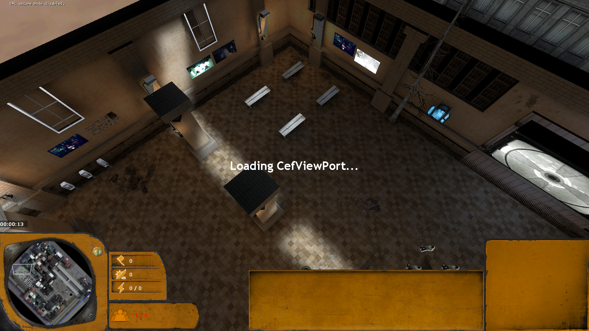
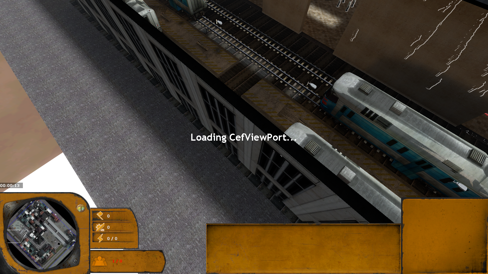
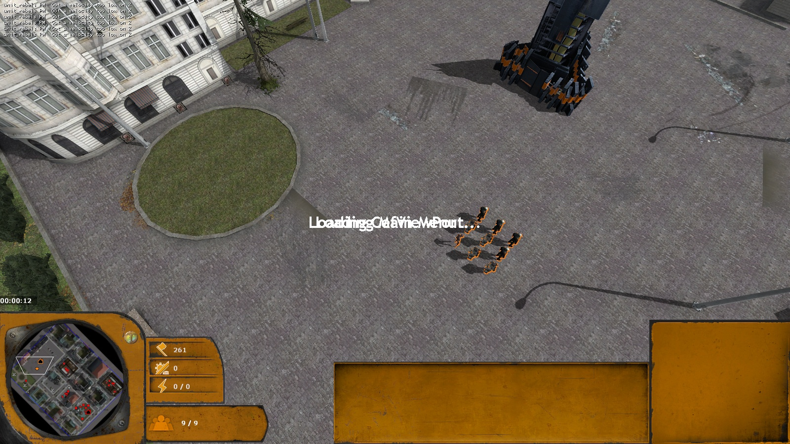
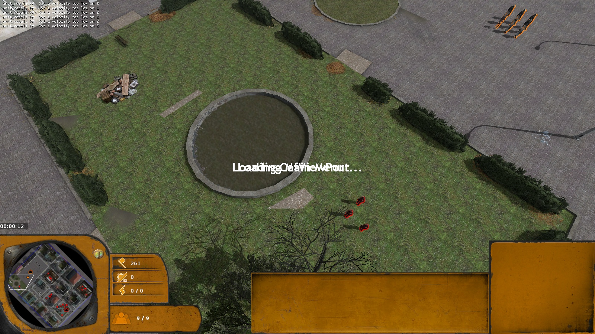

# Example maps

Three missions and a skirmish map built entirely with the editor's tools by scripts, so they double as tests of the
generators. Each is saved in `maps/` with its sketch and mission flowchart and opens and edits like any map. The
build scripts write the VMF; compile them with **Compile & test** or `scripts/compile-map.mjs`.

| Map | Script | Layout and logic |
|---|---|---|
| `sp_sofia` | `scripts/build-sofia.mjs` | `src/examples/sofia.ts` |
| `sp_tutorial_combine` | `scripts/build-civil-protection.mjs` (`--shots` retakes only the screenshots) | `src/examples/civilProtection.ts` |
| `sp_garden_district` | `scripts/build-garden-district.mjs` | `src/examples/gardenDistrict.ts` |
| `c17_district` | `scripts/build-district.mjs` | `src/examples/district.ts` |

## Sofia: Battle for the Largo

A singleplayer mission after reference photos of central Sofia, 64 × 64 cells.

- **Old town** (south): dense blocks of 2 to 4 storeys with cobbled alleys and rubble courtyards; groups of zombies
  wait in the courtyards and alley junctions.
- **Tram line** (one level up, reached by ramps): a wide street with two tram tracks, trams and parked cars.
- **The Largo** (north): a paved square closed off by the Party House with its colonnade and spire, long government
  blocks, an ochre corner tower with a dark dome, and the gold-domed Alexander Nevsky Cathedral on a terrace to the
  east. A Combine garrison holds it behind barricades.

Mission: fight through the old town to the tram line (rebel reinforcements come up it), push into the Largo (two
Combine waves are sent to the flag), capture the flag to win; losing all your units loses.

## Civil Protection (Combine tutorial)

The Combine tutorial from the design doc, 60 × 48 cells, one route from south-west to north-east.

- **The station**: Unit 09 starts in a City 17 train station. A tall concourse holds a working ration line (a
  Walking queue in each of three lanes), archways lead to a train shed, and one door opens onto the housing
  street. Stone walls with window bands, an invisible roof that still blocks the sun, light only from lamps you can
  see, relief and wear on the walls the camera sees.
- **Housing block** with a dead-end alley, **canal street** with the Combine checkpoint (its gap holds a forcefield
  and a nav blocker that open when Dispatch sends Unit 09 on), **Outpost Kilo** (the Stalker, a capture point, a
  Citadel), the **canal bridge** (the only way across), the **old city** (rebel wave spawns) and the **Citadel
  boulevard** where the Striders wait.

Mission: 19 stages, one per objective of the design doc, with Dispatch, Supervisor and Ringleader lines. The build
menu, the garrison's soldiers and the Citadel's menu are locked at the start and unlocked one objective at a time.

| Stage | Completes when |
|---|---|
| Daily quota | Unit 09 reaches the ration line |
| The loiterer, Civic litter, The runner | the named citizen is killed (each turns hostile in its stage) |
| The flyer, Report to Outpost Kilo | Unit 09 reaches the flyer, then the outpost gate (which opens) |
| The asset | Unit 09 reaches the Stalker |
| Uprising: secure the relay | the relay is captured; camera shot, sirens, screens to static, smoke and fire, dusk |
| Power first, Scrap (optional), A garrison | the buildings are finished |
| Train officers | 3 Metro Police trained |
| Proper equipment, Fortify the bridge | an armory, then 3 barricades |
| The first wave | wave 1 is dead |
| Arm the squad | all of: Unlock AR2 researched, 2 Combine soldiers trained |
| Lockdown | survive 4 minutes against waves 2 and 3 |
| Overwatch arrives | 30 s: Citadel glow, the Striders walk the boulevard, a dropship flyby, a gunship |
| Sector contained | victory |

Where the design doc needed events the game doesn't report, the map uses what it can detect: selecting a unit
became walking it somewhere, fleeing citizens became plain citizens to kill, and losing every unit (not a named
building) is the defeat. The outpost's Citadel is needed because it is the only Combine building that provides
population.

`scripts/civil-protection-test.mjs` builds `sp_tutorial_combine_test`, with shorter timers and a driver for each
stage; in game every transition fired through to victory.

## Garden District (Combine mission)

A Combine mission with base building, 64 × 52 cells, after the blocks round the St. George church garden in Sofia.

- **Palace square** (west): the Combine base site, a palace front, a park and a car park set into the paving.
- **Street grid** of tenement blocks with green courtyards, cars along the kerbs, a diagonal street and a curved
  one, Tsar Samuil street's look (worn asphalt, square slabs, stone kerbs, setts gutters, round corners), city
  surroundings and the Combine wall on the north side.
- **Customs house** and **central station**: interior buildings with rooms, held by rebels, with capture points. A
  rail line leaves the station through its east wall.
- **Street market**, **car park block**, and the **church garden**: a domed church, lawns and paths, and the rebel
  headquarters, barracks and munition depot behind barricaded gates.

| Stage | Completes when |
|---|---|
| Deploy the command post | a power generator and a garrison are finished |
| Power from scrap | a scrap power generator is finished |
| Muster | population 16, while raid 1 comes from the north |
| Hold the square | 3 minutes against raid 2 |
| Customs house, market and armory | both capture points taken and an armory finished |
| Retake the central station | the platform's capture point is taken |
| Reinforcements | elites and Hunters step off the train, a Strider walks up the boulevard |
| Break into the garden | both gate barricades destroyed, against a counterattack at dusk |
| Rebel command | the rebel headquarters is destroyed |
| District secured | victory |

Defeat when the Citadel (`combine_hq`) is lost.

## City 17 district

A two-player skirmish of pre-war tenement blocks round a paved square: starts in opposite corners, three capture
points and four scrap points. It is the map in the [README screenshot](../README.md).

## Test maps

Smaller maps in `maps/` that exercise one feature each:

| Map | Tests |
|---|---|
| `interiors_test` | simple interior houses in every style; squads ordered through doors and up the stairs |
| `rooms_station`, `rooms_demo` | interior buildings with rooms (see [generators/rooms.md](generators/rooms.md)) |
| `poi_showcase`, `poi_test` | every POI type, and a playable map with four POIs |
| `sp_unit_kits_test` | unit kits: ground and air units, the mixed start squad |
| `sp_mission_events` | flowchart building, research and "all of" conditions, ability gates |
| `sp_cine_test` | camera shots, flyby, particles, screens, atmosphere |
| `blend_demo`, `street_demo`, `shapes_demo`, `surround_demo` | ground blending, street materials, free shapes, surroundings |
| `multiblend_before`, `multiblend_after` | MultiBlend terrain painting |
