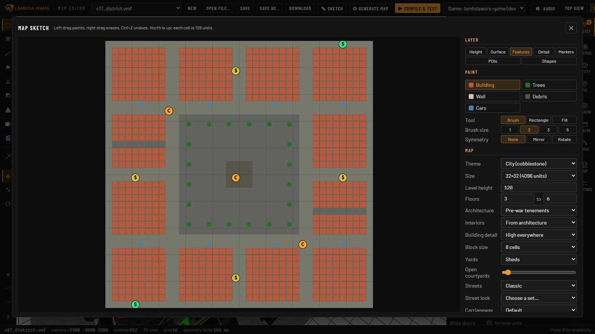
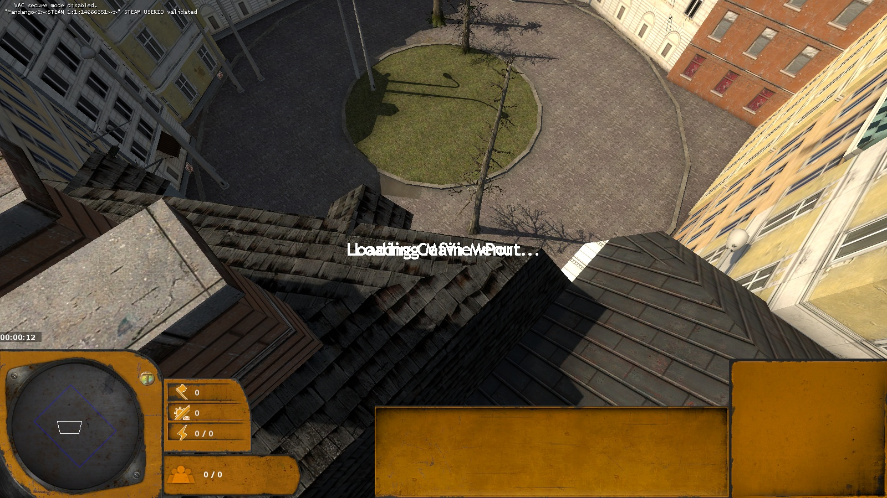
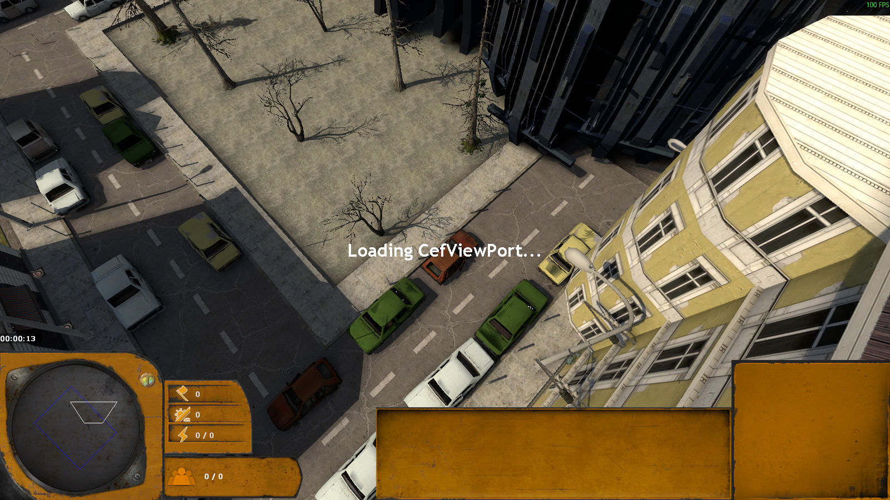
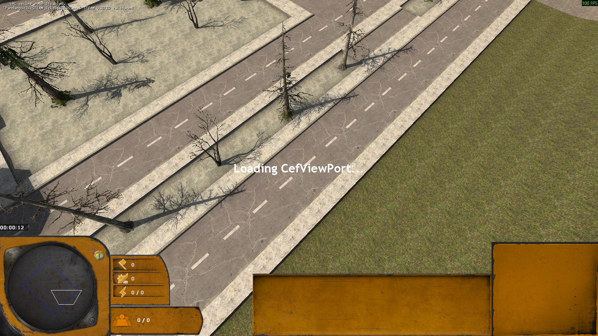

# Generating whole maps

Two ways to make a complete, compilable map in the top bar: **✎ Sketch** draws the map from above in layers and
can be redrawn and regenerated, **⚙ Generate map** paints or rolls a coarse layout. Both add the terrain,
buildings, roads, props, markers, lighting, sky shell and map boundary, so the result passes every compile check
without fixes. Code: `src/gen/sketch.ts`, `src/gen/layout.ts`, `src/ui/sketchDialog.ts`, `src/ui/generatorDialog.ts`.

## Sketch

A 2D painter on a grid of 128-unit cells with brush, rectangle and fill tools, brush sizes, mirror or rotational
symmetry and undo. Left drag paints, right drag erases. The sketch is saved next to the map as
`maps/<name>.sketch.json` and reopens with it.

| Layer | Paints |
|---|---|
| Height | Levels 0 to 4 (level height configurable, default 128). Level changes become cliffs; **Ramp** cells turn a step into a walkable slope. |
| Surface | Grass, dirt, road, cobble, rubble, blended into the terrain. Where lawn or dirt meets paving, a low stone edging runs along the boundary with leaves and dirt over it (`surfaceEdges.ts`). |
| Features | Buildings (on their cell's level), trees, walls, debris, cars. |
| Detail | Building quality per block: High, Medium or Filler (see [buildings.md](buildings.md#quality-and-the-t-junction-budget)). |
| Markers | Mission start, multiplayer start, capture point, scrap, unit groups and waves, placed with the [mission kits](../mission.md#kits). Overrun wave spawns (facing the centre) and the Overrun manager are placed as the New map Overrun template places them. |
| POIs | Points of interest at a rotation (see [points-of-interest.md](points-of-interest.md#in-generated-maps)). |
| Shapes | Free shapes over the cells (below). |

**⚙ Generate 3D map** builds power-4 displacement terrain (32-unit vertices: cliffs stay sharp, ramps become smooth
surfaces between the levels round them). Sketch maps add playerclip over raised levels, because the game's spawn
camera traces down to playerclip.

### Map options

The Map section sets the theme (city or rural), size, level height, floors, architecture, interiors and building
detail, and:

| Option | Effect |
|---|---|
| Block size | the size of building blocks the building areas are cut into |
| Yards | *Sheds*, or *green*: the open lots behind buildings become lawns with trees, benches, a bin and a playground or parking spot (`yards.ts`) |
| Open courtyards | the share of ring sides left open onto the street |
| Streets | *Classic*, or *Sofia*: wider pavements on streets of 512 and up, cars parked along the kerbs, bollards at the corners |
| Street look | a street material set and a row per part (see [roads-powerlines.md](roads-powerlines.md#street-materials)) |
| Building detail | *High everywhere*, or *auto*: High near markers and POIs, Medium further out, Filler elsewhere |
| Surroundings | what fills the band outside the playable area, for the map and per side (below) |

**Lay out street grid** replaces the building areas with blocks of 11 cells between 4-cell streets, an 8-cell
boulevard every third street and parks in about 15% of the blocks, and sets the Sofia options with auto detail.

### Shapes

The Shapes layer draws over the cells (`sketchShapes.ts`):

- **Street**: click points (half cells), Enter or a double click finishes. Width, pavement and a bend radius, so a
  street can be diagonal or curved. Built by the road code with the map's street look.
- **Railway**: tracks and a bend radius; a ballast bed with rails that runs on out of the map.
- **Area**: click an outline (kept convex), or **Round area**: drag a rectangle for the ellipse inside it, in grass,
  dirt, paving or rubble. Areas get the stone edging and leaves along their outline.
- Right-click removes a shape, Escape drops the one being drawn.

Buildings follow the shapes: the streets and areas over a block are stored on it, and its lots are trimmed along
them, so buildings get slanted fronts along a diagonal street and faceted fronts round a round square. Walls along a
cut are street walls (doors, shop fronts, cables). Props and trees on cells under a shape are left out.

## Surroundings

Maps don't end in a void at their edge. **Surroundings** (`surroundings.ts`) fill a 2048-wide band outside the
boundary, one style for the map and another per side if wanted:

- **City**: streets that reach the edge run on out, and the blocks between them get two rows of plain filler
  buildings, 4 to 7 floors along the edge and 7 to 11 behind (the skyline).
- **Hills**: terrain rising up to 1100 away from the edge with rolling bumps, grass with dirt patches higher up,
  pines and leafy trees.
- **Combine wall**: the wall clusters City16 is closed with, overlapped outside the edge, the filler skyline behind.
- **None**: a 512-unit apron.

The buildings are one `func_brush` and the walls and trees are props, so none of it uses vbsp's t-junction budget.
An NPC clip round the playable area keeps units in where streets run on out, the sky shell moves out with the band,
and everything beyond the playable area uses lightmap scale 64 to keep the BSP's light data small.

## Generate map

Paint a coarse layout on a grid of 256-unit cells (ground, road, high ground, buildings, enterable houses, trees,
player base, control point, scrap) with rotational or mirror symmetry, or roll a random two-player layout. Then:

- displacement terrain over the whole map: high-ground cells become smoothed plateaus, roads and bases are blended
  into the ground texture (grass and dirt for rural, concrete for city);
- buildings on building cells, village houses (countryside) or slum shacks (city) on house cells, trees in forest
  cells, bushes and rocks or cars, lamps and barriers along the roads;
- player starts with their RTS camera spawns, control points with capture areas, scrap markers, sun and fog;
- a number of mirrored points of interest, and scenery outside the playable area.

Random rural layouts get a few hamlets of village houses.
