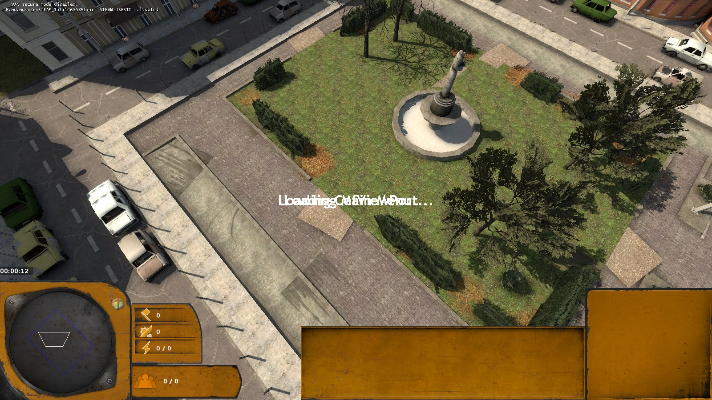

# Points of interest

A point of interest (POI) fills a rectangle with a finished area: a square, a parking lot, a Combine checkpoint, a
dock. Every POI is built for an RTS: it offers cover, chokepoints, high ground or a place to capture, and always
leaves routes open for the big units. Design notes: [poi-generator-plan.md](../poi-generator-plan.md).

Code: `src/gen/poi/` (`kit.ts` the toolkit, `catalog/` the types, `models.ts` the model table, `spec.ts` the stored
spec, `mapgen.ts` and `sketchPois.ts` the map integration).

## Placing and editing

- Pick a type in the **POI** panel, then press **P** (or choose *Point of interest* in the Generate menu) and drag
  a rectangle on the ground; a click places one at the type's default size. The rectangle snaps to 64 and is
  clamped to the type's sizes; the preview arrow shows which way the layout faces. *Fill selected block* turns
  selected block brushes into POIs instead.
- A POI's brushes are one `func_detail` carrying its spec in `she_poi` (type, seed, rectangle, rotation, ground
  height, landscape, parameters); its entities carry `she_poi_id`. Selecting any part shows its settings, and every
  change rebuilds it in place as one undo step. *Regenerate* rebuilds from the stored spec, *Re-roll* picks a new
  seed, *Delete* removes everything it made.
- Its faint orange **handle** selects, moves (W) and resizes (R) the whole POI; comma and period turn it a quarter
  turn, Ctrl+D copies it. A moved POI stands on the ground at its new spot.
- Gameplay hooks each type opts into show up as parameters: a capture point at its focus (control point + capture
  area), scrap piles, enemy unit groups.

## The toolkit

Every type builds on `kit.ts`, in the POI's own frame (90° rotations turn the whole layout):

- **Pads** (paving, asphalt, grass, sand) cut into pieces of at most 1024, reaching below the lowest terrain.
- **Edges** with gaps: fences and hedges from models, walls, kerbs and railings from brushes, `fow_blocker`s along
  hedges and high walls on request. Fences fill each run with whole pieces, so none reaches into a gate.
- **Routes**: through-routes 160 wide (large units have a radius of 58) are reserved first; the gaps they open in
  fences and walls are 64 wider still. Props are refused on a route or on top of something already placed.
- **Placement**: single props, rows and scatter; every prop stands on the pad or terrain under it, from its
  measured bounds. The model table holds the bounds of about 240 models and whether each is a valid `prop_static`;
  the rest become `prop_dynamic`.
- Paths along polylines, overlays and painted lines (one bar of the street-marking texture: the game has no plain
  white line material), lights, sandbag walls, logs, extrusions, houses through `interiorHouse()`.
- **Terrain**: on displacement terrain the POI levels the ground under it (blending back over 192 units) and paints
  the terrain's second texture there.
- **Ground**: park, parking lot and market have a *Ground* parameter (own, paving, asphalt, cobbles). The Sketch
  sets it from the surface under the POI, so a lot on a square is marked out on the square's paving and a park is a
  lawn set into it with a stone edging. A sketch POI also knows which sides face a street, and a parking lot runs up
  to the pavement there.

## Water

`water()` makes a world brush (water can't be `func_detail`) whose top face is a `%compilewater` material; the
first POI with water adds a `water_lod_control`. The Recast map mesh only filters out the water *surface*
(`recast_mapmesh.cpp` in the engine), so the ground under water stays walkable:

- **Ponds and fountains** keep their water inside a rim too high to climb (28 over the floor; units climb 18).
- **Sea** (`sea()`): displacement terrain under the sea part is lowered 128, water sits 16 below the ground, and a
  `func_nav_blocker` fills the water volume (in Lambda Wars it adds a Recast obstacle), so units don't path into
  the sea while piers above it stay walkable. On brush ground the ground under the sea has to be cut away by hand.
- Coast POIs keep the sea at their back (local +y): rotate them so their back faces the water.

## Catalogue

Sizes are in units (minimum to maximum).

| Type | Size | Contents |
|---|---|---|
| **City** | | |
| Paved lot | | paving, asphalt or gravel, kerbs, lamp posts |
| Square | 1024–3072 | cobbled border round a tiled field, a statue, fountain or Breencast screen in an open ring, benches, trees in planters, lamps; *Combine occupation* |
| Parking lot | 768×704–3072×2048 | rows of bays facing 192-wide aisles, painted bay lines, parked cars and wrecks, a ticket booth, kerbed islands with lamps |
| Playground | 768×640–2048×2048 | sand, rubber or gravel, a low fence with gates, swings, slide, carousel, climbing frames, see-saw, sandpit; *Abandoned* |
| Park | 1280–4096 | lawn, a gravel loop and four winding paths, a pond, fountain or bandstand, hedges (optionally blocking sight), tree clusters, benches |
| Market | 896×768–3072×3072 | stalls of brushes on a grid between 160-wide lanes, awnings, goods, carts; *Covered hall*, *Abandoned* |
| Football pitch | 1280×896–3072×2560 | lines and goals with chain-link nets, stepped bleachers with an NPC clip ramp, floodlights, team benches; *Running track* |
| Basketball court | 768×512–1536×1024 | court lines, hoops, a tall chain-link fence with gates |
| Combine checkpoint | 896×512–2560×1024 | a line of barricades across a street with a vehicle gap, the scanner gate, a booth, floodlights, an APC, Breencast |
| Rebel barricade | 768×384–2560×1024 | wrecked cars, furniture piles, sandbag walls, crates and drums across a street with one gap; explosive barrels |
| Ration distribution | 768–2048 | queue lanes between Combine railings, a counter with dispensers, crates of rations, Breencast |
| Junkyard | 1024×896–3072 | wrecks stacked along a fence, containers, tyres, gravel heaps; three scrap piles |
| Construction site | 1152×1024–3072 | a fenced yard round a half-built concrete frame, scaffolding, a crane frame, a bulldozer, materials |
| Tank farm | 1152–3072 | up to six brush tanks in bunds, pipe runs, a pump house, explosive barrels |
| Rail yard | 1536×896–4096×2560 | two to six tracks with buffers, platforms with optional canopies, parked train cars, level crossings |
| Gas station | 1024×896–2048×1536 | a canopy over pump islands, an enterable kiosk, propane tanks, a price sign |
| **Rural and forest** | | |
| Rebel camp | 1024×896–2560 | tents round a campfire, a shack, the radio tower, a watch post, supplies |
| Thumper site | 896–2560 | a Combine thumper, barricades, antlion burrows with `info_target`s to spawn waves from |
| Crash site | 1024×896–2560 | a scorched crater, a dropship container, gunship wreckage, headcrab canisters, fires; two scrap piles |
| Farmstead | 1408×1152–3072 | a farmhouse, an open barn, a well, furrowed fields, plank fences |
| Graveyard and chapel | 1152×1024–3072 | rows of graves, a brick wall with gates, a chapel with a bell tower; *Ravenholm look* |
| Lookout tower | 768–1536 | a wooden or concrete tower with a deck at 128 to 384, plank steps with an NPC clip ramp (infantry only) |
| Logging camp | 1152×1024–3072 | log piles in rows (cover), a sawmill shed, a truck, stumps |
| Combine power node | 896–2048 | a fenced compound with generators joined by cables, Combine lights, a Breencast |
| **Coast** | | |
| Dock | 1024–3072 | a quay wall, piers on poles (160-wide chokepoints), moored boats, containers, an optional crane |
| Beach front | 1280×1024–4096×3072 | sand down to the sea, beach huts, umbrellas, a lifeguard tower, a breakwater |
| Shipwreck | 1408×1280–3072 | a beached fishing boat on its side, spilled containers; two scrap piles |
| Lighthouse point | 1280–2560 | a stone platform, a 512-high lighthouse with a gallery and light, the keeper's house |
| Coastal bunker | 1280×1024–3072×2560 | dunes, the Combine bunker, sandbagged trenches, a mortar |
| **Rocky** | | |
| Quarry | 1536–3072 | terraces 64 high (too high to climb) with one 192-wide ramp each, a conveyor, mining carts |
| Mine entrance | 1024×896–2560×2048 | a cliff face with a tunnel mouth, timber frames, rails and carts, an `info_target` inside |
| Overlook | 1024–2048 | a rock ledge 64 to 192 high with one ramp, sandbags along its edge |
| Rocky pass | 1024–3072 | a dirt road between stepped rock masses, a rockslide leaving at least 128 |
| Radio relay | 1024–2048 | a rocky knoll with one ramp, the radio tower, a shack, a generator |
| Canal crossing | 1024–4096×2560 | a canal cut into the terrain with water and a nav blocker, one to three bridges |

## In generated maps

- **Sketch**: the **POIs** layer. Pick a type and a rotation, drag a rectangle, right-click one to remove it.
  Generating levels the terrain under each POI, cuts its sea, pits or canal into it and stores its spec, so it can
  be changed in the editor like any other POI.
- **Generate map**: a *POIs* count. The largest free rectangles away from the bases get a POI of the theme each,
  mirrored through the map centre like the layout, so both players get the same; the pair nearest the centre gets
  capture points.

## Route check

`scripts/poi-navcheck.mjs <map>` checks the compiled navmesh: for every POI route it asks the game's server for a
path from 96 outside the POI through to the other side, and up to the high ground of the lookout, overlook, relay,
quarry and the football bleachers, once with a human-size probe and once with a large one. A path more than 1.3
times the straight line counts as a detour. Results for the two test maps are in
[poi-navcheck-poi_showcase.json](../poi-navcheck-poi_showcase.json) and
[poi-navcheck-poi_test.json](../poi-navcheck-poi_test.json): every route has a direct path for both sizes, except
the lookout tower's 96-wide stair, which is for infantry only.

Test maps: `maps/poi_showcase.vmf` (all 35 types at their default size with capture points) and `maps/poi_test.vmf`
(a playable two-player map from Generate map with four POIs), both built by `scripts/poi-demo.mjs`.
