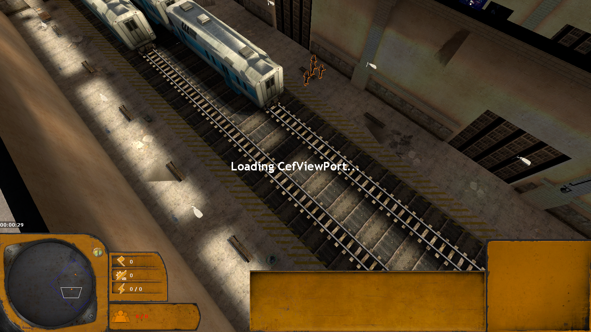
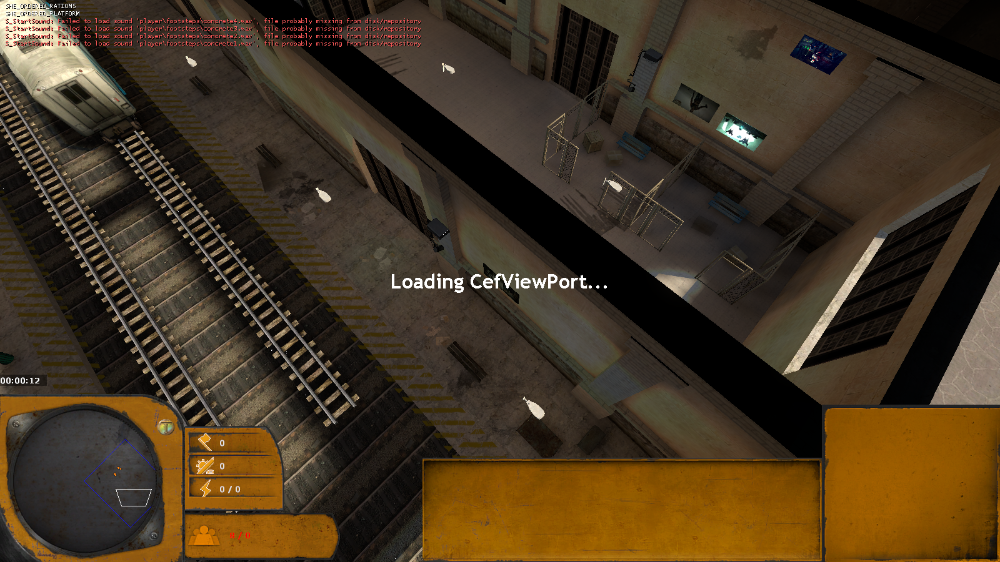
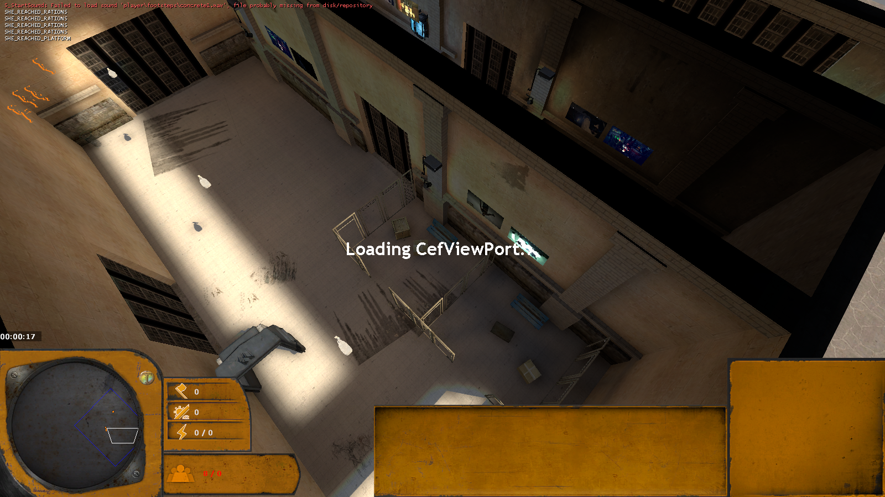

# Interior buildings with rooms

A building you walk into, made of rooms with a purpose: draw the rooms on a floor plan, give each a type, and the
generator builds the shell and furnishes every room for its type. Code: `src/gen/rooms/`; the shell shares
`src/gen/hall.ts` with the Civil Protection station. Design notes: [plans/interior-buildings.md](../plans/interior-buildings.md).

Open the **room designer** with **Custom interior building** in the Generate menu (key 4), with *Design interior
building…* when a block brush is selected, or with *Interior building…* in the Selection panel of an existing one.

## The room designer

`src/ui/roomsDialog.ts`. Drag rooms onto the floor plan, pick their types, click outer walls to place street doors,
set how neighbouring rooms meet, or start from a preset (*Train station*, *Customs house*, *Ration centre*). The
plan shows walls, doorways, archways and window bands as they will be built, and lists what is wrong: overlapping
rooms, doors not on an outer wall, rooms you can't reach from the street.

## Model

- **Rooms and shape** (`model.ts`): the building is a grid of 128-unit cells and each room a rectangle of cells;
  the rooms together are the building's shape, so an L or a T is just rooms placed that way. Walls stand wherever a
  room meets the outside or another room; walls along x keep the corners and walls along y stop against them, so
  no two wall brushes overlap.
- **How rooms meet**: each type prefers a doorway, a row of archways or no wall at all, and two rooms meet with the
  less open of their two preferences. A link per pair of rooms overrides it, including a closed wall. Street doors
  go on outer walls, clear of the corners.

## Shell

`shell.ts` and `hall.ts`:

- Plain world walls with a window band high in the north and east outer walls (the sun comes from the north-east),
  glass in a never-solid `func_brush`.
- An invisible roof that blocks the sun (a `func_brush` that casts vrad shadows), with skylight strips over the
  halls. Nothing hangs under the roof: from the RTS camera it would only cross the floor as dark bands.
- Outside, the City 17 station's own texture set (`STATION_STYLE`): plain ashlar walls whose ledges run as string
  courses, a row of arched windows on the outside of each window band, and relief (`outerRelief` in `relief.ts`):
  a rusticated plinth, pilasters about every 384 units, a cornice and framed street doors.

## Room types

`types.ts` and `dressers.ts`. Each room is furnished through a POI kit laid over its floor, so props stand on the
floor and keep off each other and the ways through. Every doorway is kept clear and joined to the others by
walkways first.

| Type | Furniture |
|---|---|
| Train hall | A raised platform along the side it is entered from, tracks on ballast with buffers, passenger coaches, a second platform in a wide hall; benches, bins, luggage, push carts; hazard stripes on the edges |
| Concourse | Stone pillars on a grid in a large one, a Breencast on a pole facing the benches, ornaments by the street doors, luggage |
| Customs | Rows of chain-link cages against the long walls with gates onto a corridor, benches and luggage inside, a scanner line of barricades across the way in, a guard booth and monitor |
| Rations | Lanes between railings up to a Combine counter with monitors, the booth and crates of rations behind it, a Breencast in a corner, ration papers in the lanes |
| Waiting room | Rows of benches facing a Breencast monitor on the north wall, canteen tables with bottles and cartons, payphones, a vending machine |
| Hallway | Benches along the walls, bins, a payphone and a vending machine, lamps down the middle |

A train hall with a street door in an end wall that a track passes through runs that track's rails to the wall and
puts the buffers at the other end only; a **Railway** shape in the Sketch can carry the line on out of the map.

## Relief, lamps and wear

`relief.ts`: the camera looks north-west, so the north and west inner faces of every room get a plinth, a ledge,
pilasters (stopping under window bands) and a cornice in one `func_brush` (so they cost no vbsp t-junctions),
lanterns on every other pilaster, and posters, propaganda and stains as overlays. Lamps hang over the furniture;
floors get stains, cracks and litter per type.

## Stored and editable

The spec is kept on the building's `func_detail` (`she_rooms`, `store.ts`), with its walls' ids and everything else
tagged, so it rebuilds in place. A green handle selects and moves it; clicking anything it made selects it; Delete
removes the whole building.

## Test maps

- `maps/rooms_station.vmf` (`scripts/build-rooms-station.mjs`): the Train station preset on a paved square with two
  player starts and two rebel squads. At map start one squad is ordered onto the platform and the other into the
  ration hall, and triggers there log their arrival. In game every unit reached its goal.
- `maps/rooms_demo.vmf` (`scripts/rooms-demo.mjs`): the three presets side by side.

